# ASSA ABLOY / COMBURSA: estudio del pedido y del corte

Fecha de corte del estudio: 2026-10-25. Destinatarios: Iván y Tamara. **No se ha programado la web ni se ha enviado nada al bot.**

## Qué conviene automatizar

El trabajo corriente se organiza principalmente en **lotes semanales, con excepciones**, juntando referencias de varios pedidos y, a veces, distintas fechas de entrega. Los DWG de Oficina Técnica conservan pedidos, confección, reparto por palets y notas de stock; las presentaciones guardadas de los lotes normales no muestran las piezas, que están en Modelo. La base reutilizable es el despiece de cada referencia: cuerpo, canalón y refuerzos, con sus herramientas y sus marcas. Después hay que calcular cantidades, aprovechar el rollo y conservar el reparto entre pedidos y OF. Hacer un DXF independiente con un rectángulo por línea perdería parte de ese trabajo.

Hay una diferencia que cambia el cálculo: **la hoja de medidas recoge el terminado y el DWG añade los márgenes de confección**. Por ejemplo, H0K420150-0002 figura como 1064,2 × 60 cm, mientras que su contorno de corte mide 1065,2 × 66,6 cm. La fórmula de medidas del pedido debe llegar al corte real, no detenerse en el terminado.

En los doce meses estudiados hay 196 pedidos con referencias de pieza, 843 líneas y 8842 unidades. Las primeras 5 familias cubren 84,0 % de esas líneas. El primer paso aconsejable es validar referencias conocidas y reconstruir sus lotes; las medidas nuevas y las cortinas necesitan reglas adicionales.

## 1. Qué se ha comprobado y de dónde sale

Se han leído los clientes y todas sus líneas conservadas en RPS, con consultas SELECT; el Excel original; el inventario completo del cliente; los DWG convertidos en copias locales; y los cortes COMBURSA de los años indicados abajo. No se ha escrito en ninguna carpeta de red, ni se ha arrancado la web con el entorno real. Todo el análisis se ha hecho con Node en este equipo.

RPS se recogió en 2026-10-25T00:31:49.604Z. La carpeta del cliente contiene 855 ficheros, de los cuales 87 son DWG. Se han convertido y leído todos esos DWG. La hoja de medidas tiene 235 referencias numéricas útiles. El maestro `COMBURSA (CRAWFORD).dwg` está modificado el 2026-10-06T12:38:45.267Z; el Excel, el 2026-09-23T08:46:03.131Z. Las fechas de fichero son UTC y prueban una modificación, no la fecha de fabricación ni quién la hizo.

| Cliente en RPS | Nombre literal | Pedidos históricos | Último pedido |
| --- | --- | --- | --- |
| 018974 | ASSA ABLOY ENTRANCE  SYSTEMS PRDUCTION SPAIN | 1271 | 2026-06-04 |
| 029465 | ASSA ABLOY ENTRANCE SYSTEMS PRODUCTION ROMANIA SRL | 1736 | 2026-10-23 |
| 034019 | ASSA ABLOY ENTRANCE SYSTEM SPAIN S.A. | 46 | 2026-07-28 |

Quedan confirmados los tres clientes del punto de partida. Rumanía es el que sigue haciendo los pedidos más recientes; España también tiene actividad dentro del periodo. No se han comparado todos los clientes de la empresa para medir cuál es el mayor.

Rutas de origen:

- Cliente: `\\192.168.0.128\Oftecnica\Oficina Tecnica\DIBUJOS\CLIENTE DETERMINADOS\COMBURSA`.
- Cortes: `\\192.168.0.128\Oftecnica\maqcorte\<año>\COMBURSA`.
- Bot: se ha inventariado, solo en lectura, `maqcorte\BOT\Pendientes\Tamara`. Un fichero ya procesado puede no estar ahí.
- PDF: `\\192.168.0.128\RPS\VENTAS\PLANTEAMIENTOS\<año>`.

| Año de carpeta | Ficheros en COMBURSA | DXF | CMT | DXF cuyo nombre empieza por LOTE |
| --- | --- | --- | --- | --- |
| 2024 | 130 | 47 | 46 | 46 |
| 2025 | 148 | 58 | 64 | 57 |
| 2026 | 152 | 58 | 55 | 56 |

El nombre de un lote puede repetirse con sufijos: el recuento anterior es de ficheros, no de lotes únicos ni de pedidos. Los CMT son binarios y no se ha descifrado su formato; su existencia y sus fechas están comprobadas, pero **las geometrías y cantidades de este estudio proceden de los DXF**. Tampoco se ha supuesto que cada CMT sea exactamente el DXF de igual nombre.

## 2. Volumen real y referencias que más se repiten

Ventana fija: desde 2025-10-25, incluido, hasta 2026-10-25, excluido. Se cuentan las tres cuentas de cliente. Una línea es un ID de línea de RPS; no se multiplican líneas al unirlas con materiales. Las cantidades cuentan unidades solicitadas, no unidades ya fabricadas.

| Alcance | Pedidos distintos | Líneas |
| --- | --- | --- |
| Todas las series y artículos del cliente | 260 | 908 |
| Solo pedidos serie AR | 253 | 901 |
| Líneas positivas con código de pieza reconocido | 196 | 843 |

Los pedidos sin pieza reconocida no desaparecen del total: muchos son palets en pedido separado. También aparecen otras ventas y notas. Este es el desglose de líneas ajenas al catálogo de piezas:

| Artículo | Líneas | Suma de cantidades de RPS |
| --- | --- | --- |
| PALETSMA1200X800 | 47 | 143 |
| QUESOARZUAULLOA | 7 | 14 |
| REPLONASVARIAS | 4 | 4 |
| NOTA | 2 | -2 |
| PUERTAPLET | 2 | 2 |
| RECTIFICARLONA | 1 | 1 |
| PRODUCTCLIENTRR | 1 | 1 |
| 40ABRC009009 | 1 | 2 |

Hay 16 líneas de pieza sin OF asignada en la lectura actual. Por eso no es cierto que toda línea lleve ya una OF. La automatización debe admitir la espera y no inventar ese número.

Familias que alcanzan el umbral del ochenta por ciento, ordenadas por líneas. Se unifican solo para el estudio las grafías HOK, H0K, OK y 0K; se conserva el código literal de RPS para la trazabilidad. No se supone que dos descripciones con distintas medidas sean intercambiables.

| Familia | Pieza | Líneas | Unidades | % líneas | % acumulado |
| --- | --- | --- | --- | --- | --- |
| 420150 | Envolvente con canalón, fondo habitual 600 mm | 220 | 3123 | 26,1 % | 26,1 % |
| 420102 | Lateral de la envolvente | 176 | 2298 | 20,9 % | 47,0 % |
| 430172 | Envolvente con canalón, fondo habitual 900 mm | 128 | 1122 | 15,2 % | 62,2 % |
| 420148 | Envolvente sin canalón | 96 | 629 | 11,4 % | 73,5 % |
| 430127 | Techo con canalón | 88 | 529 | 10,4 % | 84,0 % |

Para superar el mismo umbral por **variante concreta** hacen falta 44 referencias. Esta lista sirve para escoger la muestra inicial y los casos de comparación, no para descartar automáticamente las demás:

| Variante | Líneas | Unidades | % acumulado |
| --- | --- | --- | --- |
| H0K420150-0090 | 38 | 927 | 4,5 % |
| H0K430172-0007 | 35 | 438 | 8,7 % |
| H0K420150-0002 | 33 | 500 | 12,6 % |
| H0K430127-0014 | 32 | 168 | 16,4 % |
| H0K430125-0002 | 30 | 400 | 19,9 % |
| H0K420150-0033 | 29 | 504 | 23,4 % |
| H0K420102-0050 | 28 | 266 | 26,7 % |
| H0K420102-0034 | 23 | 776 | 29,4 % |
| H0K430172-0005 | 22 | 31 | 32,0 % |
| H0K420148-0105 | 21 | 161 | 34,5 % |
| H0K420150-0091 | 20 | 255 | 36,9 % |
| H0K420102-0030 | 18 | 313 | 39,0 % |
| H0K420150-0007 | 18 | 247 | 41,2 % |
| H0K420150-0021 | 18 | 151 | 43,3 % |
| H0K420102-0092 | 16 | 68 | 45,2 % |
| H0K430127-0001 | 16 | 61 | 47,1 % |
| H0K420102-0017 | 15 | 94 | 48,9 % |
| H0K420102-0022 | 15 | 74 | 50,7 % |
| H0K430127-0002 | 15 | 230 | 52,4 % |
| H0K430172-0031 | 15 | 115 | 54,2 % |
| H0K420150-0089 | 13 | 63 | 55,8 % |
| H0K420150-0092 | 13 | 111 | 57,3 % |
| H0K430127-0019 | 12 | 46 | 58,7 % |
| H0K420102-0021 | 11 | 203 | 60,0 % |
| H0K420148-0099 | 11 | 125 | 61,3 % |
| H0K420150-0001 | 11 | 25 | 62,6 % |
| H0K430129-0002 | 11 | 34 | 63,9 % |
| H0K430172-0002 | 11 | 50 | 65,2 % |
| H0K420148-0104 | 10 | 51 | 66,4 % |
| H0K430127-0004 | 10 | 15 | 67,6 % |
| H0K430172-0009 | 10 | 192 | 68,8 % |
| H0K430172-0034 | 9 | 66 | 69,9 % |
| H0K420148-0033 | 8 | 77 | 70,8 % |
| H0K420148-0116 | 8 | 75 | 71,8 % |
| H0K420150-0088 | 8 | 169 | 72,7 % |
| H0K430129-0017 | 8 | 37 | 73,7 % |
| H0K430172-0001 | 8 | 87 | 74,6 % |
| H0K430172-0030 | 8 | 77 | 75,6 % |
| H0K420102-0002 | 7 | 26 | 76,4 % |
| H0K420148-0002 | 7 | 66 | 77,2 % |
| H0K420150-0087 | 7 | 48 | 78,1 % |
| H0K430125-0001 | 7 | 19 | 78,9 % |
| H0K430125-0012 | 7 | 13 | 79,7 % |
| H0K420102-0004 | 6 | 84 | 80,4 % |

Como contexto, estos son los años completos recientes y el año actual hasta la fecha de corte; incluyen todas las series y artículos:

| Año | Pedidos | Líneas | Pedidos con pieza | Líneas de pieza |
| --- | --- | --- | --- | --- |
| 2023 | 256 | 1046 | 181 | 968 |
| 2024 | 216 | 1013 | 160 | 956 |
| 2025 | 234 | 1072 | 173 | 1010 |
| 2026 | 211 | 767 | 162 | 717 |

### Cuántas variantes aparecen por primera vez

“Nueva” significa **primer pedido encontrado en el histórico leído de RPS**, no alta del artículo ni primera fabricación de su vida. Se cruza el código completo con el Excel actual y con los nombres y textos de los DXF obtenidos de todos los DWG del cliente. La ausencia se refiere a esa búsqueda: puede existir un dibujo sin el código escrito o una referencia partida en varios textos. No se ha confundido tener un DWG de familia con tener dibujada una variante.

| Año del primer pedido | Variantes nuevas | Sin entrada en Excel actual | Sin referencia completa localizada en DWG | Sin ninguna de las dos |
| --- | --- | --- | --- | --- |
| 2023 | 25 | 15 | 5 | 5 |
| 2024 | 29 | 21 | 4 | 4 |
| 2025 | 38 | 32 | 9 | 8 |
| 2026 | 22 | 16 | 4 | 3 |

El año actual es parcial. Esta comparación con los archivos **actuales** no dice qué documentos existían el día del primer pedido. Las variantes recientes sin ambas referencias localizadas son:

| Año | Variante | Primer pedido fechado |
| --- | --- | --- |
| 2025 | H0K410135-0108 | 2025-03-24 |
| 2025 | H0K410135-0109 | 2025-11-04 |
| 2025 | H0K410170-0003 | 2025-09-05 |
| 2025 | H0K410171-0003 | 2025-09-05 |
| 2025 | H0K410174-0062 | 2025-07-04 |
| 2025 | H0K410174-0063 | 2025-09-26 |
| 2025 | H0K410179-0054 | 2025-10-22 |
| 2025 | H0K420102-0059 | 2025-07-15 |
| 2026 | H0K410172-0107 | 2026-02-23 |
| 2026 | H0K410173-0106 | 2026-02-23 |
| 2026 | H0K410185-0001 | 2026-06-11 |

## 3. Qué es cada familia y cómo llega al corte

En las fórmulas siguientes **B = NB / 10, H = NH / 10 y T = NT / 10**, todos en centímetros. RPS suele expresar milímetros. Se toma el número base antes de un descuento escrito: por ejemplo, NH=3800-200 significa aplicar el descuento una sola vez. Las expresiones NW o NK se conservan como tales y no se convierten a NB/NH sin validar su significado. Tampoco se completan descripciones recortadas como NH=3 o NH348.

El “terminado” es el que suele cuadrar con el Excel. El corte es el contorno de la capa `cortes - lona` del maestro, medido geométricamente. En ese DWG el modelo está en metros, por lo que se multiplica por cien para expresar centímetros; en los DXF de máquina examinados las mismas piezas están en milímetros. Se han contrastado los dos tamaños, no solo el texto de una cota.

| Familia | Qué pieza es | Largo terminado | Ancho terminado | Largo del cuerpo al corte | Ancho del cuerpo al corte |
| --- | --- | --- | --- | --- | --- |
| 420102 | Lateral de la envolvente | H − 20 | T | H − 19 | T + 6,6 |
| 420148 | Envolvente sin canalón | B + 2H − 0,5 | T − 0,5 | B + 2H + 0,5 | T + 6,1 |
| 420150 | Envolvente con canalón, fondo habitual 600 mm | B + 2H − 0,8 | T | B + 2H + 0,2 | T + 6,6 |
| 430125 | Techo | B + 0,3 | T + 2,5 | B + 5,3 | T + 9,1 |
| 430127 | Techo con canalón | B + 0,3 | T + 2,5 | B + 5,3 | T + 9,1 |
| 430129 | Techo con canalón completo | B + 0,3 | T + 2,5 | B + 5,3 | T + 9,1 |
| 430172 | Envolvente con canalón, fondo habitual 900 mm | B + 2H | T | B + 2H + 1 | T + 6,6 |

**Son fórmulas del cuerpo principal, con las excepciones detalladas más abajo; no generan por sí solas el juego completo de piezas.** En las envolventes el margen habitual añade un centímetro al largo y 6,6 cm al ancho, repartido entre los bordes. En los techos el corte añade cinco centímetros al largo de la hoja y 6,6 al ancho. No se deben aplicar los mismos márgenes a un canalón ni a una cortina.

**Canalones de NT 600 en los lotes de 2026** (lectura de piezas cerradas, 28/10/2026). Se cortan por **juegos fijos del
ancho del rollo**, uno por cada largo de canalón: un bloque combinado de 8 enteros con 14 mitades encajadas en ellos y
otro bloque de 15 mitades (8 enteros + 29 mitades). Un lote lleva 1, 2 o 3 juegos de cada largo, sin relación con las
unidades de RPS (22-08: 90 unidades NB 3450 → un juego; 31-01: 39 → casi tres). El largo es el de la referencia, no solo
el NB: 3410 (NB 3250), 3610 (NB 3450), 3600 (la 0002, también NB 3450), 3660 (NB 3500), 3560 (NB 3400), 3360 (NB 3200),
3760 (NB 3600), 2460 (0116, NB 2300, solo enteros). Pendiente de Tamara: cuántos juegos se cortan (Q-AS14).

**Paños unidos de dos en dos** (Tamara por Iván, 28/10/2026): dos paños seguidos a lo largo con una raya de rotulador
en medio, para envarillar dos de un golpe. Siempre en la 420102; en la 420150, solo las referencias de menos de 5 m de
largo (0109 y 0116). En los lotes antiguos la 0116 iba suelta, pero «pueden ir unidos»; la 0109 era una sola unidad.

**Techos de NT 600 (430125 / 430127), tres en el ancho del rollo** (Tamara por Iván, 28/10/2026: «son 691 y se corta a
68, 68 × 3 = 204»). El corte normal es T + 9,1 = 69,1, pero cuando van tres apilados en el ancho del rollo se cortan a
68 para que quepan justos en 204. Comprobado en los lotes de 2026: todas las pilas de tres van a 680 mm (una a 681);
las sueltas salen unas a 691 y otras a 680. Pendiente para cuando se programen los techos (están fuera de la fase A).

Estas son las comprobaciones reproducibles. “Con fórmula” exige que RPS conserve los parámetros necesarios; las referencias sin datos suficientes no se cuentan como coincidencias. Los contornos se asocian al rótulo que tienen encima, sin usar el resultado esperado para escogerlos. Se toleran dos centésimas de centímetro en la comparación numérica; esto es una tolerancia de lectura, no una tolerancia de fabricación aprobada.

| Familia | Referencias Excel | Con fórmula evaluable | Excel coincide | Excel discrepa | Contorno principal localizado | Corte coincide con fórmula |
| --- | --- | --- | --- | --- | --- | --- |
| 420102 | 50 | 45 | 45 | 0 | 48 | 44 |
| 420148 | 32 | 27 | 26 | 1 | 31 | 26 |
| 420150 | 53 | 44 | 38 | 6 | 53 | 40 |
| 430125 | 26 | 25 | 23 | 2 | 26 | 23 |
| 430127 | 32 | 32 | 30 | 2 | 30 | 27 |
| 430129 | 19 | 18 | 18 | 0 | 19 | 18 |
| 430172 | 19 | 19 | 17 | 2 | 19 | 17 |

Muestra de distintas variantes por familia; el inventario de todas las comprobaciones está en los datos del estudio. La columna OF puede estar vacía si el pedido reciente aún no la tiene:

| Familia | Variante | Pedido usado | OF | NB / NH / NT en mm | Excel en cm | Corte medido en cm |
| --- | --- | --- | --- | --- | --- | --- |
| 420102 | H0K420102-0001 | AR.26.03639 | 0230757 | — / 3200 / 600 | 300 × 60 | 301 × 66,6 |
| 420102 | H0K420102-0002 | AR.26.04397 | 0231910 | — / 3200 / 900 | 300 × 90 | 301 × 96,6 |
| 420102 | H0K420102-0004 | AR.26.05047 | 0233023 | — / 3600 / 900 | 340 × 90 | 341 × 96,6 |
| 420148 | H0K420148-0001 | AR.26.04797 | 0232644 | 3250 / 3200 / 600 | 964,5 × 59,5 | 965,5 × 66,1 |
| 420148 | H0K420148-0002 | AR.26.04504 | 0232124 | 3450 / 3600 / 600 | 1064,5 × 59,5 | 1065,5 × 66,1 |
| 420148 | H0K420148-0003 | AR.26.03638 | 0230661 | 3450 / 3200 / 600 | 984,5 × 59,5 | 985,5 × 66,1 |
| 420150 | H0K420150-0001 | AR.26.04703 | 0232440 | 3250 / 3200 / 600 | 964,2 × 60 | 965,2 × 66,6 |
| 420150 | H0K420150-0002 | AR.26.05064 | 0233064 | 3450 / 3600 / 600 | 1064,2 × 60 | 1065,2 × 66,6 |
| 420150 | H0K420150-0007 | AR.26.04703 | 0232442 | 3250 / 3600 / 600 | 1044,2 × 60 | 1045,2 × 66,6 |
| 430125 | H0K430125-0001 | AR.26.04949 | 0232849 | 3250 / — / 600 | 325,3 × 62,5 | 330,3 × 69,1 |
| 430125 | H0K430125-0002 | AR.26.05234 | — | 3450 / — / 600 | 345,3 × 62,5 | 350,3 × 69,1 |
| 430125 | H0K430125-0003 | AR.25.05684 | 0222583 | 3250 / — / 900 | 325,3 × 92,5 | 330,3 × 99,1 |
| 430127 | H0K430127-0001 | AR.26.04884 | 0232773 | 3250 / — / 600 | 325,3 × 62,5 | 330,298 × 69,1 |
| 430127 | H0K430127-0002 | AR.26.05234 | — | 3450 / — / 600 | 345,3 × 62,5 | 350,3 × 69,1 |
| 430127 | H0K430127-0003 | AR.16.06684 | 0104471 | 3300 / — / 600 | 330,3 × 62,5 | 335,3 × 69,1 |
| 430129 | H0K430129-0001 | AR.25.03498 | 0218873 | 3250 / — / 900 | 325,3 × 92,5 | 330,3 × 99,1 |
| 430129 | H0K430129-0002 | AR.26.05240 | — | 3450 / — / 900 | 345,3 × 92,5 | 350,3 × 99,1 |
| 430129 | H0K430129-0003 | AR.13.05195 | 0055961 | 2800 / — / 900 | 280,3 × 92,5 | 285,3 × 99,1 |
| 430172 | H0K430172-0001 | AR.26.05111 | 0233156 | 3450 / 3600 / 900 | 1065 × 90 | 1066 × 96,6 |
| 430172 | H0K430172-0002 | AR.26.05064 | 0233066 | 3250 / 3600 / 900 | 1045 × 90 | 1046 × 96,6 |
| 430172 | H0K430172-0005 | AR.26.05240 | — | 3250 / 3200 / 900 | 965 × 90 | 966 × 96,6 |

### Laterales y envolventes

La 420102 es el lateral; su largo terminado descuenta el tramo indicado respecto a NH. La 420148 rodea los laterales y el techo sin el conjunto de canalón. Las 420150 y 430172 añaden el vierteaguas: además del cuerpo largo aparece un canalón con pendiente, marcas, agujeros y piezas de refuerzo.

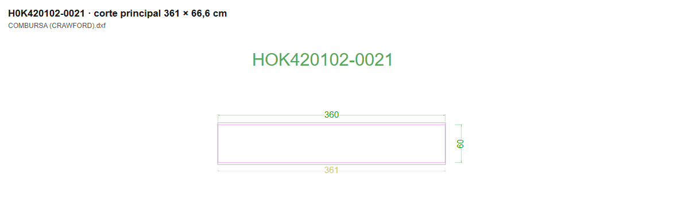

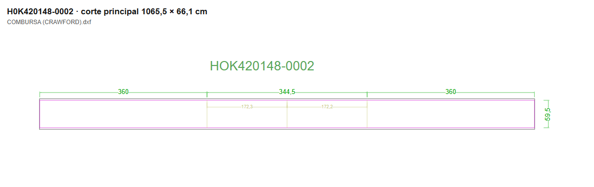

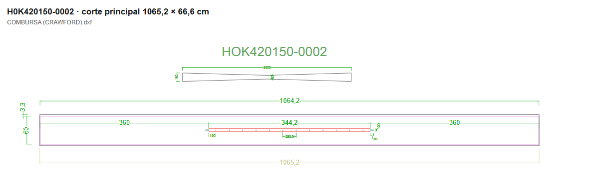

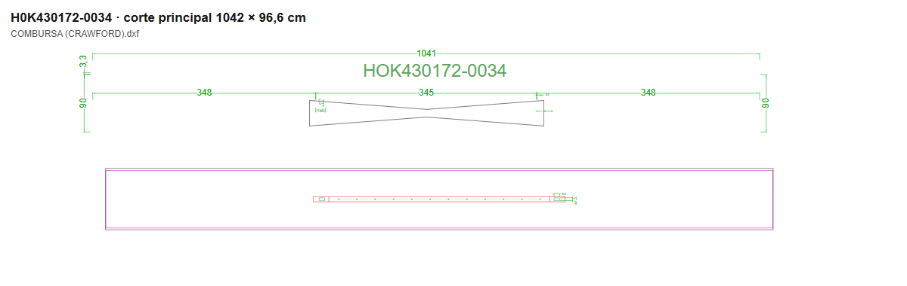

### Techos

Los techos 430125, 430127 y 430129 comparten la fórmula habitual del cuerpo. El 430125 figura como techo en RPS; el 430127 y el 430129 añaden el conjunto de vierteaguas. En el maestro se ven tiras con broche, solapas y la indicación de soldar el vierteaguas por el revés. El nombre de familia no basta para resolver esos accesorios de una medida nueva.

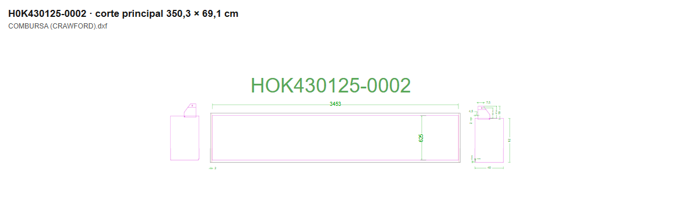

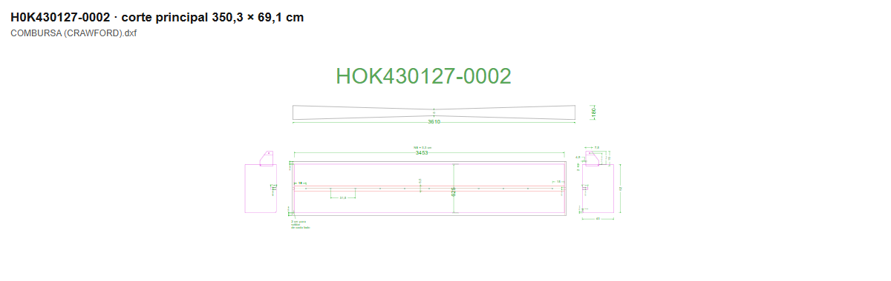

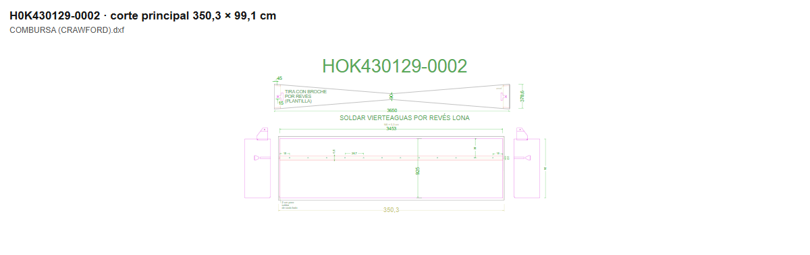

### Cortinas 410129 y 410130

Son cortinas de la parte frontal del abrigo. Sus pedidos describen otras medidas —TWB, TWT, H, altura de guía y color—, no siempre NT/NB/NH. **No hay una fórmula general de corte suficientemente comprobada para estas dos familias.** Hay desarrollo de lona fina, piezas de lona gruesa, tapas y agujeros; no basta un rectángulo frontal.

El dibujo de la variante superior 0117 distingue PLASTEL TE62, una pieza de lona gruesa, derecho/revés y un agujero indicado como FURO DE Ø40. La lateral 0175 tiene varios desarrollos, guía blanca, indicaciones de lona gruesa y otras de PVC de distinto gramaje. Se conservan las notas históricas tal como están: no se transforma “900 gr” del dibujo en una referencia actual de material sin confirmarlo.

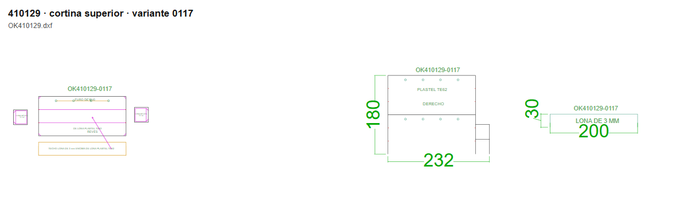

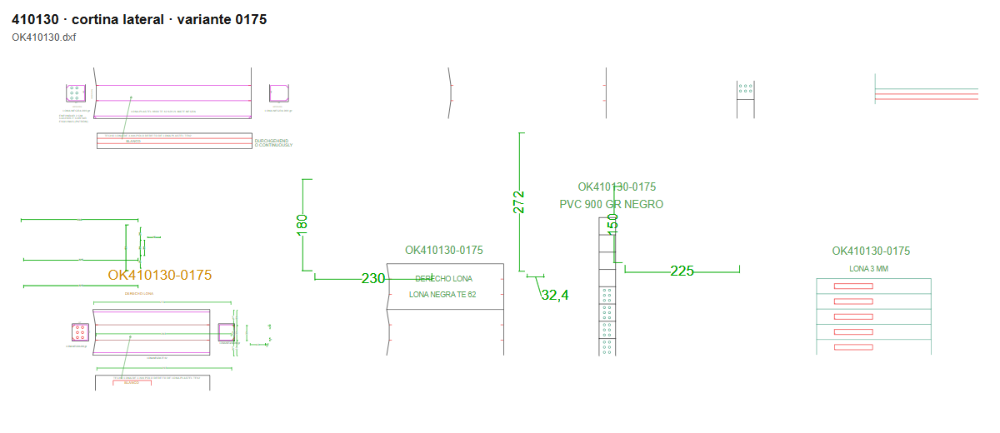

### Variantes que no cumplen la regla o tienen fuentes que discrepan

Esta tabla reúne los desacuerdos del Excel o del contorno con la fórmula evaluable de RPS. El pedido elegido es el último que conserva esa referencia en el histórico; algunos son antiguos. Un desacuerdo no prueba qué fuente está equivocada: obliga a revisar el dibujo y el pedido original antes de fabricar. Las descripciones recortadas sin fórmula quedan aparte y no se han rellenado por intuición.

| Variante | Pedido | OF | Descripción literal de línea | Excel cm | Terminado según fórmula cm | Contorno DWG cm |
| --- | --- | --- | --- | --- | --- | --- |
| H0K420150-0003 | AR.13.00581 | 0045451 | LONA ENVOLVENTE VIERTEAGUA NT600 NB2850 NH3250 BLC | 974,2 × 60 | 934,2 × 60 | 975,2 × 66,6 |
| H0K420148-0007 | AR.20.02340 | 0154442 | LONA ENVOLVENTE NB=3300 NH=3600 NT=600 | 1049,2 × 59,5 | 1049,5 × 59,5 | 1050,2 × 66,1 |
| H0K420150-0017 | AR.14.06392 | 0072922 | LONA ENVOLVENTE CON VIERTEAGUA NT600NB3500NH3800 B | 1109 × 60 | 1109,2 × 60 | 1125 × 66,6 |
| H0K430125-0012 | AR.26.05064 | 0233065 | DACHPLANE NB=3500+3 NT=600+25 SCHWARZ | 351,3 × 62,5 | 350,3 × 62,5 | 356,3 × 69,1 |
| H0K430125-0014 | AR.25.01832 | 0215744 | LONA ENVOLVENTE (DACHPLANE) NB=3100+3 NT=600+25 SCHWARZ | 311,3 × 62,5 | 310,3 × 62,5 | 316,3 × 69,1 |
| H0K430127-0016 | AR.26.02676 | 0229053 | DACHPLANE MIT REGENRINNE NT600 NB=2800 SCHWARTZ | 280,3 × 62,5 | 280,3 × 62,5 | 285,25 × 69,1 |
| H0K430127-0023 | AR.25.01183 | 0214510 | LONA ENVOLVENTE C VIERTEAGUAS NT600NB3450NH3600 BL | 290,3 × 62,5 | 345,3 × 62,5 | 295,3 × 69,1 |
| H0K420150-0095 | AR.12.05376 | 0042424 | ABDECKPLANE MIT REGENRINNE NT600 NB3300 NH3400 SCH | 1019,2 × 60 | 1009,2 × 60 | 1020,2 × 66,6 |
| H0K430127-0066 | AR.23.06801 | 0199543 | LONA ENVOLVENTE CON VIERTEAGUAS NT600 NB=3700 SCHWARZ | 270,3 × 62,5 | 370,3 × 62,5 | 275,3 × 69,1 |
| H0K430172-0010 | AR.26.04397 | 0231917 | ABDECKPLANE MIT REGENRINNE NT=900 NB=3250 NH=3200 | 985 × 90 | 965 × 90 | 986 × 96,6 |
| H0K420150-0120 | AR.21.07516 | 0175911 | LONA ENVOLVENTE CON VIERTEAGUA NT=600 NB=3300 NH=3200 BLACK PVC | 969,2 × 30 | 969,2 × 60 | 970,2 × 66,6 |
| H0K430172-0035 | AR.26.03264 | 0230159 | ABDECKPLANE MIT REGENRINNE NT900 NB3450 NH3860 SCH | 1081 × 90 | 1117 × 90 | 1082 × 96,6 |
| H0K420150-0122 | AR.22.03062 | 0181825 |  LONA ENVOLVENTE CON VIERTEAGUA NT=600 NB=3600 NH=3500 BLACK PVC | 1159,2 × 60 | 1059,2 × 60 | 1060,2 × 66,6 |
| H0K420150-0123 | AR.22.06094 | 0186980 | LONA ENVOLVENTE CON VIERTEAGUA NT600 NB3400 NH3700 BLACK | 1049,2 × 60 | 1079,2 × 60 | 1050,2 × 66,6 |

El maestro contiene literalmente la nota **“EN LA NUMERO 90 TIENE PEDIDO 2 MEDIDAS”** junto a la 420150-0090. Se ha comprobado su existencia en el texto del DXF; por eso esa variante tampoco debe convertirse en una plantilla única sin revisión de la medida. También existen pequeñas diferencias geométricas que requieren acordar cómo redondear, y cambios claros entre terminado y corte. Las referencias sin comparación suficiente están enumeradas en `evidencias.json`.

## 4. Lo que lleva cada pieza, además del rectángulo

En el maestro de oficina aparecen capas de terminado, referencias, cotas, márgenes, marcas y curvas. **No son directamente las capas de herramienta del bot.** En los lotes de máquina sí aparecen DISCO1, DISCO2, CUTTER y ROTULADOR, más la leyenda de taladro y los textos. El dibujo de máquina conserva curvas y marcas; no es un mero cambio de nombre de capa del contorno exterior.

En el fichero de muestra `LOTE 31-10.dxf`, estas son las primitivas leídas por capa. Se incluyen los símbolos de leyenda que lleva el propio archivo: un arco en taladro no significa que todas las piezas se taladren. Una ranura puede contener varios arcos y líneas, así que esta tabla tampoco cuenta agujeros:

| Capa literal | Primitivas | Tipos leídos |
| --- | --- | --- |
| DISCO1 | 2745 | texto: 1; raya: 2744 |
| DISCO2 | 597 | texto: 1; raya: 596 |
| ROTULADOR | 1100 | texto: 1; raya: 1099 |
| CUTTER | 1021 | texto: 1; raya: 436; arco: 584 |
| taladro | 2 | texto: 1; arco: 1 |
| texto | 138 | texto: 138 |

Este contraste por familia mira solo la zona de un cuerpo principal identificado por referencia y tamaño. Los canalones y accesorios exteriores quedan fuera de esa zona. Los números son entidades dentro de ella; un borde continuo del conjunto puede cruzarla sin estar contenido por completo y, por tanto, no entrar en la cuenta. “Sin rectángulo cerrado” no significa que la pieza no exista: el lote puede dejar un borde abierto o unirlo a otro corte. No se han trasladado las herramientas de una familia a otra por parecido.

| Familia / caso | Lote examinado | Capas en la zona del cuerpo | Accesorios consumidos en alguna OF de la familia |
| --- | --- | --- | --- |
| 420102 / H0K420102-0034 | LOTE 31-10.dxf | DISCO1: 4 | MACARRNEGR6MM; KITREMACHEPOLNEG |
| 420148 / H0K420148-0099 | LOTE 10-10.dxf | DISCO1: 3 | MACARRNEGR6MM |
| 420150 / H0K420150-0090 | LOTE 31-10.dxf | CUTTER: 28; DISCO1: 3; ROTULADOR: 2 | MACARRNEGR6MM; REFCUADP80MM12MM; REFCONJTPL80MM |
| 430172 / H0K430172-0007 | LOTE 31-10.dxf | DISCO1: 4; ROTULADOR: 16; CUTTER: 28 | MACARRNEGR6MM; REFCUADP80MM12MM; KITREMACHEPOLNEG; REFCONJTPL80MM; REFRECP240MM70MM |
| 430125 / H0K430125-0002 | LOTE 31-10.dxf | Sin rectángulo cerrado identificado | MACARRNEGR6MM; KITREMACHEPOLNEG; REFSOLP200MM170M |
| 430127 / H0K430127-0014 | LOTE 31-10.dxf | Sin rectángulo cerrado identificado | MACARRNEGR6MM; KITREMACHEPOLNEG; REFSOLP200MM170M |
| 430129 / H0K430129-0008 | LOTE 31-10.dxf | DISCO1: 4; ROTULADOR: 3; CUTTER: 11 | MACARRNEGR6MM; KITREMACHEPOLNEG; REFSOLP200MM170M; REFCONJTPL80MM |

Así se distingue el lateral sencillo de los cuerpos con canalón, que llevan operaciones interiores de CUTTER y ROTULADOR. Los consumos de refuerzos, solapas o velcro son observaciones de OF de la familia, no instrucciones para montarlos en todas sus variantes. Las dos familias de cortinas conservan el despiece específico mostrado arriba; no se ha encontrado y validado un cuerpo de lote que permita darles una receta de herramientas general.

- **DISCO1 / DISCO2:** tramos de corte que el dibujo separa por herramienta. Hay bordes compartidos entre paños contiguos y casos con un borde abierto. Se deben conservar los recorridos reales, no reconstruirlos solo por la caja exterior.
- **CUTTER:** curvas, ranuras y tramos cortos de detalles. En los cuerpos con canalón se ven pares repetidos de ranuras en la zona del vierteaguas. No se ha convertido su recuento de entidades en una tabla de posiciones de ollaos.
- **ROTULADOR:** marcas y líneas de confección. Una línea que se ve en el plano de oficina no se envía al rotulador sin identificar su función.
- **taladro:** la leyenda existe en los lotes de muestra; las perforaciones reales deben comprobarse en la zona de la pieza y en la capa correspondiente. Algunas están resueltas con CUTTER.
- **texto:** códigos, cantidades, sentido REVÉS y rótulos de palet. Es información del dibujo; su presencia no demuestra que la máquina la escriba físicamente en la lona. Tampoco hay que mover todos los textos a ROTULADOR.

Los accesorios se han contrastado también con el consumo de materiales de las OF. Esta tabla cuenta OF distintas con cada material, no metros ni piezas consumidas por unidad: las cantidades de distintos materiales pueden tener unidades diferentes y una OF puede tener varias imputaciones.

| Referencia de material | Descripción de RPS | OF distintas | Familias observadas |
| --- | --- | --- | --- |
| PLAST880NEGRP204 | LONA PLASTEL 8800 TE62 620 2L MATE :NEGRO :204 AN | 664 | 430172, 430125, 420148, 410129, 420102, 420150, 410135, 430129, 430127, 410130, D001624514, D001602298, D001602304 |
| MACARRNEGR6MM | MACARRON PVC :NEGRO :6MM | 731 | 420148, 430172, 430125, 420102, 420150, 430129, 430127, D001624514, D001602298, D001602304 |
| REFCUADP80MM12MM | REFUERZO CUADRADO PLASTEL 80MM X 120MM (420150) | 206 | 420150, 430172 |
| KITREMACHEPOLNEG | KIT REMACHE POLIAMIDA NEGRO  | 153 | 430125, 430129, 430127, 430172, 420102 |
| REFSOLP200MM170M | SOLAPA PLASTEL DE 200MM X 170MM (430125) | 146 | 430125, 430129, 430127 |
| REFCONJTPL80MM | CONJUNTO " T" L PLASTEL (430172-129) | 137 | 430172, 430129, 420150 |
| RESTOSPLASTEL | RESTO LONA PLASTEL | 110 | 420148, 430125, 430127, 420102, 420150, 430172, 430129, 410130, D001602298 |
| MUCA78NEGROP160 | LONA MUELLE CARGA 7808-3800 (G.3MM) :NEGRO :160 AN | 99 | 430125, 410129, 410135, 410130, 430129, 430127, 410143, 430134, 410134, otros, 420150, H7A006007 |
| REFRECP240MM70MM | REFUERZO RECTANGULO LONA PLASTEL 240X70MM (430172) | 114 | 430172 |
| RESTOPVC | RESTO LONA PVC | 84 | 410129, 430125, 420102, 430172, 430127, 420150, 410130, 430129, 410174, 410143, 410245, 410172, 410173, 410182, 420148, 410185, otros |
| RESTOMUELLEC3MM | RESTO LONA MUELLE DE CARGA :3MM  | 74 | 410129, 430125, 430129, 430127, 430172, 420102, 420150 |
| PALETSMA1200X800 | PALET DE MADERA 1200 x 800 (EUROPEO) | 35 | 410129, 420148, 430172, 410174, 420102, 420150, D001624514, 430125, 430127, 410245, 430129 |
| VALMEX7311NEGROP150 | LONA VALMEX 7311 5340 1450grs/m² 1,2MM:NEGRO:150 AN | 7 | 410174, 410172, 410173, 410170, 410171 |
| MUCA76NEGRP120 | LONA MUELLE CARGA 7806 (G.2MM) :NEGRO MATE :120 AN | 9 | 410143, 410134, 410172, 410173, 410170, 410171, 410182, 410155 |
| ALPHANEGRP250 | LONA ALPHA 1L 580 g/m² :NEGRO :250 AN (580) | 11 | 410121, 410241, 410242, 410245, 410123, 410124 |
| RESTOMUELLEC2MM | RESTO LONA MUELLE DE CARGA :2MM | 4 | 410143, 410172, 410173, 410134 |
| PLAST880ROJOP204 | LONA PLASTEL 8800 TE62 620 2L MATE:ROJO 370:204 AN | 1 | 420150 |
| MUCA76NEGRP210 | LONA MUELLE CARGA 7806 (G.2MM) :NEGRO MATE :210 AN | 3 | 410143, 410182, 410134 |
| RESTOMUELLEC1,2 | RESTO LONA MUELLE DE CARGA :1,2 MM | 2 | 410173, 410155 |
| VEBCOSNEGR50MM | VELCRO COSER BRAVO :NEGRO :50MM (R.25M) | 2 | otros |
| VESCOSNEGR50MM | VELCRO COSER SUAVE :NEGRO :50MM (R.25M) | 2 | otros |

La lona principal más repetida es PLASTEL 8800 TE62, negra mate, con ancho indicado en RPS como 204. También se consumen macarrón negro, refuerzos cuadrados y rectangulares, conjuntos en T, solapas y remaches. Para las cortinas aparecen materiales de distinto espesor y otros anchos de rollo. El velcro figura en consumos de ciertas OF; **no hay prueba para añadir velcro a toda la familia**. El detalle por OF está en la extracción local.

En los ejemplos del cuerpo de fondo habitual 600, tres paños de 66,6 cm ocupan 199,8 cm y caben en el ancho 204 del material. Esto aprovecha el ancho del rollo; **no es un empate para formar una pieza más ancha**. No se ha encontrado una regla general que permita introducir empates automáticamente. Canalones y refuerzos deben llevar la misma cantidad que su cuerpo, con el despiece aprobado. Falta cerrar su regla completa para variantes nuevas (Q-AS02 y Q-AS06).

## 5. Cómo se reconstruye el trabajo actual de Tamara

Los ficheros prueban el resultado guardado, no una observación en directo de los clics ni la autoría de cada operación. La atribución a Tamara procede del encargo y de la carpeta de pendientes; las marcas de fecha por sí solas no identifican a la persona.

El recorrido que mejor encaja con las pruebas es:

1. Se lee el pedido: referencia, descripción, cantidad y fecha solicitada. La OF se cruza cuando está creada.
2. Se busca la variante en el maestro y en los dibujos del cliente. Hay plantillas antiguas CMT por familia, pero el trabajo reciente se guarda principalmente en lotes DXF/CMT.
3. Se preparan lotes principalmente semanales por pedidos y material. En los ejemplos recientes el nombre coincide con `ReceptionDemandDate`, pero el conjunto de DWG también contiene pedidos con otras entregas. `ReceptionDate` a menudo sigue vacía como fecha de origen del sistema.
4. Se colocan cuerpos, canalones y accesorios en conjuntos aprovechando el rollo. Se repiten los conjuntos y se completan los sobrantes con piezas sueltas.
5. Se conservan rótulos de referencia y multiplicadores; se guarda el corte como `LOTE …`. La pareja CMT/DXF y sus fechas muestran las dos salidas guardadas, pero no cómo se importan o lanzan exactamente en la máquina.
6. El DWG de Oficina Técnica conserva pedidos y reparto por palets, con cantidades, repeticiones y notas de stock. Queda confirmar su interpretación por línea/OF, y la ventana de Modelo que se imprime: Q-AS04 y Q-AS07. La repetición («x30» = hacer ese corte 30 veces) es una indicación para el corte (Q-AS03, contestada).

### Lotes que juntan pedidos

En cada fila se cruzan los códigos que realmente están escritos en el DXF con las líneas RPS de la fecha solicitada y anteriores a la modificación del fichero. Las coincidencias son **candidatas documentadas**: no se atribuye una pieza concreta a una OF si el dibujo no la identifica.

| DXF | Modificado UTC | Fecha de entrega del nombre | Referencias escritas | Líneas RPS candidatas | Pedidos candidatos |
| --- | --- | --- | --- | --- | --- |
| LOTE 10-10.dxf | 2026-10-08T09:12:26.685Z | 2026-10-10 | 17 | 21 | AR.26.04703; AR.26.04669; AR.26.04710; AR.26.04772; AR.26.04796 |
| LOTE 24-10.dxf | 2026-10-16T05:14:56.705Z | 2026-10-24 | 10 | 13 | AR.26.04504; AR.26.04734; AR.26.04797 |
| LOTE 31-10.dxf | 2026-10-23T05:39:56.642Z | 2026-10-31 | 28 | 33 | AR.26.04704; AR.26.04864; AR.26.04961; AR.26.05029; AR.26.05047; AR.26.05064 |

Las parejas guardadas permiten comprobar las fechas por separado. Si después cambia uno de los dos archivos, la igualdad del nombre no demuestra que representen la misma versión:

| DXF | Fecha DXF UTC | CMT del mismo nombre | Fecha CMT UTC |
| --- | --- | --- | --- |
| LOTE 10-10.dxf | 2026-10-08T09:12:26.685Z | LOTE 10-10.cmt | 2026-10-05T05:19:35.290Z |
| LOTE 24-10.dxf | 2026-10-16T05:14:56.705Z | LOTE 24-10.cmt | 2026-10-15T09:18:10.807Z |
| LOTE 31-10.dxf | 2026-10-23T05:39:56.642Z | LOTE 31-10.cmt | 2026-10-20T12:13:58.926Z |

Ejemplo completo del lote más reciente estudiado, con los pedidos, OF, códigos y cantidades candidatos:

| Pedido | OF | Código literal RPS | Cantidad | Entrega solicitada |
| --- | --- | --- | --- | --- |
| AR.26.04704 | 0232437 | H0K430172-0030 | 1 | 2026-10-31 |
| AR.26.04704 | 0232436 | H0K430125-0020 | 2 | 2026-10-31 |
| AR.26.04704 | 0232433 | H0K420102-0085 | 4 | 2026-10-31 |
| AR.26.04704 | 0232435 | H0K420148-0018 | 3 | 2026-10-31 |
| AR.26.04704 | 0232438 | H0K430125-0002 | 2 | 2026-10-31 |
| AR.26.04704 | 0232434 | H0K420102-0034 | 41 | 2026-10-31 |
| AR.26.04864 | 0232724 | H0K430125-0002 | 2 | 2026-10-31 |
| AR.26.04864 | 0232720 | H0K420102-0018 | 2 | 2026-10-31 |
| AR.26.04864 | 0232723 | H0K430172-0009 | 2 | 2026-10-31 |
| AR.26.04864 | 0232722 | H0K430172-0007 | 5 | 2026-10-31 |
| AR.26.04864 | 0232719 | H0K420102-0017 | 4 | 2026-10-31 |
| AR.26.04864 | 0232721 | H0K430129-0017 | 1 | 2026-10-31 |
| AR.26.04961 | 0232889 | H0K420150-0092 | 2 | 2026-10-31 |
| AR.26.04961 | 0232891 | H0K420150-0088 | 10 | 2026-10-31 |
| AR.26.05029 | 0232960 | H0K420102-0060 | 2 | 2026-10-31 |
| AR.26.05029 | 0232962 | H0K430129-0006 | 1 | 2026-10-31 |
| AR.26.05029 | 0232961 | H0K420148-0105 | 2 | 2026-10-31 |
| AR.26.05047 | 0233026 | H0K420102-0050 | 2 | 2026-10-31 |
| AR.26.05047 | 0233030 | H0K430129-0008 | 4 | 2026-10-31 |
| AR.26.05047 | 0233028 | H0K420150-0090 | 20 | 2026-10-31 |
| AR.26.05047 | 0233025 | H0K420102-0030 | 5 | 2026-10-31 |
| AR.26.05047 | 0233023 | H0K420102-0004 | 8 | 2026-10-31 |
| AR.26.05047 | 0233027 | H0K420150-0089 | 2 | 2026-10-31 |
| AR.26.05047 | 0233031 | H0K430172-0009 | 15 | 2026-10-31 |
| AR.26.05047 | 0233029 | H0K430127-0014 | 5 | 2026-10-31 |
| AR.26.05047 | 0233032 | H0K430172-0030 | 1 | 2026-10-31 |
| AR.26.05047 | 0233024 | H0K420102-0022 | 4 | 2026-10-31 |
| AR.26.05064 | 0233062 | H0K420102-0092 | 6 | 2026-10-31 |
| AR.26.05064 | 0233066 | H0K430172-0002 | 1 | 2026-10-31 |
| AR.26.05064 | 0233063 | H0K420102-0092 | 6 | 2026-10-31 |
| AR.26.05064 | 0233067 | H0K430172-0007 | 15 | 2026-10-31 |
| AR.26.05064 | 0233065 | H0K430125-0012 | 2 | 2026-10-31 |
| AR.26.05064 | 0233064 | H0K420150-0002 | 15 | 2026-10-31 |

Los códigos del lote y las fechas corroboran la agrupación, pero no sustituyen la conciliación del número de cada componente. Un código repetido en varios pedidos puede agruparse en un mismo conjunto de corte.

### Cantidades grandes: qué cuenta hay detrás de un x30

Se midieron las líneas verticales del cuerpo y la separación de los cortes. Cuando un lado continuo abarca varios paños iguales, se divide por la separación comprobada. Se asocian solo los conjuntos con rótulo del código y un multiplicador próximo. Los grupos sin código no se asignan por intuición.

| Lote | Código | Paños por repetición y piezas sueltas | Total reconstruido | Pedido / OF candidatos y cantidad RPS |
| --- | --- | --- | --- | --- |
| LOTE 22-08.dxf | H0K420150-0090 | 3 × 30 | 90 | AR.26.03639 / OF 0230759 / 90 |
| LOTE 31-10.dxf | H0K420150-0090 | 3 × 6 + 2 × 1 | 20 | AR.26.05047 / OF 0233028 / 20 |
| LOTE 24-10.dxf | H0K420150-0091 | 3 × 18 + 1 × 1 | 55 | AR.26.04797 / OF 0232646 / 55 |
| LOTE 10-10.dxf | H0K420150-0090 | 3 × 10 | 30 | AR.26.04703 / OF 0232443 / 30 |
| LOTE 10-10.dxf | H0K420148-0099 | 3 × 10 + 2 × 1 | 32 | AR.26.04669 / OF 0232429 / 2; AR.26.04703 / OF 0232439 / 30 |

Por ejemplo, la OF 0230759, del pedido AR.26.03639, pide 90 unidades para 2026-08-22. El DXF de esa fecha contiene el cuerpo en tres paños y la marca x30. En otro lote la suma del conjunto repetido y las dos piezas sueltas cuadra con veinte unidades. **No se dibujan necesariamente todas las unidades una por una.** El DWG confirma además la distinción x90/x30 y descuentos de stock; falta confirmar dónde se introduce la repetición al ejecutar la máquina.

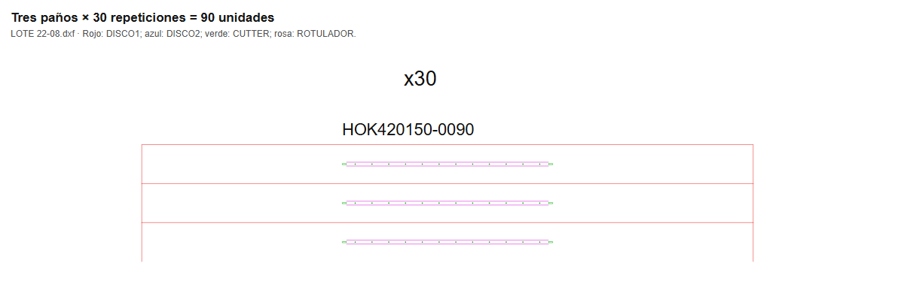

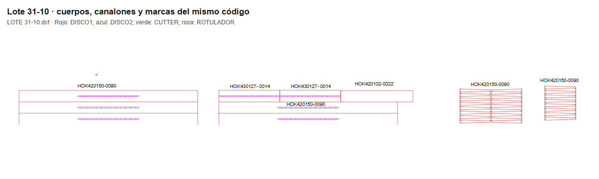

Los pedidos de exactamente sesenta unidades de esa referencia encontrados este año son:

| Pedido | OF | Código | Cantidad | Fecha pedido | Entrega solicitada |
| --- | --- | --- | --- | --- | --- |
| AR.26.02678 | 0229020 | H0K420150-0090 | 60 | 2026-06-03 | 2026-06-19 |
| AR.26.05234 | — | H0K420150-0090 | 60 | 2026-10-23 | 2026-11-07 |
| AR.26.05240 | — | H0K420150-0090 | 60 | 2026-10-23 | 2026-11-07 |

Los dos más recientes aún no tenían OF en la lectura. El caso anterior tiene entrega solicitada en viernes y existe un lote del sábado siguiente con la misma referencia y una repetición distinta; **no se ha cerrado su reparto**. No se afirma que baste repetir un DXF sesenta veces ni que todos esos pedidos estén ya cortados.

### ¿Reutiliza un DXF tal cual? ¿Hay plano impreso?

Hay reutilización de geometría por referencia: los mismos contornos y desarrollos reaparecen, colocados con cantidades y agrupaciones diferentes. **No hay prueba de que se envíe un DXF inmutable por código tal cual**; el archivo conservado corriente es un lote mixto. El maestro también se actualiza, y la nota de la variante 0090 obliga a revisar su medida.

En los DXF de máquina de los lotes normales de muestra no se encontraron textos con OF, pedido AR ni ROBA. La segunda lectura de los DWG de Oficina Técnica sí encuentra pedidos AR y reparto por palets en Modelo. Sí se ven códigos de variante, multiplicadores, REVÉS y rótulos de palet. Como contraste, `AR2603328.dxf` contiene las OF 0230284 y 0230283 y piezas D00; por tanto existe una vía específica por pedido además de la vía por lotes.

Estos PDF sí se localizaron en el archivo de Planteamientos para pedidos ASSA de los años revisados:

| PDF | Última modificación UTC |
| --- | --- |
| AR.25.00787-10.pdf | 2025-02-20T13:50:06.612Z |
| AR.25.00896-10.pdf | 2025-02-25T10:50:02.451Z |
| AR.25.00976-10.pdf | 2025-02-28T08:50:17.836Z |
| AR.26.02851-10.pdf | 2026-06-16T09:50:16.441Z |
| AR.26.03328-10.pdf | 2026-07-27T11:50:03.140Z |
| AR.26.03328-11.pdf | 2026-07-27T11:50:03.077Z |

La poca presencia de PDF de pedidos normales **no demuestra que no se imprima**. Puede imprimirse desde el maestro o el programa de corte sin guardar un PDF en esa carpeta. Los PDF anteriores prueban que hay planteamientos guardados para casos especiales; no prueban una impresión física. La segunda lectura localiza el plano de preparación en Modelo y las presentaciones completas de los especiales; queda confirmar cómo se imprime el lote normal (Q-AS07).

## Planos de los lotes (Oficina Tecnica\2026\COMBURSA)

Esta segunda lectura añade la carpeta de Oficina Técnica, distinta de los maestros del cliente y de los cortes de máquina. Se inventariaron **80 ficheros**, se copiaron a tmp y se convirtieron **los 44 DWG con ODA a DXF**. También se leyeron los 7 DXF conservados allí. Los originales de red y RPS se han tratado solo en lectura; los BAK se inventariaron y copiaron, pero no se han tratado como revisiones adicionales ni convertido a escondidas. La foto de RPS sigue siendo la de 2026-10-25T00:31:49.604Z.

### Cuántos lotes hay y cada cuánto se preparan

| Extensión | Ficheros |
| --- | --- |
| .cmt | 10 |
| .dwg | 44 |
| .dxf | 7 |
| .bak | 19 |

Hay **50 nombres de lote distintos**: 43 con DWG y siete de 2025 sin DWG en esta carpeta. Los 43 DWG de lote incluyen **42 nombres con fecha válida de 2026** y el nombre irregular `LOTE 06-067-03.dwg`; el otro DWG es `AR2603328.dwg`, un pedido especial. BAK, DXF y CMT del mismo nombre no suman otro lote.

**La cadencia es principalmente semanal, con excepciones; no es un lote al mes.** En 2026 hay entre tres y cinco fechas de lote por mes y 41 de las 42 fechas válidas caen en sábado. El lunes 21 de septiembre es una salida adicional entre los sábados 19 y 26. Falta el 11 de julio y el 15 de agosto en esta carpeta; eso no prueba que no se trabajara esos días.

| Mes de la fecha del nombre | Lotes | Días del mes |
| --- | --- | --- |
| 2025-02 | 1 | 01 |
| 2025-03 | 1 | 01 |
| 2025-05 | 1 | 03 |
| 2025-08 | 1 | 02 |
| 2025-10 | 2 | 01, 04 |
| 2025-11 | 1 | 01 |
| 2026-01 | 4 | 10, 17, 24, 31 |
| 2026-02 | 4 | 07, 14, 21, 28 |
| 2026-03 | 4 | 07, 14, 21, 28 |
| 2026-04 | 4 | 04, 11, 18, 25 |
| 2026-05 | 5 | 02, 09, 16, 23, 30 |
| 2026-06 | 4 | 06, 13, 20, 27 |
| 2026-07 | 3 | 04, 18, 25 |
| 2026-08 | 4 | 01, 08, 22, 29 |
| 2026-09 | 5 | 05, 12, 19, 21, 26 |
| 2026-10 | 5 | 03, 10, 17, 24, 31 |

| Separación entre fechas consecutivas de 2026 | Intervalos |
| --- | --- |
| 2 días | 1 |
| 5 días | 1 |
| 7 días | 37 |
| 14 días | 2 |

La fecha de fichero cuenta una **última modificación**, no una sesión de trabajo ni el momento de impresión. Los siguientes totales usan un fichero principal por nombre de lote (DWG si existe; si no, DXF o CMT). Las fechas completas de los 43 DWG de lote se detallan más abajo. Puede haber varios preparados o retocados el mismo día, y un lote puede revisarse después de su entrega.

| Mes de última modificación del fichero principal | Lotes |
| --- | --- |
| 2025-01 | 1 |
| 2025-02 | 1 |
| 2025-04 | 1 |
| 2025-07 | 1 |
| 2025-09 | 2 |
| 2025-10 | 1 |
| 2025-12 | 1 |
| 2026-01 | 4 |
| 2026-02 | 3 |
| 2026-03 | 6 |
| 2026-04 | 3 |
| 2026-05 | 5 |
| 2026-06 | 5 |
| 2026-07 | 3 |
| 2026-08 | 4 |
| 2026-09 | 5 |
| 2026-10 | 4 |

Para los nombres fechados en 2026, al ordenar sus modificaciones, la separación mediana es 7 días; va de 0 a 34 días naturales. El intervalo mayor incluye el cambio de año. Estos datos también encajan con una preparación semanal retocada en días variables, no con una única preparación mensual.

Por ejemplo, `LOTE 10-01.dwg` se modificó el 17/12/2025 y corresponde al 10/01/2026 por la proximidad de fechas, los pedidos AR26 escritos y sus entregas en RPS. **No es un lote de enero de 2025.** `LOTE 17-01.dwg` se modificó el 28/01/2026, once días después del día del nombre. El intervalo observado entre nombre y modificación va de once días después a veinticuatro días antes; no debe usarse como plazo estándar.

Los siete nombres realmente fechados en 2025 se conservan como restos de ese año dentro de la carpeta 2026. No forman un archivo completo de 2025 y no se puede deducir una cadencia mensual de esa selección. Los tres CMT `976.CMT`, `AR2500976.CMT` y `AR2500976_.CMT`, y `LONA 3 MM.dxf`, tampoco son lotes nuevos por el mero hecho de estar allí.

| Lote de 2025 | Fecha inferida del nombre | Última modificación principal UTC | Ficheros conservados |
| --- | --- | --- | --- |
| LOTE 01-02 | 2025-02-01 | 2025-01-29T07:05:32.735Z | .dxf, .cmt |
| LOTE 01-03 | 2025-03-01 | 2025-02-21T09:27:58.430Z | .cmt, .dxf |
| LOTE 01-10 | 2025-10-01 | 2025-09-19T12:55:15.358Z | .cmt, .dxf |
| LOTE 01-11 | 2025-11-01 | 2025-10-23T11:47:02.949Z | .cmt, .dxf |
| LOTE 02-08 | 2025-08-02 | 2025-07-31T06:40:55.546Z | .bak, .cmt, .dxf |
| LOTE 03-05 | 2025-05-03 | 2025-04-30T12:32:36.961Z | .cmt, .dxf |
| LOTE 04-10 | 2025-10-04 | 2025-09-22T07:29:58.960Z | .cmt |

Los seis DXF de lote de 2025 conservados aquí son **idénticos byte a byte** a los DXF de igual nombre de maqcorte/2025/COMBURSA: coinciden sus SHA-256, por lo que también coinciden sus geometrías y rótulos de repetición. No son seis DWG con hojas de taller nuevas. El séptimo nombre, LOTE 04-10, solo conserva aquí su CMT. Para los seis DXF, el cruce por fecha solicitada da lo siguiente; «sin coincidencia» no significa que no se fabricara.

| DXF de 2025 en Oficina Técnica | Referencias / rótulos xN | Pedidos / líneas RPS por fecha y referencia | Igual al DXF de máquina |
| --- | --- | --- | --- |
| LOTE  01-02.dxf | 16 / 4 | 2 / 16 | Sí, SHA-256 idéntico |
| LOTE 01-03.dxf | 17 / 11 | 4 / 20 | Sí, SHA-256 idéntico |
| LOTE 01-10.dxf | 1 / 1 | 0 / 0 | Sí, SHA-256 idéntico |
| LOTE 01-11.dxf | 17 / 9 | 7 / 22 | Sí, SHA-256 idéntico |
| LOTE 02-08.dxf | 7 / 6 | 2 / 2 | Sí, SHA-256 idéntico |
| LOTE 03-05.dxf | 3 / 91 | 1 / 1 | Sí, SHA-256 idéntico |

### Entregas y pedidos que aparecen en cada DWG

La columna de entregas cruza **pedido AR escrito + referencia escrita** con las líneas positivas de RPS cuyos pedidos ya existían cuando se modificó el plano. Es una selección comprobable, no una certificación de que se haya cortado toda esa cantidad: una misma referencia puede figurar como modelo, sobrar de otra revisión, salir del stock o repartirse entre palets. El JSON conserva pedidos, OF, cantidades y fechas candidatos para cada lote. La segunda selección, solo por fecha del nombre y referencia, se guarda aparte para no confundir ambas pruebas.

| DWG de lote | Día del nombre | Modificado UTC | Entregas RPS de pedidos/referencias escritos | Pedidos escritos / líneas RPS coincidentes |
| --- | --- | --- | --- | --- |
| LOTE 10-01.dwg | 2026-01-10 | 2025-12-17T13:36:00.378Z | 2026-01-10; 2026-01-17 | 7 / 40 |
| LOTE 17-01.dwg | 2026-01-17 | 2026-01-28T08:00:40.343Z | 2026-01-17 | 4 / 9 |
| LOTE 24-01.dwg | 2026-01-24 | 2026-01-20T06:48:32.307Z | 2026-01-24 | 2 / 6 |
| LOTE 31-01.dwg | 2026-01-31 | 2026-01-27T13:39:46.607Z | 2026-01-31 | 3 / 7 |
| LOTE 07-02.dwg | 2026-02-07 | 2026-01-30T08:32:16.219Z | 2026-02-07; 2026-02-21 | 4 / 22 |
| LOTE 14-02.dwg | 2026-02-14 | 2026-02-10T06:33:12.767Z | 2026-02-14 | 5 / 10 |
| LOTE 21-02.dwg | 2026-02-21 | 2026-02-18T08:46:12.234Z | 2026-02-21; 2026-02-28 | 5 / 16 |
| LOTE 28-02.dwg | 2026-02-28 | 2026-02-25T07:19:58.729Z | 2026-02-21; 2026-02-28 | 5 / 23 |
| LOTE 07-03.dwg | 2026-03-07 | 2026-03-02T13:49:09.895Z | 2026-03-07; 2026-03-14 | 3 / 17 |
| LOTE 14-03.dwg | 2026-03-14 | 2026-03-06T08:06:07.695Z | 2026-03-07; 2026-03-14 | 6 / 31 |
| LOTE 21-03.dwg | 2026-03-21 | 2026-03-10T06:41:32.281Z | 2026-03-21; 2026-03-28; 2026-04-04 | 3 / 24 |
| LOTE 28-03.dwg | 2026-03-28 | 2026-03-18T08:29:51.884Z | 2026-03-21; 2026-03-28; 2026-04-04 | 3 / 30 |
| LOTE 04-04.dwg | 2026-04-04 | 2026-03-27T09:03:32.970Z | 2026-04-11; 2026-04-18 | 5 / 20 |
| LOTE 11-04.dwg | 2026-04-11 | 2026-03-30T09:02:45.410Z | 2026-04-11; 2026-04-18 | 6 / 23 |
| LOTE 18-04.dwg | 2026-04-18 | 2026-04-09T09:14:57.382Z | 2026-03-28; 2026-04-18 | 12 / 32 |
| LOTE 25-04.dwg | 2026-04-25 | 2026-04-15T12:29:42.751Z | 2026-04-25 | 7 / 21 |
| LOTE 02-05.dwg | 2026-05-02 | 2026-04-23T12:34:21.904Z | 2026-05-02 | 4 / 24 |
| LOTE 09-05.dwg | 2026-05-09 | 2026-05-04T06:28:29.923Z | 2026-05-16 | 2 / 3 |
| LOTE 16-05.dwg | 2026-05-16 | 2026-05-14T06:43:22.468Z | 2026-05-16; 2026-06-13 | 7 / 18 |
| LOTE 23-05.dwg | 2026-05-23 | 2026-05-18T11:30:27.639Z | 2026-05-23 | 4 / 11 |
| LOTE 30-05.dwg | 2026-05-30 | 2026-05-22T08:54:01.951Z | 2026-05-30; 2026-06-13 | 5 / 13 |
| LOTE 06-06.dwg | 2026-06-06 | 2026-06-03T11:30:52.853Z | 2026-06-06 | 7 / 23 |
| LOTE 13-06.dwg | 2026-06-13 | 2026-06-04T11:56:51.023Z | 2026-05-30; 2026-06-13 | 7 / 20 |
| LOTE 20-06.dwg | 2026-06-20 | 2026-06-16T11:53:10.752Z | 2026-06-19; 2026-06-20 | 6 / 11 |
| LOTE 27-06.dwg | 2026-06-27 | 2026-06-25T07:04:31.020Z | 2026-06-27 | 2 / 13 |
| LOTE 04-07.dwg | 2026-07-04 | 2026-06-26T07:27:13.353Z | 2026-06-27; 2026-07-04; 2026-07-11; 2026-07-18 | 4 / 28 |
| LOTE 18-07.dwg | 2026-07-18 | 2026-07-03T11:26:10.277Z | 2026-06-27; 2026-07-04; 2026-07-11; 2026-07-18 | 2 / 23 |
| LOTE 25-07.dwg | 2026-07-25 | 2026-07-20T08:49:22.089Z | 2026-07-25 | 2 / 3 |
| LOTE 01-08.dwg | 2026-08-01 | 2026-07-27T11:33:48.536Z | 2026-07-11; 2026-07-18; 2026-08-01 | 2 / 9 |
| LOTE 08-08.dwg | 2026-08-08 | 2026-08-06T05:58:09.947Z | 2026-08-08 | 1 / 2 |
| LOTE 22-08.dwg | 2026-08-22 | 2026-08-13T07:25:28.840Z | 2026-08-22 | 2 / 6 |
| LOTE 29-08.dwg | 2026-08-29 | 2026-08-24T09:18:17.120Z | 2026-08-29 | 5 / 17 |
| LOTE 05-09.dwg | 2026-09-05 | 2026-08-25T12:24:57.682Z | 2026-09-05 | 2 / 13 |
| LOTE 12-09.dwg | 2026-09-12 | 2026-09-02T07:43:50.980Z | 2026-09-12 | 3 / 23 |
| LOTE 19-09.dwg | 2026-09-19 | 2026-09-11T11:39:02.407Z | 2026-09-19 | 2 / 9 |
| LOTE 21-09.dwg | 2026-09-21 | 2026-09-21T10:01:12.366Z | 2026-09-21; 2026-09-26 | 4 / 21 |
| LOTE 26-09.dwg | 2026-09-26 | 2026-09-23T05:23:57.961Z | 2026-09-26 | 3 / 19 |
| LOTE 03-10.dwg | 2026-10-03 | 2026-09-24T07:36:41.445Z | 2026-10-03 | 2 / 17 |
| LOTE 10-10.dwg | 2026-10-10 | 2026-10-08T08:11:15.347Z | 2026-10-10 | 6 / 24 |
| LOTE 17-10.dwg | 2026-10-17 | 2026-10-08T06:43:07.104Z | 2026-10-17 | 4 / 18 |
| LOTE 24-10.dwg | 2026-10-24 | 2026-10-15T09:22:07.305Z | 2026-10-24 | 3 / 13 |
| LOTE 31-10.dwg | 2026-10-31 | 2026-10-20T12:01:59.626Z | 2026-10-31 | 6 / 33 |
| LOTE 06-067-03.dwg | — | 2026-05-29T06:07:03.515Z | 2026-06-06 | 1 / 1 |

Hay lotes con una sola entrega y lotes con varias; por ejemplo, el 04/07 cruza entregas del 27/06 al 18/07. El 20/06 incluye el pedido de sesenta unidades con entrega solicitada el viernes 19/06 además de las del sábado 20/06. El 09/05 solo cruza entregas del 16/05 para sus pedidos y códigos escritos: el nombre no basta para fijar su contenido. El nombre irregular `LOTE 06-067-03` no se fuerza a una fecha: identifica AR.26.02445 y su cruce apunta al 06/06/2026. Estas diferencias quedan en Q-AS08.

### Modelo y presentaciones: qué hay realmente para imprimir

**Todos los DWG de lote contienen pedidos AR en Modelo**, junto con referencias, dibujos de confección, cotas, despieces, multiplicadores y preparación por palets. Los pedidos y la organización manual se pierden en los DXF de máquina de los lotes recientes. Las capas habituales son `cortes - lona`, `referencias`, `referencia-1`, `marca`, `curv`, `cotas` y `texto`; no equivalen directamente a las herramientas DISCO1/DISCO2/CUTTER del corte.

El cajetín A4 de los lotes lleva las etiquetas Técnico, NºPedido, OF, Cliente, Revisión, página, Medidas y Fecha. En los recientes, NºPedido contiene el nombre del lote, OF y Cliente están vacíos, Técnico conserva «TÉCNICO», revisión «00» y página «01-01». La hoja DIN A3 conserva «Nº PEDIDO», «MEDIDA EMPATE:», «MEDIDAS EN CM» y «REALIZADO POR:», sin cumplimentar. «EMPATE: 2 CM» es un texto de plantilla del cajetín: **no autoriza un empate en cualquier pieza**.

Se han separado las presentaciones usando LAYOUT y BLOCK_RECORD, incluso cuando la presentación inactiva estaba en BLOCKS y no llevaba grupo 410. De 77 presentaciones de los DWG de lote, 74 no enfocan ninguna primitiva de Modelo; en las otras tres solo quedan una, tres o cuatro rayas, sin textos de piezas. **Ninguna presentación guardada de estos lotes normales muestra la preparación completa.** El Modelo sí contiene esa preparación. Puede imprimirse mediante una ventana elegida al trazar, pero el fichero no demuestra cuál se eligió ni una impresión física.

| DWG | Modelo: primitivas / referencias / pedidos | Presentaciones: nombre (primitivas de Modelo visibles) |
| --- | --- | --- |
| AR2603328.dwg | 7440 / 2 / 1 | -10 (51); -11 (63) |
| LOTE 01-08.dwg | 15936 / 18 / 2 | DIN A3 (0); A4 (0) |
| LOTE 02-05.dwg | 29772 / 19 / 4 | DIN A3 (0); A4 (0) |
| LOTE 03-10.dwg | 12386 / 18 / 2 | DIN A3 (0); A4 (1) |
| LOTE 04-04.dwg | 13842 / 20 / 5 | A4 (0) |
| LOTE 04-07.dwg | 9479 / 25 / 4 | DIN A3 (0); A4 (0) |
| LOTE 05-09.dwg | 6512 / 14 / 2 | DIN A3 (0); A4 (0) |
| LOTE 06-06.dwg | 17250 / 21 / 7 | A4 (0) |
| LOTE 06-067-03.dwg | 77 / 1 / 1 | A4 (0) |
| LOTE 07-02.dwg | 14178 / 16 / 4 | DIN A3 (0); A4 (0) |
| LOTE 07-03.dwg | 12929 / 18 / 3 | A4 (0) |
| LOTE 08-08.dwg | 4930 / 13 / 1 | DIN A3 (0); A4 (0) |
| LOTE 09-05.dwg | 8368 / 3 / 2 | DIN A3 (0); A4 (0) |
| LOTE 10-01.dwg | 31882 / 29 / 7 | DIN A3 (0); A4 (0) |
| LOTE 10-10.dwg | 16967 / 21 / 6 | DIN A3 (0); A4 (0) |
| LOTE 11-04.dwg | 21127 / 22 / 6 | A4 (0) |
| LOTE 12-09.dwg | 9026 / 22 / 3 | DIN A3 (0); A4 (0) |
| LOTE 13-06.dwg | 14469 / 22 / 7 | A4 (0) |
| LOTE 14-02.dwg | 10228 / 8 / 5 | DIN A3 (0); A4 (0) |
| LOTE 14-03.dwg | 19224 / 25 / 6 | A4 (0) |
| LOTE 16-05.dwg | 17805 / 18 / 7 | DIN A3 (0); A4 (0) |
| LOTE 17-01.dwg | 6210 / 11 / 4 | DIN A3 (0); A4 (0) |
| LOTE 17-10.dwg | 7963 / 14 / 4 | DIN A3 (0); A4 (0) |
| LOTE 18-04.dwg | 18519 / 30 / 12 | DIN A3 (0); A4 (0) |
| LOTE 18-07.dwg | 26817 / 29 / 2 | DIN A3 (0); A4 (0) |
| LOTE 19-09.dwg | 3378 / 9 / 2 | DIN A3 (0); A4 (0) |
| LOTE 20-06.dwg | 9727 / 10 / 6 | DIN A3 (0); A4 (0) |
| LOTE 21-02.dwg | 17323 / 13 / 5 | DIN A3 (0); A4 (0) |
| LOTE 21-03.dwg | 13117 / 26 / 3 | A4 (3) |
| LOTE 21-09.dwg | 25383 / 22 / 4 | DIN A3 (0); A4 (0) |
| LOTE 22-08.dwg | 4122 / 7 / 2 | DIN A3 (0); A4 (0) |
| LOTE 23-05.dwg | 12934 / 12 / 4 | DIN A3 (0); A4 (0) |
| LOTE 24-01.dwg | 5965 / 6 / 2 | DIN A3 (0); A4 (0) |
| LOTE 24-10.dwg | 7072 / 11 / 3 | DIN A3 (0); A4 (0) |
| LOTE 25-04.dwg | 12586 / 18 / 7 | DIN A3 (0); A4 (0) |
| LOTE 25-07.dwg | 13899 / 17 / 2 | DIN A3 (0); A4 (0) |
| LOTE 26-09.dwg | 24570 / 20 / 3 | DIN A3 (0); A4 (4) |
| LOTE 27-06.dwg | 9409 / 15 / 2 | DIN A3 (0); A4 (0) |
| LOTE 28-02.dwg | 20997 / 21 / 5 | DIN A3 (0); A4 (0) |
| LOTE 28-03.dwg | 16575 / 23 / 3 | A4 (0) |
| LOTE 29-08.dwg | 5699 / 17 / 5 | DIN A3 (0); A4 (0) |
| LOTE 30-05.dwg | 15297 / 10 / 5 | DIN A3 (0); A4 (0) |
| LOTE 31-01.dwg | 5294 / 8 / 3 | DIN A3 (0); A4 (0) |
| LOTE 31-10.dwg | 18333 / 29 / 6 | DIN A3 (0); A4 (0) |

Las presentaciones de tres lotes recientes se capturaron tal como están guardadas. La ausencia de piezas en ellas es un resultado del estudio, no un fallo de haber omitido las presentaciones inactivas.


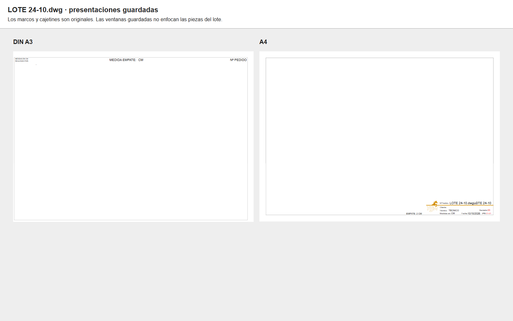


En el caso especial `AR2603328.dwg`, sí hay dos hojas completas, `-10` y `-11`, con confección arriba, corte debajo, material, pedido y OF. Ambas llevan cliente «ASSA BLOY», técnico «TAMARA», valor de revisión «JAIME» y fecha 27/07/2026. Hay elementos antiguos de plantilla en Modelo; el pedido vigente de estas hojas se toma del cajetín y no de todos los textos históricos del archivo.

| Presentación | Referencia visible | OF escrita en la hoja | OF de esa referencia en RPS | Cantidad RPS / entrega |
| --- | --- | --- | --- | --- |
| -10 | D001602304-001 | 0230283 | 0230284 | 10 / 2026-08-01 |
| -11 | D001602298-001 | 0230284 | 0230283 | 20 / 2026-08-01 |

**Las OF están intercambiadas respecto de RPS para las dos referencias de AR.26.03328.** **Q-AS09 contestada por Iván (26/10/2026): lo que está mal es el cajetín; RPS manda.** La OF de cada referencia se toma siempre de RPS y el cajetín del DWG no se usa como fuente.

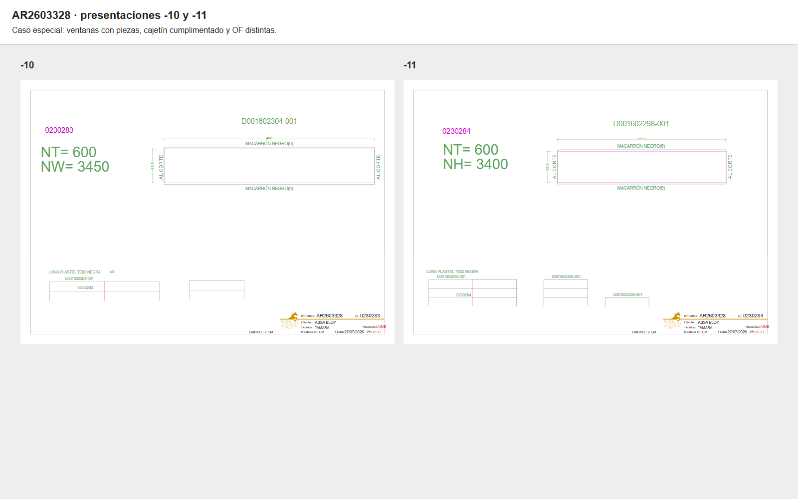

Q-AS07 queda parcialmente resuelta: se ha encontrado el plano de preparación y se distingue la vía normal en Modelo de las hojas especiales completas. Falta confirmar una impresión real del lote normal y el formato que usa el taller.

### Cruce con el DXF y el CMT de máquina

Se encontraron DXF de máquina asociados para 42 de los 43 DWG de lote y CMT para 38. Se igualaron espacios repetidos y la grafía `LOTE13-06`, y se mantuvieron por separado `LOTE 27-06 (2)` y `LOTE 27-06_nuevas`: son salidas relacionadas, no una sola versión demostrada. El nombre irregular no tiene pareja inequívoca. El CMT se comprueba por existencia, tamaño y fecha; **su formato binario no se ha decodificado**, por lo que no se afirma qué orden de repetición contiene.

Para comparar los DXF se conservaron los códigos completos y su grafía de variante. Los sufijos abreviados (por ejemplo, -02 frente a -0002) no se igualaron sin avisar. En 36 DWG de lote hay al menos una salida cuyos códigos de máquina están todos escritos en el DWG; esto demuestra correspondencia de catálogo, no igualdad de piezas, cantidades o versión.

| DWG | DXF de máquina asociado | Referencias escritas: DWG / DXF | Solo en máquina | CMT asociado |
| --- | --- | --- | --- | --- |
| LOTE 10-01.dwg | LOTE 10-01.dxf | 29 / 1 | — | LOTE 10-01.cmt |
| LOTE 17-01.dwg | LOTE 17-01.dxf | 11 / 7 | H0K420102-0017 | LOTE 17-01.cmt |
| LOTE 24-01.dwg | LOTE 24-01.dxf | 6 / 6 | — | LOTE 24-01.cmt |
| LOTE 31-01.dwg | LOTE 31-01.dxf | 8 / 2 | — | LOTE 31-01.cmt |
| LOTE 07-02.dwg | LOTE 07-02.dxf | 16 / 15 | — | LOTE 07-02.cmt |
| LOTE 14-02.dwg | LOTE 14-02.dxf | 8 / 8 | — | LOTE 14-02.cmt |
| LOTE 21-02.dwg | LOTE 21-02.dxf | 13 / 11 | — | LOTE 21-02.cmt |
| LOTE 28-02.dwg | LOTE 28-02.dxf | 21 / 16 | — | LOTE 28-02.cmt |
| LOTE 07-03.dwg | LOTE 07-03.dxf | 18 / 17 | — | LOTe 07-03.cmt |
| LOTE 14-03.dwg | LOTE 14-03.dxf | 25 / 23 | — | LOTE 14-03.cmt |
| LOTE 21-03.dwg | LOTE 21-03.dxf | 26 / 17 | — | LOTE 21-03.cmt |
| LOTE 28-03.dwg | LOTE 28-03.dxf | 23 / 14 | — | LOTE 28-03.cmt |
| LOTE 04-04.dwg | LOTE 04-04.dxf | 20 / 4 | H0K420148-0103 | LOTE 04-04.cmt |
| LOTE 11-04.dwg | LOTE 11-04.dxf | 22 / 18 | — | LOTE 11-04.cmt |
| LOTE 18-04.dwg | LOTE18-04.dxf | 30 / 29 | — | LOTE 18-04.cmt |
| LOTE 25-04.dwg | LOTE 25-04.dxf | 18 / 21 | H0K420102-92; H0K420148-105; H0K420150-02; H0K430172-02 | LOTE 25-04.cmt |
| LOTE 02-05.dwg | LOTE 02-05.dxf | 19 / 18 | — | LOTE 02-05.cmt |
| LOTE 09-05.dwg | LOTE 09-05.dxf | 3 / 3 | — | LOTE 09-05.cmt |
| LOTE 16-05.dwg | LOTE 16-05.dxf | 18 / 13 | — | LOTE 16-05.cmt |
| LOTE 23-05.dwg | lote 23-05.dxf | 12 / 11 | H0K420148-0116 | LOTE 23-05.cmt |
| LOTE 30-05.dwg | LOTE 30-05.dxf | 10 / 10 | — | LOTE 30-05.cmt |
| LOTE 06-06.dwg | LOTE 06-06.dxf | 21 / 20 | — | LOTE 06-06.cmt |
| LOTE 13-06.dwg | LOTE13-06.dxf | 22 / 20 | — | — |
| LOTE 20-06.dwg | LOTE 20-06.dxf | 10 / 5 | — | lote 20-06.cmt |
| LOTE 27-06.dwg | LOTE 27-06 (2).dxf | 15 / 13 | — | LOTE 27-06.cmt |
| LOTE 27-06.dwg | LOTE 27-06_nuevas.dxf | 15 / 2 | — | LOTE 27-06.cmt |
| LOTE 04-07.dwg | LOTE 04-07.dxf | 25 / 14 | — | — |
| LOTE 18-07.dwg | LOTE 18-07.dxf | 29 / 17 | — | LOTE 18-07.cmt |
| LOTE 25-07.dwg | LOTE 25-07.dxf | 17 / 14 | — | LOTE 25-07.cmt |
| LOTE 01-08.dwg | LOTE 01-08.dxf | 18 / 15 | — | LOTE 01-08.cmt |
| LOTE 08-08.dwg | LOTE 08-08.dxf | 13 / 18 | H0K420102-0030; H0K420102-0050; H0K420102-0086; H0K420102-0092; H0K420148-0018; H0K420148-0104; H0K420148-0116; H0K420150-0002; H0K420150-0021; H0K420150-0092; H0K430125-0007; H0K430125-0009; H0K430125-0020; H0K430127-0004; H0K430172-0009 | LOTE 08-08.cmt |
| LOTE 22-08.dwg | LOTE 22-08.dxf | 7 / 6 | — | LOTE 22-08.cmt |
| LOTE 29-08.dwg | LOTE 29-08.dxf | 17 / 13 | — | — |
| LOTE 05-09.dwg | LOTE 05-09.dxf | 14 / 11 | — | — |
| LOTE 12-09.dwg | LOTE 12-09.dxf | 22 / 21 | H0K430127-0068 | LOTE 12-09.cmt |
| LOTE 19-09.dwg | LOTE 19-09.dxf | 9 / 8 | — | LOTE 19-09.cmt |
| LOTE 21-09.dwg | LOTE 21-09.dxf | 22 / 2 | — | LOTE 21-09.cmt |
| LOTE 26-09.dwg | LOTE 26-09.dxf | 20 / 20 | — | LOTE 26-09.cmt |
| LOTE 03-10.dwg | LOTE 03-10.dxf | 18 / 16 | — | LOTE 03-10.cmt |
| LOTE 10-10.dwg | LOTE 10-10.dxf | 21 / 17 | — | LOTE 10-10.cmt |
| LOTE 17-10.dwg | LOTE 17-10.dxf | 14 / 14 | — | LOTE 17-10.cmt |
| LOTE 24-10.dwg | LOTE 24-10.dxf | 11 / 10 | — | LOTE 24-10.cmt |
| LOTE 31-10.dwg | LOTE 31-10.dxf | 29 / 28 | — | LOTE 31-10.cmt |
| LOTE 06-067-03.dwg | Sin pareja inequívoca | 1 / — | — | — |

Además se midieron las longitudes y curvaturas de segmentos, sin cotas, pasando el Modelo de metros a milímetros. Se comparan multiconjuntos: una raya duplicada se cuenta dos veces. El DWG incluye la pieza terminada, el despiece y copias por palet; no se espera que todas sus rayas sean las del corte. La siguiente prueba es necesaria pero **no suficiente para demostrar igualdad del contorno o de las repeticiones**: no compara posición relativa ni interpreta el fichero CMT. Las medidas rectangulares se contrastan por sus cuatro lados, sin usar el número de la cota.

| Pareja reciente | Referencias de máquina presentes en DWG | Segmentos de máquina con longitud/curvatura presentes en DWG | Medidas de cuerpos rectangulares coincidentes | Multiplicadores en DXF de máquina |
| --- | --- | --- | --- | --- |
| LOTE 10-10.dwg | 17 / 17 | 4056 / 4082 | 10 | X10; X10; X5; X2; X5; X5; X2; X2; X2 |
| LOTE 24-10.dwg | 10 / 10 | 1947 / 1973 | 9 | x18; x2; x7; x2 |
| LOTE 31-10.dwg | 28 / 28 | 4849 / 4875 | 20 | x6; x7; x2; x2; x5; x7; x2; x6; x3 |

La relación de preparación y corte es clara en las referencias recientes, las medidas y los conjuntos repetidos. **No se puede declarar que todos los DXF sean una exportación idéntica del DWG de igual nombre.** Por ejemplo, el 08/08 presenta códigos adicionales en máquina, y el 04/04 fue modificado en oficina después de guardar el corte. Las diferencias pueden ser revisiones, restos del modelo o agrupaciones diferentes; se conservan explícitas en el JSON y en Q-AS08.

El DWG añade pedidos AR, numeración de piezas, medidas de confección, instrucciones de soldadura y broches, distribución por palets y notas de stock. El DXF conserva geometría preparada por herramientas, referencias y multiplicadores. Por eso hace falta conservar ambos niveles para reproducir el trabajo.

### Cantidades, repeticiones, stock y reparto entre pedidos

El 22/08 se ve el pedido **AR.26.03639**, la referencia **H0K420150-0090**, un rótulo **x90** junto a la pieza de confección y **x30** junto al conjunto de tres cuerpos. RPS pide 90 unidades y lo enlaza con OF 0230759. El mismo plano anota «45 uds palet 2» y «45 uds palet 3». Para AR.26.03911 aparece x57 frente a x19 en el despiece de H0K420150-0088: también diferencia unidades de producto y repeticiones del conjunto de tres.

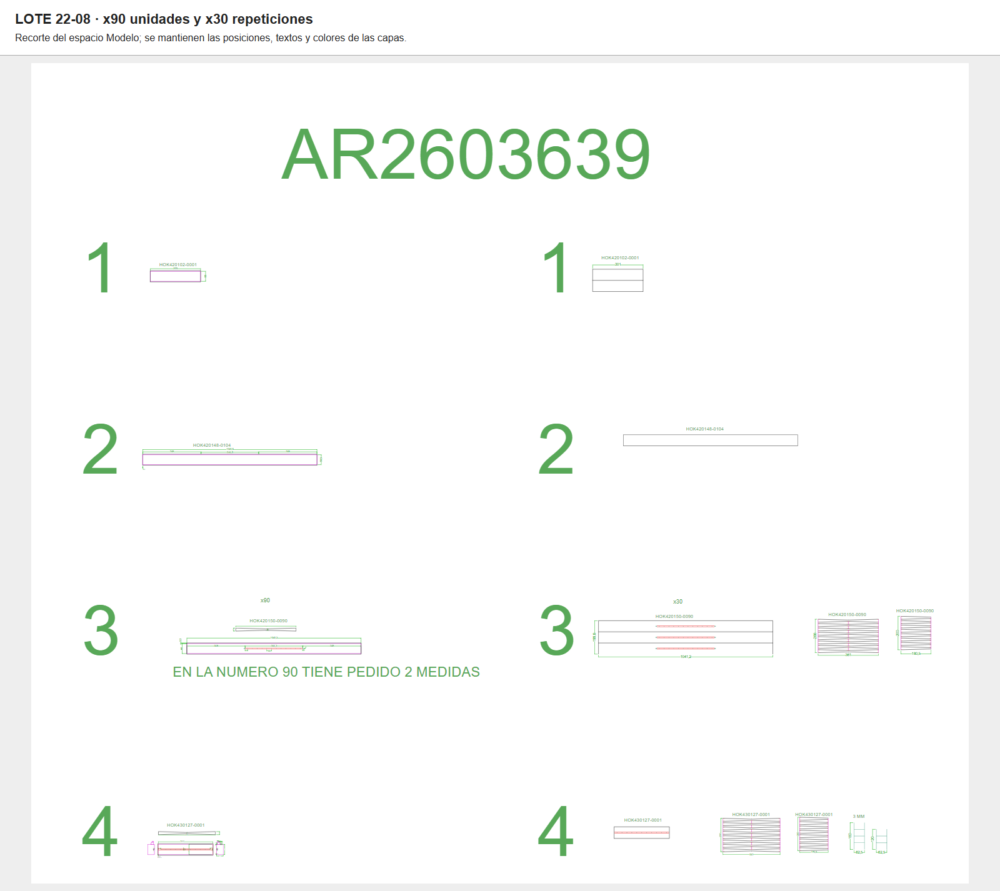

El 24/10 contiene **«hay en stock 2»**, **«hay en stock 1»**, **«se corta en palet 3»** y **«hok430172-0031 palet 2»**. El 31/10 contiene «1 ud en stock». Se prueba así que la preparación puede descontar material ya disponible y mover piezas entre conjuntos. No se deduce de esas notas su fecha de fabricación ni una contabilidad completa del stock.

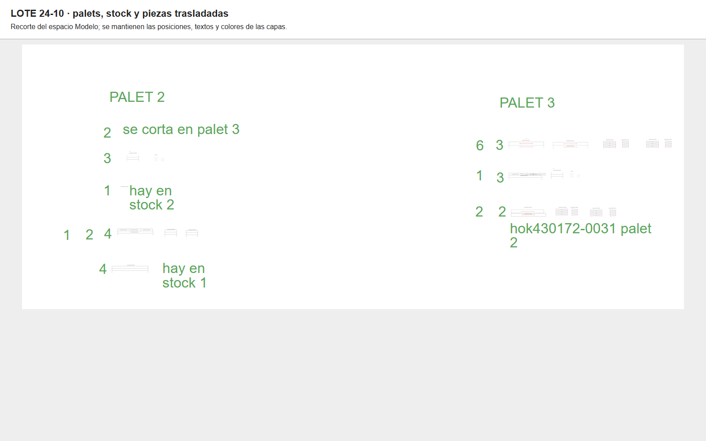

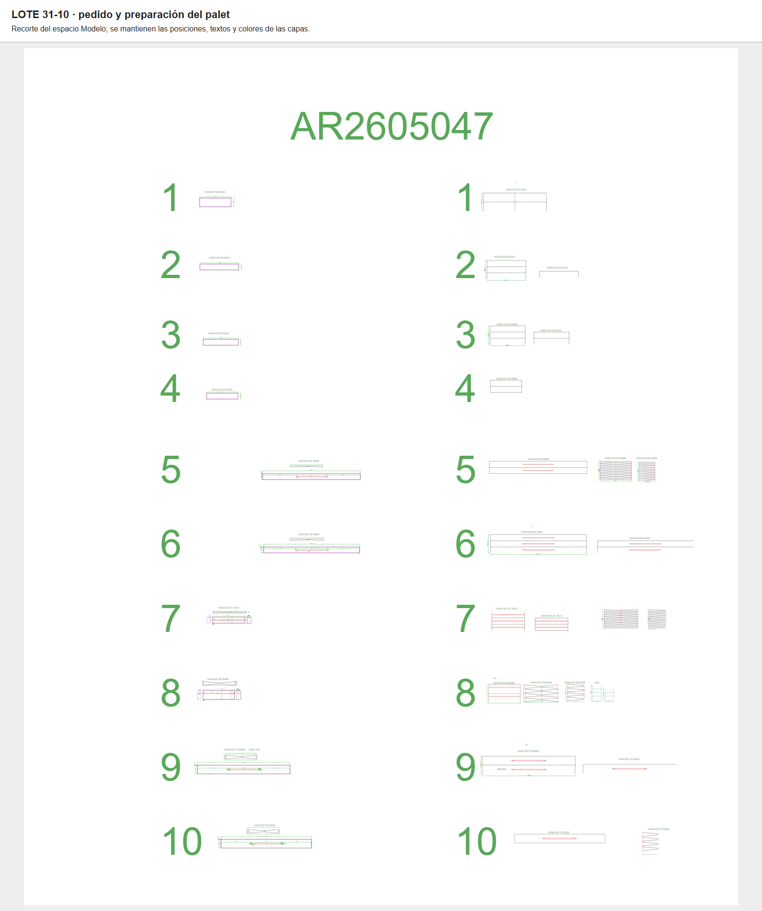

Q-AS03 queda resuelta en lo que muestra el dibujo: hay cantidades totales, conjuntos repetidos, sobrantes y uso de stock. **Contestada por Iván (26/10/2026):** el «x30» es una indicación para el corte: ese corte se hace 30 veces. Es lo que el cortador lee para saber qué cortar, no un dato que se meta en el programa. El stock lo ponen en corte y queda registrado en el material gastado del pedido. Q-AS04 también se acota: el DWG sí conserva pedidos y reparto por palets, pero los números grandes no se han traducido automáticamente a líneas de RPS ni a OF. En las tablas previas las líneas siguen siendo candidatas; los pedidos del lote reciente ya cuentan además con prueba escrita en el DWG.

### Consecuencias para la automatización y nuevas dudas

La agrupación debe admitir una cadencia semanal con excepciones, varias entregas, revisiones y descuentos de stock. Debe conservar el pedido y la línea/OF aunque una misma referencia se corte agrupada para varios pedidos, y separar el dibujo de confección del juego de corte repetido y del palet de destino. El plano normal debe reproducir la preparación de Modelo; copiar sin más su presentación A4 guardada produciría una plantilla sin las piezas.

| Código | Estado tras leer los lotes |
| --- | --- |
| Q-AS03 | El DWG distingue unidades y repeticiones (x90 frente a x30) y anota stock disponible. **Contestada (Iván, 26/10/2026):** «x30» indica al corte que ese corte se hace 30 veces; es una indicación para el cortador. El stock lo ponen en corte y queda registrado en el material gastado del pedido. |
| Q-AS04 | Resuelto: hay pedidos AR y reparto por palets en Modelo. Falta validar el significado exacto de los números grandes junto a las piezas y cómo se conserva el vínculo con cada línea/OF cuando se juntan códigos iguales; no hemos convertido cercanía gráfica en una asignación automática. |
| Q-AS04b | ¿Qué son los números grandes junto a las piezas del DWG? | Comprobado en RPS (26/10/2026): son el **número de línea del pedido**. En AR2605047 (LOTE 31-10) los números 1 a 10 son las líneas 1 a 10, con las mismas referencias y en el mismo orden; en AR2603639 (LOTE 22-08), igual con sus 4 líneas (`tmp/assa-estudio/lineas-5047.mjs`). | Cada pieza del lote lleva su número de línea; con el pedido y la línea se saca de RPS la OF y la cantidad. |
| Q-AS07 | Resuelto: se ha localizado el plano de preparación; las presentaciones guardadas normales no muestran las piezas. ¿Se imprime una ventana de Modelo, cada pedido o cada palet, y con qué escala/formato? En AR2603328 sí hay dos presentaciones completas. |
| Q-AS08 | Hay entregas distintas dentro de los pedidos escritos, un nombre LOTE 06-067-03 y diferencias de contenido entre DWG/DXF de igual nombre. ¿Cuáles son restos de plantilla, adelantos, retrasos o revisiones y cuál es la versión válida? |
| Q-AS09 | Las presentaciones -10/-11 asocian las dos referencias D00 a las OF opuestas a RPS. **Contestada (Iván, 26/10/2026):** el error está en el cajetín; RPS manda. |

### Repetición de esta segunda parte

```powershell
node tmp/assa-estudio/lotes-recoger.mjs
node --test tmp/assa-estudio/lotes.test.mjs
node tmp/assa-estudio/lotes-analizar.mjs
node tmp/assa-estudio/lotes-capturas.mjs
node tmp/assa-estudio/informe.mjs
node tmp/assa-estudio/informe.mjs --comprobar
node --env-file="C:/Users/ivan.sanchez/Documents/Proyectos DEV/toldos-testar/.env" tmp/assa-estudio/verificar.mjs --red --rps
```

Los originales, los DXF convertidos y la extracción detallada se quedan en tmp. El documento incorpora solo capturas y una ampliación compacta de [evidencias.json](assa-combursa/evidencias.json), con inventario, resúmenes por dibujo, entregas y diferencias. La verificación compara las huellas SHA-256 de las copias y sus conversiones, los cruces de RPS, todos los ficheros nuevos y las capturas. Solo se preparan para Git los scripts, este documento, las imágenes y el JSON compacto.

## Previsión semanal de Producción (añadido por Claude, 25/10/2026)

Producción (Miguel Tato) manda a Oficina Técnica, con copia a Producción, un correo «PREVISION ASSA ABLOY dd/mm» por cada sábado de entrega. La tabla va escrita en el cuerpo, sin adjunto, con las columnas Línea, Referencia, Artículo, Peso, Cantidad, Pedido, OF, Comentario y PALET, y debajo el total de unidades. Las correcciones llegan como respuesta al mismo correo, en gallego, con la tabla completa otra vez: «Añádense 4 lonas no palet 2», «Añádese o pedido 26.04960 ao palet 2», «Métese o pedido 26.04949 e crease un novo palet».

Iván guardó en PDF las previsiones del 10/10, 17/10, 24/10 y 31/10. Se compararon con RPS (`tmp/assa-estudio/previsiones-rps.mjs` y `previsiones-fecha.mjs`, solo lectura):

- **Todo menos el palet sale de RPS.** Línea = `NumLine`, Referencia = artículo, Cantidad = `Quantity`, OF = la de la línea y Comentario = el comentario de la línea (ROBA…, el pedido de ASSA, que también está en la cabecera como «SU PEDIDO: ROBA…»). Peso no se ha comprobado.
- **El lote es «fecha pedida de la línea = ese sábado».** Las líneas de ASSA con `ReceptionDemandDate` igual al sábado dan las mismas líneas y el mismo total de unidades que el pie del correo: 178 (10/10), 187 (17/10), 117 (24/10) y 197 (31/10). La previsión del 07/11 ya se puede sacar de RPS: 4 pedidos y 312 unidades.
- **El palet lo decide Producción.** No está en RPS. En `LOTE 31-10.dwg`, guardado el 20/10, un día después del correo, están los mismos 6 pedidos, las mismas referencias y PALET 1, 2 y 3. Las notas de stock («1 ud en stock») están en el DWG; el stock lo ponen en corte y queda en el material gastado del pedido (Q-AS03).
- **Las correcciones explican las revisiones del DWG.** Por ejemplo, la del 17/10 llegó el 07/10 a las 13:09 y `LOTE 17-10.dwg` se guardó el 08/10, después de su `.bak`.

Consecuencia: la web puede montar el lote desde RPS sin depender del correo. El único dato que tendría que pedir o recibir de Producción es el palet de cada línea (Q-AS10).

## Catálogo de modelos de la carpeta del cliente (añadido por Claude, 26/10/2026)

Un compañero de Iván enseñó que en `DIBUJOS\CLIENTE DETERMINADOS\COMBURSA` están todos los modelos que se hacen, y que este año han quitado la H de las referencias. Inventario solo en lectura (`tmp/assa-estudio/catalogo.mjs`, que cruza la carpeta con las líneas de RPS desde 2023):

- **La H.** No se han renombrado las referencias: las de siempre siguen con H en RPS (`H0K…`, 727 líneas pedidas para 2026) y las **altas nuevas desde enero de 2026 van sin H** (`0K…`: 21 referencias y 35 líneas, la primera `0K420148-0120` para el 31/01/2026). Los planos PDF de ASSA de `PLANOS` ya vienen sin H (`0K410129_01_01_A3.pdf`). Para la web, la familia es el número de seis cifras (`410129`) y se aceptan las dos formas: `H0K410129-0211` y `0K410129-0211`. En los nombres de fichero también aparece `HOK`/`OK` con la letra O.
- **La carpeta.** 58 DWG y 125 PDF con familia reconocible: 45 familias con DWG propio y 69 con plano PDF de ASSA. Hay además dibujos sin familia en el nombre (la máquina Crawford, cálculos, pedidos AR viejos, `D00…`, `H7A…`).
- **Lo que se pide.** 35 familias con pedidos en 2025 o 2026. **Las de más volumen** (los abrigos 420150, 420102, 420148, 430127, 430125 y 430129) **tienen el plano de ASSA en PDF, pero no un DWG nuestro en esta carpeta**: su dibujo de corte está en los lotes (`Oficina Tecnica\<año>\COMBURSA`), como ya recoge este estudio. Las familias 41xxxx (cortinas, laterales, techos) sí tienen su DWG aquí.

Familias pedidas en 2025-2026, de más a menos unidades:

| Familia | Qué es (RPS) | Referencias (sin H) | Uds 2025 | Uds 2026 | Última entrega | DWG en la carpeta | Plano PDF de ASSA |
| --- | --- | --- | --- | --- | --- | --- | --- |
| 420150 | ABDECKPLANE MIT REGENRINNE NT=600 NB=3450 NH=3200 | 25 (4) | 4389 | 2917 | 2026-11-07 | — | OK420150.pdf |
| 420102 | ABDECKPLANE SEITENTEIL NH=3200-200 NT=600 SCHWARZ | 31 | 2040 | 2074 | 2026-11-07 | — | OK420102.pdf |
| 430172 | ABDECKPLANE MIT REGENRINNE NT=900 NB=3250 NH=3200  | 15 | 946 | 1096 | 2026-11-07 | HOK430172.dwg | OK430172.pdf |
| 420148 | ABDECKPLANE NB=3250-8 NH=3200 NT=900-5 | 26 (5) | 880 | 531 | 2026-11-07 | — | OK420148.pdf |
| 430127 | DACHPLANE MIT REGENRINNE NT600 NB=2800 SCHWARTZ | 19 (1) | 494 | 520 | 2026-11-07 | — | H0K430127.pdf |
| 430125 | DACHPLANE NB=3450+3 NT=900+25 SCHWARZ | 14 | 381 | 428 | 2026-11-07 | — | OK430125.pdf |
| 430129 | DACHPL.REGENR.KOMPL.NT=900 NB=3250 SCHWARZ | 6 | 132 | 114 | 2026-11-07 | — | OK430129.pdf |
| 410130 | PLANE SC SEITLICH WB300xWT250xH2500 PARKING GUIDE WHITE/STAN | 19 (2) | 58 | 98 | 2026-11-07 | OK410130.dwg | OK410130.pdf |
| 410179 | PLANE 2MM WB=300 WT=300 H=2900, SCHWARZPVC, WHITE PKG IN CON | 2 | 120 | 0 | 2025-11-29 | OK410179.dwg | OK410179.pdf |
| 410143 | PLANE PWP OBEN TWB400xTWT300xB3100 OP=700 | 6 | 77 | 37 | 2026-06-13 | HOK410143.dwg | 0K410143_01.pdf, 410143-410170-410171.pdf, OK410143-OK410170-OK410171.pdf |
| 410129 | PLANE TWP OBEN 300X300X2600 | 24 (3) | 50 | 50 | 2026-11-07 | OK410129.dwg | 0K410129_01_01_A3.pdf, OK410129.pdf |
| 410241 | SIDE LEFT SNH2400_SWBO400_SWBU300_SWTO400_SWTU250_WTM310_WTM | 5 | 52 | 28 | 2026-09-26 | HOK410241-0014.dwg, HOK410241-0015.dwg, HOK410241.dwg | 0K410241.pdf, H0K410241-0003.pdf |
| 410242 | SIDE RIGHT DH2000_SWBO400_SWBU300_SWTO400_SWTU250_WTM310_WTM | 5 | 52 | 28 | 2026-09-26 | HOK410242-0004.dwg, HOK410242-0007.dwg, HOK410242-0015.dwg | 0K410242.pdf |
| 410182 | PLANE OBEN 2MM SC WB=300 WT=300 B=3100 SCHWARZ | 4 (1) | 46 | 27 | 2026-08-15 | OK410182.dwg | OK410182.pdf, OK410182.pdf |
| 410245 | BOTTOM PVC 0,5mm GLOSSY BLACK B1980-WBxWT/250x250 | 3 | 60 | 11 | 2026-06-20 | HOK410245-0001.dwg, HOK410245-0005.dwg, HOK410245.dwg | 0K410245.pdf, 0K410245.pdf, H0K410245-0007.pdf, 0K410245.pdf, 0K410245.pdf |
| 410124 | TOP PVC 0,5MM GLOSSY BLK TNB2080XTWB300XTWT400_W/O OP_480X20 | 1 | 44 | 17 | 2026-09-26 | HOK410124.dwg | 0K410124-0004 (4).pdf |
| 410134 | PLANE SC STANDARD 300X300X2500 OP=600 PVC SCHWARZ, REINFORCE | 1 | 15 | 45 | 2026-04-11 | OK410134.dwg | 0K410134_01 (2).pdf, 0K410134_01 (4).pdf |
| 410174 | PLANE SEITE MIT SCHUPPEN WB300xWT400xH3000 WHITE | 5 | 51 | 0 | 2025-12-06 | OK410174.dwg, OK410174_.dwg | 0K410174_01_01_A3.pdf, OK410174-2.pdf, OK410174.pdf |
| 410172 | PLANE LEFT Schuppen/reinf.WB400XWT300X2600 Parking guide thr | 3 (1) | 37 | 3 | 2026-06-13 | OK410172.dwg | 0K410172_01_02_A3.pdf, 0K410172_01_02_A3.pdf, OK410172-L.pdf, OK410172-R.pdf, OK410172.pdf |
| 410173 | PLANE RIGHT SCHUPPEN/REINF.WB300xWT300x3000 PARKING GUIDE 75 | 3 (1) | 37 | 3 | 2026-06-13 | OK410173.dwg | 0K410173_01_02_A3 (1).pdf, OK410173.pdf |
| 410237 | WEAR SHIELD LEFT & RIGHT_WITH VELCRO TAPE | 1 | 40 | 0 | 2025-07-05 | HOK410237.dwg | H0K410237.pdf |
| 410122 | TOP PVC 0,5mm GLOSSY BLACK TNB1980xTWB300xTWT400_OP=200_WITH | 3 | 38 | 0 | 2025-08-09 | HOK410122.dwg | 0K410122.pdf, 0K410122.pdf, 0K410122.pdf |
| 410170 | PLANE RIGHT SCHUPPEN/REINFORCED 2MM H=2600 SWB FRONT=400 SWB | 3 | 6 | 26 | 2026-08-15 | 410170-2.dwg, 410170.dwg, OK410170.dwg | Drawings 66090196 (1).pdf, Drawings 66090200-L (1).pdf, Drawings 66090200-R (1).pdf, Drawings curtains (3).pdf, 0K410170.pdf |
| 410171 | PLANE LEFT SCHUPOEN/REINFORCED 2MM H=2600 SWB FRONT=400 SWB  | 3 | 6 | 26 | 2026-07-25 | OK410171.dwg | 0K410171.pdf |
| 410251 | LEFT PVC glossy black_WS 1200X200_SNH2100_SWBO400_SWBU300_SW | 2 | 20 | 0 | 2025-07-05 | HOK410251.dwg | 0K410251.pdf, 0K410251.pdf, 0K410251.pdf |
| 410252 | RIGHT PVC_WS_ 1000x200_SNH2000_SWBO400_SWBU300_SWTO400_SWTU2 | 3 | 20 | 0 | 2025-07-05 | HOK410252-0004.dwg, HOK410252.dwg | 0K410252.pdf, 0K410252.pdf, H0K410252-S0001.pdf, 0K410252.pdf |
| 410149 | PLANE TWP OBEN TRWB500XTFWB400XTWT300XB3400 | 3 | 16 | 0 | 2025-10-11 | HOK410149.dwg | 0K410149-0001.pdf, 0K410149-0002.pdf |
| 410123 | TOP PVC 0,5mm GLOSSY BLK TNB2080XTWB300XTWT400_W/O OP_480X20 | 2 | 8 | 7 | 2026-06-20 | HOK410123-S0001.dwg, HOK410123.dwg | 0K410123.pdf, 0K410123.pdf, H0K410123-S001.pdf, 0K410123.pdf, HOK410123-S.pdf, HOK410123-S(GUARDADO).pdf |
| 410300 | SPECIAL PVC 2MM BLACK, 500x490 - 200/170MM WELDED | 3 | 8 | 0 | 2025-03-15 | OK410300 C.dwg, OK410300.dwg | 0K410300-0001_PVC curtain for Special corner seal (3).pdf, 0K410300-0002.pdf, 410300-0005.pdf, 410300-0006.pdf |
| 410135 | PLANE TWP OBEN WB300XWT300X3200 OP=600 SCHWARZ SCHWARZ | 3 | 5 | 0 | 2025-11-29 | OK410135.dwg | 0K410135_01_01_A3.pdf, OK410135.pdf |
| 410121 | TOP PVC 0,5MM GLOSSY BLK. TNB2080xTWB450xTWT400_WITHOUT OP_W | 3 | 0 | 4 | 2026-02-28 | HOK410121.dwg | 0K410121.pdf |
| 410155 | TOP PVC 2MM W.WP ON EDGSE TRWB500 TFWB400 B3100 BLACK | 1 (1) | 0 | 4 | 2026-10-10 | 0K410155.dwg | 0K410155-0001.pdf, 0K410155-0002.pdf |
| 410185 | PLANE TWP OBEN TRWB500XTFWB400XTWT300XB3400 | 1 (1) | 0 | 4 | 2026-06-27 | 0K410185.dwg | — |
| 430222 | TOP CURTAIN LOGO: NASSAU; L=NB=2600; OP=1000; SP=600 BLACK | 1 | 2 | 0 | 2025-08-09 | HOK430222.dwg | 0K430222_01_01_A1.pdf |
| 430134 | Top curtain DS6060A ASSAABLOY NW3500 A=3418 OP1000 SP600 | 1 (1) | 0 | 1 | 2026-02-21 | HOK430134.dwg | 0K430134_01_03_A2.pdf |

Sin DWG propio en la carpeta: 420150, 420102, 420148, 430127, 430125, 430129.

**Los DWG con muchos modelos dentro** (Iván, 26/10/2026: «fíjate en los DWG como COMBURSA (CRAWFORD), tienen un montón de modelos dentro»; `tmp/assa-estudio/modelos-dwg.mjs` y `cobertura.mjs`). `COMBURSA (CRAWFORD).dwg` (guardado el 06/10/2026, 31.262 textos) tiene **244 variantes de 16 familias**, con los abrigos de más volumen: 420150 (57), 420102 (48), 420148 (33), 430127 (33), 430125 (26), 430129 (19). `COMBURSA (CRAWFORD)2.dwg` tiene otras 167 de 13 familias. Los DWG HOK41xxxx traen también las piezas de sus familias hermanas (laterales, techo, fondo). En total, **65 familias y 444 variantes**. **De las 249 referencias pedidas desde 2023 en familias activas, 241 están dibujadas en algún DWG de esta carpeta (97 %).** Faltan: H0K410122-0006, H0K410129-0105, H0K410129-0115, 0K410185-0001, H0K410300-0001, H0K420102-0049, H0K420102-0059 y 0K420148-0115.

**Para ir guardando los modelos en la web**, la propuesta es una ficha por familia con: el plano de ASSA (PDF), nuestro DWG de despiece (de esta carpeta o, para los abrigos, el de un lote reciente), las medidas que cambian entre referencias (sacadas de la descripción de RPS: NB, NH, NT, WB, WT…) y lo que queda fijo (canalón, refuerzos, agujeros: Q-AS02, contestada: lo dice el pedido según el ancho de la pieza). Empezar por las de más volumen.

## Modelos extraídos de la carpeta del cliente

Extracción del 26/10/2026 de **441 variantes de 47 familias**, en los dos COMBURSA (CRAWFORD) y los HOK41xxxx/OK41xxxx: **52 DXF locales**. Cada variante tiene su ficha en `tmp/assa-estudio/modelos/<familia>/<familia>-<variante>.json`. **397 fichas tienen algún contorno cerrado vinculado; 44 quedan sin un contorno cerrado atribuible con este método.** No son 441 modelos aprobados para cortar. Se conserva cada aparición y cada fuente: las vistas alternativas no se suman como si fueran un juego de piezas.

Se empezó por 420150, 420102, 420148, 430127, 430125 y 430129. Las coordenadas de oficina se conservan en metros y las medidas se dan en milímetros, como se ha contrastado con las cotas y el lote de agosto; el valor INSUNITS del DXF declara mm y no sirve para convertir estos dibujos. Las cotas escritas se guardan por separado: algunas tienen una escala o un texto que no corresponde a la geometría.

El índice completo está en [modelos-indice.json](../../tmp/assa-estudio/modelos-indice.json). Se guardan la caja, los contornos y segmentos originales con sus curvas y capas, las marcas interiores sin asignarles una función inventada, los textos, las cotas, los trazos abiertos y el identificador de cada rótulo. El vínculo se busca dentro del contorno o bajo un título alineado sin otro código interpuesto; los paños con un borde compartido pueden llevar el mismo título. Si compiten códigos o hay trazos sin cerrar, se señala la duda. **Un contorno cerrado pequeño de CUTTER también puede ser una ranura: no se certifica como pieza suelta por su caja.** La clasificación de marcas y accesorios debe contrastarse con el pedido.

### Cuántas variantes hay por familia y qué se ha podido contrastar

«Con coincidencia cerrada» cuenta variantes con al menos un rótulo cuyo número, tamaño y forma de contornos cerrados coinciden con una vista sin dudas. Mantiene la orientación: no permite girar las piezas. **No equivale a validar todos los lotes de esa referencia ni el juego completo de accesorios.**

| Familia | Fichas | Con contorno | En lotes | Con coincidencia cerrada |
| --- | ---: | ---: | ---: | ---: |
| 400118 | 1 | 1 | 0 | 0 |
| 410121 | 3 | 3 | 0 | 0 |
| 410122 | 3 | 0 | 1 | 0 |
| 410123 | 3 | 2 | 1 | 0 |
| 410124 | 2 | 1 | 2 | 0 |
| 410125 | 1 | 0 | 0 | 0 |
| 410129 | 33 | 31 | 12 | 0 |
| 410130 | 32 | 31 | 6 | 0 |
| 410134 | 2 | 2 | 1 | 0 |
| 410135 | 8 | 8 | 2 | 0 |
| 410137 | 11 | 11 | 0 | 0 |
| 410143 | 6 | 6 | 4 | 0 |
| 410149 | 3 | 3 | 3 | 0 |
| 410150 | 1 | 1 | 0 | 0 |
| 410155 | 2 | 2 | 1 | 0 |
| 410170 | 3 | 3 | 2 | 0 |
| 410171 | 3 | 3 | 2 | 0 |
| 410172 | 6 | 2 | 2 | 0 |
| 410173 | 7 | 5 | 3 | 0 |
| 410174 | 15 | 15 | 3 | 0 |
| 410179 | 6 | 6 | 2 | 0 |
| 410182 | 9 | 9 | 2 | 0 |
| 410186 | 1 | 1 | 0 | 0 |
| 410187 | 1 | 1 | 0 | 0 |
| 410196 | 2 | 2 | 0 | 0 |
| 410197 | 1 | 0 | 0 | 0 |
| 410200 | 2 | 2 | 0 | 0 |
| 410213 | 2 | 2 | 0 | 0 |
| 410241 | 7 | 0 | 2 | 0 |
| 410242 | 6 | 0 | 2 | 0 |
| 410245 | 4 | 4 | 2 | 0 |
| 410251 | 2 | 0 | 1 | 0 |
| 410252 | 4 | 1 | 1 | 0 |
| 410300 | 5 | 0 | 2 | 0 |
| 420102 | 48 | 48 | 25 | 13 |
| 420103 | 2 | 2 | 0 | 0 |
| 420127 | 3 | 0 | 0 | 0 |
| 420148 | 33 | 33 | 18 | 12 |
| 420150 | 57 | 56 | 22 | 0 |
| 420152 | 1 | 1 | 0 | 0 |
| 420176 | 1 | 1 | 0 | 0 |
| 430125 | 26 | 26 | 13 | 6 |
| 430127 | 33 | 33 | 11 | 0 |
| 430129 | 19 | 19 | 6 | 0 |
| 430172 | 19 | 19 | 14 | 0 |
| 430173 | 1 | 1 | 0 | 0 |
| 430251 | 1 | 0 | 0 | 0 |

### Comparación con el corte de 2025 y 2026

Se leyeron **113 lotes**, con **4963 rótulos de 168 variantes** del catálogo extraído. **31 variantes tienen alguna coincidencia de contornos cerrados**. El detalle completo, con todas las vistas alternativas y las diferencias, está en [modelos-cotejo.csv](../../tmp/assa-estudio/modelos-cotejo.csv) y [modelos-cotejo.json](../../tmp/assa-estudio/modelos-cotejo.json). Cada fila identifica año, lote, código, rótulo, fuente y vista, con medidas y número de contornos que faltan o sobran. No se escoge una única vista favorable para ocultar las otras.

| Resultado por rótulo | Cantidad | Qué significa |
| --- | ---: | --- |
| Coinciden los contornos cerrados comparados | 103 | Coinciden cantidad, tamaño y forma en alguna vista; no hay un vínculo dudoso ni trazos sueltos en esa zona. |
| Coincidencia parcial | 382 | Coinciden los contornos cerrados de alguna vista, pero quedan bordes abiertos o dudas de asignación. |
| Diferencias | 3012 | Se han podido medir contornos en ambas fuentes, pero no coinciden todos: pueden cambiar las medidas, las repeticiones o el reparto entre cuerpo, canalón y detalles. |
| Sin comparación segura | 1466 | No hay contornos vinculados en alguna de las dos fuentes. No se declara coincidencia. |

**No se da por comprobado ningún juego completo con todos sus accesorios y operaciones.** El corte agrupa repeticiones y puede dejar el orillo abierto, mientras el maestro guarda varias versiones y dibujos de confección. Los totales del cuadro son de contornos dibujados por rótulo, no unidades fabricadas: los multiplicadores solo se usan cuando hay una evidencia independiente, como el caso de agosto siguiente. Los contornos de marcas o ranuras pendientes de clasificar quedan como diferencias o dudas, sin convertirlos en una regla de piezas.

**Caso comprobado: 420150-0090, lote 22-08 de 2026.** La vista `2CA2B` de COMBURSA (CRAWFORD) tiene tres paños de **10.412 × 666 mm**, con dos contornos cerrados y el tercero abierto al orillo; se conservan sus dos tramos laterales abiertos. El corte real reproduce esos dos contornos cerrados y tres líneas horizontales separadas 666 mm. El rótulo x30 y el pedido AR.26.03639 / OF 0230759 respaldan **3 × 30 = 90 unidades**. La prueba automática comprueba esta geometría contra el DXF local del lote; no dibuja un borde ficticio para cerrar el tercero. El cotejo general sigue mostrando diferencias en otras vistas y en el reparto de accesorios.

### Qué sigue dudoso

Las dudas quedan identificadas por código, fichero y rótulo en [modelos-dudas.csv](../../tmp/assa-estudio/modelos-dudas.csv), además de la propia ficha JSON. Hay **157 variantes con diferencias entre fuentes** al comparar todas sus vistas o cotas; una vista adicional también cuenta como diferencia, y no implica por sí sola que hayan cambiado las medidas.

- **44 variantes sin contorno cerrado vinculado.** Hay referencias que solo aparecen en bloques o papel, dibujos con bordes abiertos y títulos cuyo despiece no se puede atribuir con seguridad. Están guardadas como fichas dudosas, sin inventar piezas. Solo 143 variantes tienen alguna vista sin dudas geométricas con este método.
- **Un mismo código puede señalar tamaños distintos.** 420150-0090 aparece con un cuerpo de 10.412 mm y también con otro de 9.810 mm y un canalón distinto. La segunda vista incluso conserva una cota escrita de 965 cm. Se mantienen ambas y manda el pedido del cliente.
- **Bordes abiertos y detalles interiores.** No se cierran por programa. Las marcas conservan su capa, pero no se les asigna automáticamente «soldadura», «canalón», «refuerzo» o «agujero» sin el pedido. En piezas inclinadas o curvas, la caja es solo una medida exterior; el contorno se conserva.
- **Entidades que el lector actual no interpreta.** 12 ficheros contienen tipos de geometría de corte pendientes de interpretar. Sus tipos, capas e identificadores quedan en el índice y las fichas afectadas llevan aviso. Falta incorporarlos al lector antes de considerar completo ese despiece.
- **Alcance del encargo.** Las otras tres variantes del inventario de 444 están en DWG HOK43xxxx propios, fuera de los ficheros pedidos aquí: 430134-0012, 430222-0060 y 430251-0001. El lote 21-02_1 de 2026 contiene 430134-0012 y queda anotado como «sin modelo», sin perder esa diferencia.

### Ejemplos del dibujo original

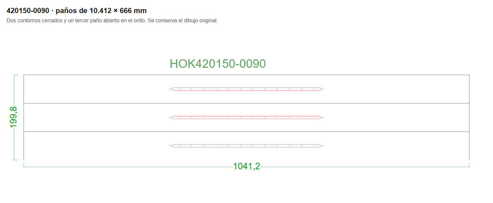

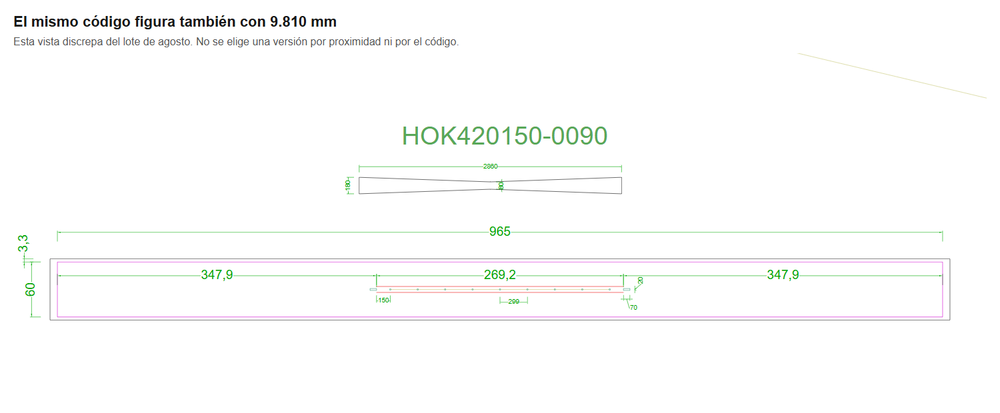

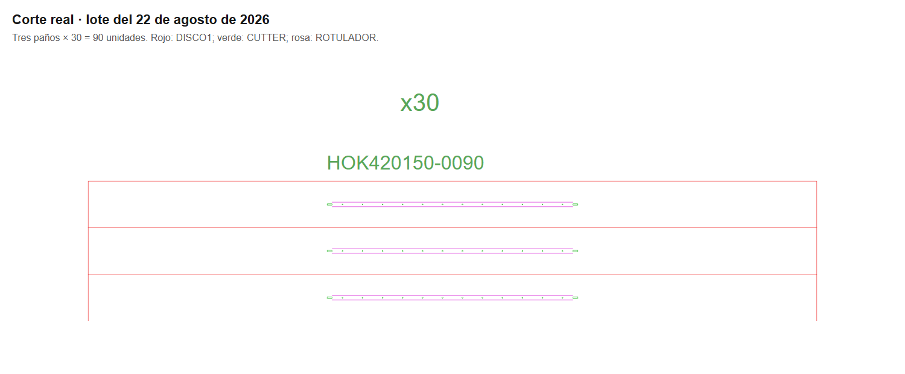

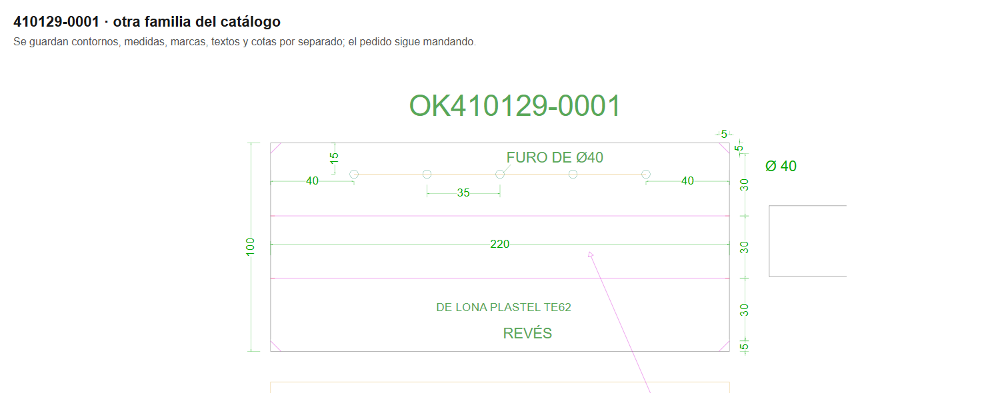

### Cómo repetir esta extracción

Con los DXF ya convertidos en `tmp/assa-estudio/cliente/out/` y las copias de corte en `tmp/assa-estudio/cortes/2025/` y `2026/`, desde la raíz del worktree:

```powershell
node tmp/assa-estudio/modelos-extraer.mjs
node tmp/assa-estudio/modelos-cotejar.mjs
node --test tmp/assa-estudio/modelos.test.mjs
node tmp/assa-estudio/modelos-capturas.mjs
node tmp/assa-estudio/modelos-informe.mjs --actualizar
```

La prueba cubre códigos con O/cero, lados compartidos, bordes abiertos, curvas, ambigüedad entre códigos, cantidades, cambios de unidades, prohibición de giro, perforaciones interiores y el caso real de agosto. Las capturas se generan y revisan en tmp antes de copiarlas a `docs/modelos/assa-combursa/`; no se arranca la web ni se lee el .env, ni se escribe en la red. Los scripts no modifican `src/`. Al ejecutar de nuevo el generador anterior `informe.mjs`, hay que volver a insertar esta sección con `modelos-informe.mjs --actualizar`.

## 6. Propuesta de automatización por fases

**Preparación: catálogo aprobado y comparación sin fabricar.** Guardar una versión revisada del juego de piezas de cada referencia frecuente, con el pedido y las medidas que la respaldan. Separar terminado y corte, material, sentido de la lona, herramientas y cantidad de cada accesorio. Comparar el resultado con lotes reales antes de habilitar envíos. Bloquear las discrepancias de la tabla, las descripciones incompletas y las referencias con más de una medida.

**Primera fase: leer RPS y preparar el lote de referencias conocidas.** La web leería pedidos y líneas, distinguiría palets y notas, comprobaría la OF cuando exista y propondría lotes semanales por pedidos y material, admitiendo entregas mezcladas y stock descontado. Tomaría el juego de piezas aprobado, calcularía conjuntos repetidos y sobrantes y mostraría la cuenta de cuerpos, canalones y refuerzos. Entregaría un DXF para el bot, una vista del corte y una lista que conserve pedido, línea, OF, código, versión y cantidades. La publicación en la bandeja del bot quedaría para después de la revisión humana, con registro del envío para evitar duplicados.

**Segunda fase: medidas variables de laterales y envolventes sin canalón.** Parametrizar primero 420102 y 420148, con los márgenes comprobados, la confección y el material aprobados. Permitir una nueva medida solo dentro del alcance revisado; no convertir una descripción recortada ni un NK/NW dudoso. Generar la hoja del lote con los pedidos, confección, stock y palets conservados en Modelo, confirmando la ventana que se imprime y el reparto de OF.

**Tercera fase: canalones y techos completos.** Incorporar 420150, 430172, 430125, 430127 y 430129 cuando estén resueltas las pendientes, solapas, piezas en T, refuerzos, agujeros y marcas de cada versión. El cálculo debe controlar todos los componentes, el ancho de rollo y la repetición. Las primeras familias de volumen servirán para priorizar qué referencias revisar antes.

**Después: cortinas, materiales especiales y variantes fuera de catálogo.** Las 410129 y 410130 necesitan su despiece y sus parámetros propios; las D00, H7A y demás piezas conservan su vía específica hasta estudiar su plano. Una referencia nueva no debe heredar una regla solo porque se parezca el nombre.

El plano no se debe decidir con un “sí” o “no” genérico. La propuesta es mostrar siempre una vista y conservar una lista de reparto del lote; el formato que se imprime debe copiar la información que el taller necesita realmente. No se ha demostrado que haga falta un plano nuevo por cada línea corriente.

Riesgos que condicionan estas fases:

- Confundir terminado con corte, o descontar dos veces una medida escrita con un signo menos.
- Elegir una sola plantilla para un código que ha tenido distintas medidas o revisiones.
- Obtener un cuerpo correcto y equivocarse en el canalón, las perforaciones o sus cantidades.
- Tomar el multiplicador del dibujo («x30») como una orden de la máquina: es una indicación para el cortador (Q-AS03).
- Perder el reparto de OF al mezclar pedidos y cortar de más al reenviar un lote.
- Usar el material o el ancho de rollo de una versión distinta; girar, cerrar bordes o introducir empates sin autorización del taller.

## 7. Dudas necesarias para Iván o Tamara

Lista actualizada el 26/10/2026, con las respuestas del taller del mismo día. Son decisiones que cambian el corte o el trabajo del taller. Lo comprobable por archivos se ha descrito arriba; estas preguntas no piden a Tamara repetir el estudio.

### Abiertas

| Código | Qué hay que cerrar | Pregunta | Qué debe hacer la futura web mientras tanto |
| --- | --- | --- | --- |
| Q-AS05 | Versiones de cortinas y material | Taller, 26/10/2026: «ni idea». Hay que preguntarlo a otra persona (¿Producción o el comercial de ASSA?). Las cortinas combinan lona de distinta clase, tapas y guías blancas o amarillas. ¿Qué plano y material corresponden a cada versión actual y qué datos deben venir en el pedido? ¿Son válidos los anchos de rollo del maestro de materiales de RPS? | Excluir las cortinas de la generación por fórmula hasta validar su despiece completo. |

### Contestadas

| Código | Pregunta | Respuesta | En la web |
| --- | --- | --- | --- |
| Q-AS01 | Cuando no coinciden el código, el pedido y el plano, ¿qué medida manda? | Taller, 26/10/2026: hay que mirar las medidas que trae el pedido del cliente. | Manda la medida del pedido del cliente; el código y los planos antiguos no se usan como fuente de medidas. |
| Q-AS02 | Canalones, refuerzos y agujeros al cambiar medidas. | Taller, 26/10/2026: también se indica en el pedido del cliente, según el ancho de la pieza. | Canalones y refuerzos se toman del pedido del cliente, según el ancho de la pieza; no se estira el dibujo entero. |
| Q-AS03 | Repetición en máquina y uso del stock: ¿dónde se mete el «x30» y cómo se apunta el stock? | Iván, 26/10/2026: el «x30» es una indicación para el corte, que ese corte se hace 30 veces; no se mete en el programa de la máquina. El stock lo ponen en corte y queda registrado en el material gastado del pedido. | El plano y el DXF rotulan «x30» junto a la pieza, dibujada una vez. La web no lleva la cuenta del stock. |
| Q-AS04 | ¿Qué significan los números del lote? | Taller, 26/10/2026: son el día y el mes; «LOTE 31-08» es el lote del 31 de agosto. | El nombre del lote se forma con la fecha de entrega (día-mes). Los números junto a las piezas son la línea del pedido (Q-AS04b). |
| Q-AS06 | ¿Se puede girar una pieza o empatar? | Taller, 26/10/2026: no se empatan nunca y no se admite girar las piezas. | El colocador no gira ni empata piezas de ASSA. Si una pieza no cabe entera en el rollo, aviso. |
| Q-AS06b | Cuando un corte deja un borde sin cortar, ¿ese borde es el orillo del rollo? | Iván, 26/10/2026: sí. | Las piezas que aprovechan el orillo se colocan pegadas al borde del rollo y ese lado no se corta. |
| Q-AS07 | ¿Qué se imprime en un lote normal? | Taller, 26/10/2026: no se imprime nada ni se maqueta; se paletiza según el listado que pasa el cliente. | Sin PDF ni presentaciones en los lotes normales; solo el corte al bot. |
| Q-AS08 | Fechas distintas dentro de un lote y diferencias entre DWG y DXF del mismo nombre. | Taller, 26/10/2026: seguramente, si hay fechas distintas, es porque el cliente cambió cosas después. | Vale la última versión del pedido en RPS; las diferencias antiguas son cambios del cliente. |
| Q-AS09 | OF y referencia cruzadas en AR.26.03328: ¿qué se corrige, el cajetín, el rótulo o RPS? | Iván, 26/10/2026: el error está en el cajetín; RPS manda. | La OF de cada referencia sale siempre de RPS; el cajetín de los DWG antiguos no se usa como fuente. |
| Q-AS10 | ¿Con qué criterio se reparten las líneas en palets? | Taller, 26/10/2026: por peso, para no sobrepasar el peso por palet; lo decide el encargado de planta. | El palet no lo calcula la web: lo escribe el encargado de planta. Como mucho, la web puede sumar el peso de cada palet para ayudarle. |
| Q-AS11 | Canalones de la 420150: ¿un entero y dos mitades por cubierta o por juego de tres paños? | Taller, 28/10/2026: «el paño es de 204; se colocan enteros o partidos para optimizar la lona, no hay reglas exactas: o uno entero o dos mitades». | Cada canalón va entero o en dos mitades, lo que gaste menos lona. Pendiente de programar. |
| Q-AS12 | Referencias de RPS que no salían en el lote (0085, 0004, 0092 del 31-10). | Taller, 28/10/2026: la 0085 sí sale en el DXF del 31-10. Era la lectura: iba en paños unidos de dos en dos (Q-AS13). | El lector reconoce los paños unidos; la 0085 y la 0004 cuadran. La 0092 sigue sin leerse. |
| Q-AS13 | ¿Por qué el lote lleva menos paños que RPS? | Taller, 28/10/2026: «hacen dos unidas por fila con una raya de marcar para poder envarillar dos de un golpe y después las separan». | El lector parte la pareja por la raya de rotulador y la cuenta como dos: la 0034 del 31-10 pasa de 5 a 41, como RPS. |

## 8. Cómo repetir y verificar el estudio

Los scripts están en `tmp/assa-estudio/`; se han añadido a Git expresamente porque tmp se ignora por defecto. No modifican `src/`. Las tablas anteriores se producen con `informe.mjs`; ninguna tabla numérica se mantiene a mano. Los datos compactos que acompañan al documento están en [evidencias.json](assa-combursa/evidencias.json); los originales copiados y las extracciones completas quedan en tmp, sin incluir credenciales.

Desde la raíz del worktree, con Node y las dependencias ya disponibles:

```powershell
node --env-file="C:/Users/ivan.sanchez/Documents/Proyectos DEV/toldos-testar/.env" tmp/assa-estudio/recoger.mjs rps
node tmp/assa-estudio/recoger.mjs cliente
node tmp/assa-estudio/recoger.mjs cortes
node tmp/assa-estudio/recoger.mjs planos
node tmp/assa-estudio/preparar.mjs
node tmp/assa-estudio/todos-dwg.mjs
node tmp/assa-estudio/analizar-cad.mjs
node --env-file="C:/Users/ivan.sanchez/Documents/Proyectos DEV/toldos-testar/.env" tmp/assa-estudio/materiales.mjs
node tmp/assa-estudio/analizar.mjs
node tmp/assa-estudio/series.mjs
node tmp/assa-estudio/cuerpos.mjs
node tmp/assa-estudio/capturas.mjs
node tmp/assa-estudio/informe.mjs
node --test tmp/assa-estudio/analisis.test.mjs
node --env-file="C:/Users/ivan.sanchez/Documents/Proyectos DEV/toldos-testar/.env" tmp/assa-estudio/verificar.mjs --red --rps
```

El archivo de entorno solo configura las lecturas de SQL de esos scripts; estos comandos **no arrancan el servidor web**. ODA recibe solo carpetas locales dentro de tmp y Chrome usa un perfil temporal en tmp. Las capturas son vistas del DXF convertido, con sus textos y contornos originales, no dibujos inventados; en los detalles de máquina se han recoloreado las capas para distinguirlas. No se han abierto ni modificado los originales con AutoCAD.

`verificar.mjs` comprueba los pedidos, OF y variantes citados frente a los datos leídos; con --rps vuelve a comprobar pedidos y OF en SQL mediante SELECT. Con --red comprueba la existencia de los ficheros de origen citados; avisa si su tamaño ha cambiado desde la copia. También revisa los enlaces del documento, las imágenes y la coherencia de las cuentas. `informe.mjs --comprobar` confirma que el documento coincide exactamente con el generado por los datos locales. Al repetir una extracción en otro día, el histórico o las fechas pueden haber cambiado: no hay que confundir una nueva lectura con la foto de este estudio.

<!-- INICIO ASSA FASE 1 GENERADO -->
## Fase 1: generador 420150

Esta sección la genera `scripts/validar-assa-420150.mjs`; sus tablas no se editan a mano. Fuente: SELECT de RPS recogido el 2026-10-26T14:00:05.870Z; 110 DXF de lotes de 2025/2026, 94 fechas. Los SHA-256 de cada DXF y el ID de cada línea se conservan en `tmp/assa-fase1/validacion.json`. No se ha escrito en RPS ni en la red.

**Resultado de paños completos y cantidades: 325/492 líneas (66,1 %).** Se exige la misma fecha `ReceptionDemandDate`, el mismo código, medidas y operaciones de cada paño dentro de ±1 mm, un orillo abierto por conjunto y la misma cantidad agrupada por referencia/fecha. 390 líneas coinciden en medidas y operaciones de todos sus paños identificados, sin certificar su cantidad; 403 tienen al menos un paño compatible (esto tampoco certifica el pedido). 48 líneas quedan a mano por datos o reglas insuficientes.

| Año | Líneas RPS con fecha de lote | Paño y cantidad cuadran | % | Toda la geometría cuadra | A mano |
| --- | --- | --- | --- | --- | --- |
| 2025 | 295 | 210 | 71,2 % | 228 | 33 |
| 2026 | 197 | 115 | 58,4 % | 162 | 15 |

| Referencia RPS | Líneas | Paño y cantidad cuadran | Toda la geometría cuadra | A mano |
| --- | --- | --- | --- | --- |
| 0K420150-0130 | 1 | 0 | 0 | 1 |
| 0K420150-0131 | 1 | 0 | 0 | 1 |
| 0K420150-0132 | 1 | 0 | 0 | 1 |
| 0K420150-0133 | 1 | 0 | 0 | 1 |
| H0K420150-0001 | 17 | 9 | 13 | 0 |
| H0K420150-0002 | 79 | 62 | 74 | 0 |
| H0K420150-0007 | 53 | 43 | 49 | 0 |
| H0K420150-0020 | 20 | 10 | 13 | 0 |
| H0K420150-0021 | 39 | 33 | 37 | 0 |
| H0K420150-0033 | 55 | 39 | 50 | 0 |
| H0K420150-0064 | 2 | 0 | 0 | 2 |
| H0K420150-0087 | 11 | 11 | 11 | 0 |
| H0K420150-0088 | 36 | 0 | 0 | 36 |
| H0K420150-0089 | 22 | 15 | 20 | 0 |
| H0K420150-0090 | 80 | 54 | 66 | 0 |
| H0K420150-0091 | 42 | 32 | 35 | 0 |
| H0K420150-0092 | 26 | 17 | 22 | 0 |
| H0K420150-0109 | 1 | 0 | 0 | 1 |
| H0K420150-0116 | 3 | 0 | 0 | 3 |
| H0K420150-0127 | 1 | 0 | 0 | 1 |
| H0K420150-0129 | 1 | 0 | 0 | 1 |

### Terminado y márgenes contrastados de nuevo

Se vuelve a leer la hoja de producción conservada y se compara con las medidas del lote de las líneas cuya geometría completa coincide. La hoja se usa solo en este contraste: el generador toma las medidas de la línea de RPS. Los anchos de corte distintos o los solapes históricos no se convierten en márgenes nuevos.

| Referencia | Líneas con geometría coincidente | Terminado de la hoja mm | Corte real mm | Diferencia largo/ancho mm |
| --- | --- | --- | --- | --- |
| H0K420150-0002 | 74 | 10642 × 600 | 10652 × 666 | 10 / 66 |
| H0K420150-0007 | 49 | 10442 × 600 | 10452 × 666 | 10 / 66 |
| H0K420150-0021 | 37 | 10042 × 600 | 10052 × 666 | 10 / 66 |
| H0K420150-0090 | 66 | 10402 × 600 | 10412 × 666 | 10 / 66 |
| H0K420150-0033 | 50 | 10242 × 600 | 10252 × 666 | 10 / 66 |
| H0K420150-0087 | 11 | 9802 × 600 | 9812 × 666 | 10 / 66 |
| H0K420150-0091 | 35 | 10802 × 600 | 10812 × 666 | 10 / 66 |
| H0K420150-0092 | 22 | 10002 × 600 | 10012 × 666 | 10 / 66 |
| H0K420150-0001 | 13 | 9642 × 600 | 9652 × 666 | 10 / 66 |
| H0K420150-0089 | 20 | 10602 × 600 | 10612 × 666 | 10 / 66 |
| H0K420150-0020 | 13 | 9842 × 600 | 9852 × 666 | 10 / 66 |

### Hipótesis de completar conjuntos para stock

El interruptor de código `completarConjuntosDe3` está **apagado por defecto**. Al activarlo, el generador corta `ceil(cantidad/3) × 3` y devuelve por separado `cantidadPedida`, `cantidadCortada` y `extraStock`. No hay interfaz ni activación automática. Es una opción pendiente de confirmar con Iván, no una regla deducida de tres ejemplos.

El script comprueba **todas** las 375 agrupaciones referencia/fecha que corresponden a las 492 líneas, también las que faltan en el dibujo o quedan a mano. ¿La cantidad cortada siempre es el siguiente múltiplo de tres del pedido agrupado? **No**. Cantidades y validación geométrica son pruebas distintas:

| Criterio en todas las agrupaciones | Agrupaciones cuya cantidad cuadra | Total |
| --- | --- | --- |
| Cantidad exacta pedida | 301 | 375 |
| Completar el total de referencia/fecha a tres | 92 | 375 |
| Completar cada línea por separado y sumar | 79 | 375 |

Con geometría, orillo y trazabilidad exigidos, completar el total agrupado validaría 100/492 líneas (20,3 %); completar cada línea por separado validaría 70/492. El redondeo agrupado explicaría 4 líneas adicionales respecto a la regla exacta, pero haría dejar de cuadrar 229 que sí cuadran con cantidad exacta. Por tanto, no se aplica a todos los lotes ni se mezcla a conveniencia para aumentar el porcentaje principal.

**Q-ASSA-F1-02, para Iván/Tamara:** en los lotes donde se completa un conjunto, ¿se decide expresamente mandar el sobrante a stock? ¿Se completa el total de la referencia en el lote o cada pedido por separado? El interruptor queda apagado mientras se confirma.

### Reglas que genera y límites

- Entrada: referencia literal, descripción **de la línea** de RPS con NT/NB/NH, cantidad entera positiva, pedido, ID de línea y OF de RPS. No busca la medida por referencia ni completa la descripción con el artículo o con el dibujo de cliente.
- Terminado del paño: `NB + 2 × NH − 8` por `NT` mm. Corte: `NB + 2 × NH + 2` por `NT + 66` mm: suma **10 mm de largo y 66 mm de ancho** al terminado. La comprobación usa el contorno y todas las operaciones interiores del lote, no las cotas del dibujo.
- Solo NT600 y NB3250/NB3450 con descripción suficiente y material negro: son los repartos de agujeros contrastados. Dos ranuras de 70 × 20 mm y radio 3, centradas en `NH − 30` y `NH + NB + 32`. Dos marcas ROTULADOR separadas 65 mm, entre `NH + 5` y `NH + NB − 3`. Agujeros Ø14 desde `NH + 155` hasta `NH + NB − 153`, repartidos en 11 posiciones para NB3250 y 12 para NB3450. No se extrapola un paso a otros anchos.
- Rollo PLASTEL 8800 TE62 negra de 2040 mm, sin empates ni giros. Conjuntos de tres paños de 666 mm, repetidos `floor(cantidad/3)` veces, y programa de una o dos sueltas para el resto. El borde inferior queda sin cortar, en el orillo. Las repeticiones son metadatos del trabajo; **x30 no se escribe en el DXF de máquina**. Los textos ROTULADOR añaden referencia/pedido/OF para trazabilidad.
- `generarPanos420150` devuelve entidades compatibles con `escribirDxf2004` (DISCO1/CUTTER/ROTULADOR, con arcos y círculos). `generar420150` retiene el **conjunto completo a mano y aptoFabricacion=false** porque falta confirmar el despiece de canalones y refuerzos separados. No hay interfaz ni envío al bot.
- Las coincidencias son del agregado referencia/fecha: cuando hay varios pedidos no se atribuye un paño concreto a una OF por proximidad. Dos DXF con sufijos se mantienen como ambigüedad; solo se deduplican ficheros con idénticos bytes. Los casos sin regla no se fuerzan para mejorar el porcentaje.
- El lector identifica paños rectangulares por cortes DISCO1 y sus dos costados reales; conserva los que terminan en orillo superior o inferior y las sueltas de longitudes distintas con borde compartido. Admite el título interior y propaga un único código común entre paños contiguos de igual longitud; si son distintos necesita sus títulos propios. Para títulos exteriores usa la alineación inmediatamente sobre la pila (menos de 500 mm). Los rótulos sin pila y las asignaciones dudosas quedan pendientes; no se presentan como ausencia física demostrada. Las operaciones se comparan en ambos sentidos y por herramienta, con puntos cada 10 mm en líneas, uniones y puntos medios entre tramos, y 5° en arcos; también se detectan recorridos duplicados. Las semicurvas de polilínea se convierten en arcos sin aproximar su radio.
- Alcance de inventario: 8 líneas RPS de 2025/2026 tienen fecha sin DXF local; 16 pilas del dibujo no tienen línea RPS de esa referencia/fecha. Se listan aparte y no se inventan pedidos para ellas. 1046 rótulos no se han podido asignar a una pila de paños (incluyen accesorios). 3 ficheros no tienen una fecha interpretable.

Se han leído también los 3 DXF siguientes, con geometría de 420150 pero sin fecha de pedido demostrable. No entran en el porcentaje por línea RPS: no se puede construir ese vínculo sin inventarlo. Quedan a mano hasta confirmar su fecha.

| DXF sin fecha | Rótulos 420150 | Pilas de paños identificadas | Paños × repeticiones | Corte observado mm |
| --- | --- | --- | --- | --- |
| 2026/LOTE 25 89.dxf | 1 | 1 | 420150-0089: 1 × 1 | 10612 × 666 |
| 2026/lote 25_ADRI.dxf | 1 | 1 | 420150-0020: 3 × 1 | 9852 × 666 |
| 2026/lote rocio.dxf | 13 | 4 | 420150-0090: 3 × 1; 420150-0021: 3 × 5; 420150-0002: 3 × 3; 420150-0007: 3 × 1 | 10412 × 666; 10052 × 666; 10652 × 666; 10452 × 666 |

### Caso de control y accesorios pendientes

| Lote | Pedido RPS | OF RPS | Referencia | Cantidad RPS | Terminado mm | Corte mm | Programas calculados | Estado |
| --- | --- | --- | --- | --- | --- | --- | --- | --- |
| 2026-08-22 | AR.26.03639 | 0230759 | H0K420150-0090 | 90 | 10402 × 600 | 10412 × 666 | 3 paños × 30 | cuadra-pano-y-cantidad |

El coordinador autorizó validar primero los paños y dejar accesorios a mano. Se han revisado todas las líneas de los pedidos con entrega solicitada 22-08-2026: AR.26.03639, AR.26.03911. Estas son las líneas relacionadas que devuelve RPS:

| Pedido | Referencia | OF | Cantidad | Descripción literal |
| --- | --- | --- | --- | --- |
| AR.26.03639 | H0K420150-0090 | 0230759 | 90 | ABDECKPLANE MIT REGENRINNE NT600NB3450NH3480 SCHWA |
| AR.26.03911 | H0K420150-0088 | 0231146 | 57 | LONA ENVOLVENTE CON VIERTEAGUAS NT600 NB3250 NH348 |

Las medidas literales 3610/1805 aparecen en **0** de esas líneas o sus comentarios/notas de RPS. No se han podido deducir de estas líneas las cantidades de accesorios separados.

**Q-ASSA-F1-01, para Iván/Tamara:** junto a los tres paños de la 420150-0090, el lote 22-08-2026 tiene otros dos grupos rotulados con el mismo código. Hay formas de canalón de 3610 mm y mitades de 1805 mm, sin x30 escrito. ¿Las mitades son canalones de ese pedido partidos para aprovechar, o de otro trabajo? Falta confirmar cuántos canalones/refuerzos corresponden a cada envolvente y cómo se obtiene ese despiece del ancho pedido. Mientras tanto, los accesorios separados quedan a mano y ningún conjunto completo queda autorizado para fabricar. Las medidas 3610/1805 proceden de medir ese DXF; no se convierten en una regla del generador.

El DXF de revisión del caso de control queda en `tmp/assa-fase1/revision-420150-0090-tres-panos.dxf`: tres paños, sin x30, con referencia/pedido/OF en ROTULADOR. No incluye canalones ni refuerzos pendientes y no se ha enviado a máquina.

**Q-ASSA-F1-03, dibujo histórico retenido a mano:** los solapes de 25 mm entre sueltas que dejan 641 mm entre cortes se conservan como diferencias del DXF histórico. No se reduce el ancho nuevo de 666 mm para hacerlos coincidir; el coordinador indicó mantener esas piezas históricas a mano. Las líneas y medidas afectadas aparecen en la tabla siguiente.

### Líneas que no cuadran o quedan a mano

La tabla siguiente sale del cruce por fecha/código. Cada pedido citado existe en SELECT de RPS y tiene fecha de lote local; la columna DXF dice dónde se ha identificado su código o deja constancia de que no se identifica. Los motivos distinguen cantidad, geometría y ausencia de datos. Los detalles de cada paño y las excepciones de inventario se pueden consultar en los resultados locales.

| Fecha | Pedido | OF | Referencia | Estado (acción: a mano) | DXF rotulado | Cantidad RPS/corte agrupada | Programas reales (paños × veces) | Corte regla / real mm | Motivo |
| --- | --- | --- | --- | --- | --- | --- | --- | --- | --- |
| 2025-01-11 | AR.24.06908 | 0211911 | H0K420150-0088 | a-mano | 2025/LOTE 11-01.dxf | 14 / 14 | 3 × 4 + 1 × 1 + 1 × 1 | A mano /  | NH es corta o está recortada; no se completa añadiendo cifras. |
| 2025-01-11 | AR.24.06908 | 0211912 | H0K420150-0127 | a-mano | 2025/LOTE 11-01.dxf | 1 / 1 | 1 × 1 | A mano /  | NB3040: reparto de agujeros y accesorios pendiente de validar. |
| 2025-01-18 | AR.24.06967 | 0212088 | H0K420150-0007 | no-cuadra | 2025/LOTE 18-01.dxf | 4 / 4 | 3 × 1 + 1 × 1 | 10452 × 666 / 10452 × 666; 10452 × 641 | Las medidas del contorno real difieren más de 1 mm de NB + 2NH + 2 / NT + 66. Hay ranuras, agujeros, marcas o herramientas que no coinciden con la regla. |
| 2025-01-18 | AR.25.00113 | 0212517 | H0K420150-0088 | a-mano | 2025/LOTE 18-01.dxf | 1 / 1 | 1 × 1 | A mano /  | NH es corta o está recortada; no se completa añadiendo cifras. |
| 2025-01-25 | AR.25.00113 | 0212519 | H0K420150-0088 | a-mano | 2025/LOTE 25-01.dxf | 3 / 0 |  | A mano /  | No se ha identificado un paño rectangular con ese código en el lote. Cantidad agrupada: RPS 3; paños identificados × repeticiones 0. NH es corta o está recortada; no se completa añadiendo cifras. |
| 2025-01-25 | AR.25.00113 | 0212518 | H0K420150-0090 | no-cuadra | 2025/LOTE 25-01.dxf | 1 / 1 | 1 × 1 | 10412 × 666 / 10412 × 641 | Las medidas del contorno real difieren más de 1 mm de NB + 2NH + 2 / NT + 66. Hay ranuras, agujeros, marcas o herramientas que no coinciden con la regla. |
| 2025-01-25 | AR.24.07015 | 0212145 | H0K420150-0091 | no-cuadra | 2025/LOTE 25-01.dxf | 5 / 5 | 3 × 1 + 1 × 1 + 1 × 1 | 10812 × 666 / 10812 × 666 | Hay ranuras, agujeros, marcas o herramientas que no coinciden con la regla. |
| 2025-01-25 | AR.24.07015 | 0212146 | H0K420150-0109 | a-mano | 2025/LOTE 25-01.dxf | 1 / 1 | 1 × 1 | A mano /  | NH es corta o está recortada; no se completa añadiendo cifras. NB2200: reparto de agujeros y accesorios pendiente de validar. |
| 2025-02-08 | AR.24.06664 | 0211581 | H0K420150-0002 | no-cuadra | 2025/LOTE 08-02 (PALET 3_4_5).dxf / 2025/LOTE_08_02 (PALET 1 Y 2).dxf | 44 / 44 | 3 × 13 + 3 × 1 + 1 × 1 + 1 × 1 | 10652 × 666 / 10652 × 666 | Hay varios DXF de la misma fecha: no se supone que sean acumulables ni revisiones. |
| 2025-02-08 | AR.25.00138 | 0212585 | H0K420150-0002 | no-cuadra | 2025/LOTE 08-02 (PALET 3_4_5).dxf / 2025/LOTE_08_02 (PALET 1 Y 2).dxf | 44 / 44 | 3 × 13 + 3 × 1 + 1 × 1 + 1 × 1 | 10652 × 666 / 10652 × 666 | Hay varios DXF de la misma fecha: no se supone que sean acumulables ni revisiones. |
| 2025-02-08 | AR.25.00363 | 0213036 | H0K420150-0088 | a-mano | 2025/LOTE 08-02 (PALET 3_4_5).dxf | 1 / 1 | 1 × 1 | A mano /  | NH es corta o está recortada; no se completa añadiendo cifras. |
| 2025-02-08 | AR.25.00363 | 0213034 | H0K420150-0116 | a-mano | 2025/LOTE 08-02 (PALET 3_4_5).dxf | 20 / 20 | 3 × 6 + 1 × 1 + 1 × 1 | A mano /  | NH es corta o está recortada; no se completa añadiendo cifras. NB2300: reparto de agujeros y accesorios pendiente de validar. |
| 2025-02-15 | AR.25.00362 | 0213012 | H0K420150-0088 | a-mano | 2025/LOTE 15-02.dxf | 15 / 15 | 3 × 5 | A mano /  | NH es corta o está recortada; no se completa añadiendo cifras. |
| 2025-02-15 | AR.25.00362 | 0213014 | H0K420150-0116 | a-mano | 2025/LOTE 15-02.dxf | 24 / 18 | 3 × 6 | A mano /  | Cantidad agrupada: RPS 24; paños identificados × repeticiones 18. NH es corta o está recortada; no se completa añadiendo cifras. NB2300: reparto de agujeros y accesorios pendiente de validar. |
| 2025-02-22 | AR.25.00348 | 0212990 | H0K420150-0088 | a-mano | 2025/LOTE 22-02.dxf | 36 / 36 | 3 × 12 | A mano /  | NH es corta o está recortada; no se completa añadiendo cifras. |
| 2025-03-01 | AR.25.00307 | 0212869 | H0K420150-0007 | no-cuadra | 2025/LOTE 01-03.dxf | 6 / 4 | 3 × 1 + 1 × 1 | 10452 × 666 / 10452 × 666 | Cantidad agrupada: RPS 6; paños identificados × repeticiones 4. |
| 2025-03-01 | AR.25.00605 | 0213516 | H0K420150-0007 | no-cuadra | 2025/LOTE 01-03.dxf | 6 / 4 | 3 × 1 + 1 × 1 | 10452 × 666 / 10452 × 666 | Cantidad agrupada: RPS 6; paños identificados × repeticiones 4. |
| 2025-03-01 | AR.25.00976 | 0214123 | H0K420150-0020 | no-cuadra | Sin rótulo de referencia | 1 / 0 |  | 9852 × 666 /  | No se ha identificado un paño rectangular con ese código en el lote. Cantidad agrupada: RPS 1; paños identificados × repeticiones 0. |
| 2025-03-01 | AR.25.00605 | 0213509 | H0K420150-0088 | a-mano | 2025/LOTE 01-03.dxf | 39 / 39 | 3 × 13 | A mano /  | NH es corta o está recortada; no se completa añadiendo cifras. |
| 2025-03-15 | AR.25.00887 | 0213974 | H0K420150-0088 | a-mano | 2025/LOTE 15-03.dxf | 5 / 5 | 1 × 1 + 3 × 1 + 1 × 1 | A mano /  | NH es corta o está recortada; no se completa añadiendo cifras. |
| 2025-03-15 | AR.25.01013 | 0214182 | H0K420150-0088 | a-mano | 2025/LOTE 15-03.dxf | 5 / 5 | 1 × 1 + 3 × 1 + 1 × 1 | A mano /  | NH es corta o está recortada; no se completa añadiendo cifras. |
| 2025-03-29 | AR.25.01014 | 0214190 | H0K420150-0088 | a-mano | 2025/LOTE 29-03.dxf | 55 / 17 | 1 × 1 + 3 × 4 + 2 × 1 + 2 × 1 | A mano /  | Cantidad agrupada: RPS 55; paños identificados × repeticiones 17. NH es corta o está recortada; no se completa añadiendo cifras. |
| 2025-03-29 | AR.25.01015 | 0214209 | H0K420150-0088 | a-mano | 2025/LOTE 29-03.dxf | 55 / 17 | 1 × 1 + 3 × 4 + 2 × 1 + 2 × 1 | A mano /  | Cantidad agrupada: RPS 55; paños identificados × repeticiones 17. NH es corta o está recortada; no se completa añadiendo cifras. |
| 2025-03-29 | AR.25.01078 | 0214338 | H0K420150-0088 | a-mano | 2025/LOTE 29-03.dxf | 55 / 17 | 1 × 1 + 3 × 4 + 2 × 1 + 2 × 1 | A mano /  | Cantidad agrupada: RPS 55; paños identificados × repeticiones 17. NH es corta o está recortada; no se completa añadiendo cifras. |
| 2025-03-29 | AR.25.01181 | 0214480 | H0K420150-0088 | a-mano | 2025/LOTE 29-03.dxf | 55 / 17 | 1 × 1 + 3 × 4 + 2 × 1 + 2 × 1 | A mano /  | Cantidad agrupada: RPS 55; paños identificados × repeticiones 17. NH es corta o está recortada; no se completa añadiendo cifras. |
| 2025-03-29 | AR.25.01015 | 0214201 | H0K420150-0091 | no-cuadra | 2025/LOTE 29-03.dxf | 14 / 14 | 3 × 4 + 1 × 1 + 1 × 1 | 10812 × 666 / 10812 × 666 | Hay ranuras, agujeros, marcas o herramientas que no coinciden con la regla. |
| 2025-03-29 | AR.25.01014 | 0214191 | H0K420150-0092 | no-cuadra | Sin rótulo de referencia | 7 / 0 |  | 10012 × 666 /  | No se ha identificado un paño rectangular con ese código en el lote. Cantidad agrupada: RPS 7; paños identificados × repeticiones 0. |
| 2025-04-05 | AR.25.00563 | 0213395 | H0K420150-0020 | no-cuadra | Sin rótulo de referencia | 2 / 0 |  | 9852 × 666 /  | No se ha identificado un paño rectangular con ese código en el lote. Cantidad agrupada: RPS 2; paños identificados × repeticiones 0. |
| 2025-04-05 | AR.25.01182 | 0214487 | H0K420150-0088 | a-mano | 2025/LOTE 05-04.dxf | 28 / 28 | 3 × 9 + 1 × 1 | A mano /  | NH es corta o está recortada; no se completa añadiendo cifras. |
| 2025-04-12 | AR.25.01183 | 0214502 | H0K420150-0021 | no-cuadra | 2025/LOTE 12-04.dxf | 2 / 0 |  | 10052 × 666 /  | No se ha identificado un paño rectangular con ese código en el lote. Cantidad agrupada: RPS 2; paños identificados × repeticiones 0. |
| 2025-04-12 | AR.25.01183 | 0214503 | H0K420150-0088 | a-mano | 2025/LOTE 12-04.dxf | 80 / 80 | 3 × 26 + 2 × 1 | A mano /  | NH es corta o está recortada; no se completa añadiendo cifras. |
| 2025-04-26 | AR.25.02036 | 0216090 | H0K420150-0089 | no-cuadra | Sin rótulo de referencia | 2 / 0 |  | 10612 × 666 /  | No se ha identificado un paño rectangular con ese código en el lote. Cantidad agrupada: RPS 2; paños identificados × repeticiones 0. |
| 2025-05-10 | AR.25.01976 | 0216000 | H0K420150-0088 | a-mano | 2025/LOTE 10-05.dxf | 32 / 32 | 3 × 10 + 1 × 1 + 1 × 1 | A mano /  | NH es corta o está recortada; no se completa añadiendo cifras. |
| 2025-05-24 | AR.25.02279 | 0216500 | H0K420150-0020 | no-cuadra | Sin rótulo de referencia | 1 / 0 |  | 9852 × 666 /  | No se ha identificado un paño rectangular con ese código en el lote. Cantidad agrupada: RPS 1; paños identificados × repeticiones 0. |
| 2025-05-24 | AR.25.02106 | 0216287 | H0K420150-0088 | a-mano | 2025/LOTE 24-05.dxf | 17 / 17 | 2 × 1 + 3 × 4 + 2 × 1 + 1 × 1 | A mano /  | NH es corta o está recortada; no se completa añadiendo cifras. |
| 2025-05-24 | AR.25.02314 | 0216553 | H0K420150-0088 | a-mano | 2025/LOTE 24-05.dxf | 17 / 17 | 2 × 1 + 3 × 4 + 2 × 1 + 1 × 1 | A mano /  | NH es corta o está recortada; no se completa añadiendo cifras. |
| 2025-05-24 | AR.25.02315 | 0216551 | H0K420150-0088 | a-mano | 2025/LOTE 24-05.dxf | 17 / 17 | 2 × 1 + 3 × 4 + 2 × 1 + 1 × 1 | A mano /  | NH es corta o está recortada; no se completa añadiendo cifras. |
| 2025-05-31 | AR.25.02369 | 0216774 | H0K420150-0088 | a-mano | 2025/LOTE 31-05.dxf | 10 / 10 | 3 × 3 + 1 × 1 | A mano /  | NH es corta o está recortada; no se completa añadiendo cifras. |
| 2025-06-07 | AR.25.02105 | 0216242 | H0K420150-0020 | no-cuadra | 2025/LOTE 07-06.dxf | 3 / 0 |  | 9852 × 666 /  | No se ha identificado un paño rectangular con ese código en el lote. Cantidad agrupada: RPS 3; paños identificados × repeticiones 0. |
| 2025-06-07 | AR.25.02890 | 0217667 | H0K420150-0020 | no-cuadra | 2025/LOTE 07-06.dxf | 3 / 0 |  | 9852 × 666 /  | No se ha identificado un paño rectangular con ese código en el lote. Cantidad agrupada: RPS 3; paños identificados × repeticiones 0. |
| 2025-06-21 | AR.25.02778 | 0217513 | H0K420150-0088 | a-mano | 2025/LOTE 21-06.dxf | 37 / 37 | 3 × 12 + 1 × 1 | A mano /  | NH es corta o está recortada; no se completa añadiendo cifras. |
| 2025-07-05 | AR.25.03232 | 0218379 | H0K420150-0088 | a-mano | 2025/LOTE 05-07.dxf | 8 / 8 | 3 × 2 + 1 × 1 + 1 × 1 | A mano /  | NH es corta o está recortada; no se completa añadiendo cifras. |
| 2025-07-30 | AR.25.03517 | 0218878 | H0K420150-0002 | no-cuadra | Sin rótulo de referencia | 7 / 0 |  | 10652 × 666 /  | No se ha identificado un paño rectangular con ese código en el lote. Cantidad agrupada: RPS 7; paños identificados × repeticiones 0. |
| 2025-07-30 | AR.25.03517 | 0218876 | H0K420150-0020 | no-cuadra | Sin rótulo de referencia | 7 / 0 |  | 9852 × 666 /  | No se ha identificado un paño rectangular con ese código en el lote. Cantidad agrupada: RPS 7; paños identificados × repeticiones 0. |
| 2025-08-02 | AR.25.03355 | 0218540 | H0K420150-0090 | no-cuadra | 2025/LOTE 02-08.dxf | 100 / 250 | 3 × 33 + 1 × 1 + 3 × 50 | 10412 × 666 / 10412 × 666 | Cantidad agrupada: RPS 100; paños identificados × repeticiones 250. |
| 2025-08-23 | AR.25.03769 | 0219339 | H0K420150-0091 | no-cuadra | 2025/LOTE 23-08.dxf | 71 / 142 | 3 × 23 + 2 × 1 + 3 × 23 + 2 × 1 | 10812 × 666 / 10812 × 666 | Cantidad agrupada: RPS 71; paños identificados × repeticiones 142. |
| 2025-08-30 | AR.25.03354 | 0218545 | H0K420150-0020 | no-cuadra | 2025/LOTE 30-08.dxf | 8 / 6 | 3 × 2 | 9852 × 666 / 9852 × 666 | Cantidad agrupada: RPS 8; paños identificados × repeticiones 6. |
| 2025-08-30 | AR.25.03498 | 0218869 | H0K420150-0020 | no-cuadra | 2025/LOTE 30-08.dxf | 8 / 6 | 3 × 2 | 9852 × 666 / 9852 × 666 | Cantidad agrupada: RPS 8; paños identificados × repeticiones 6. |
| 2025-08-30 | AR.25.03354 | 0218546 | H0K420150-0088 | a-mano | 2025/LOTE 30-08.dxf | 30 / 29 | 3 × 9 + 2 × 1 | A mano /  | Cantidad agrupada: RPS 30; paños identificados × repeticiones 29. NH es corta o está recortada; no se completa añadiendo cifras. |
| 2025-08-30 | AR.25.03355 | 0218529 | H0K420150-0090 | no-cuadra | 2025/LOTE 30-08.dxf | 150 / 79 | 3 × 26 + 1 × 1 | 10412 × 666 / 10412 × 666 | Cantidad agrupada: RPS 150; paños identificados × repeticiones 79. |
| 2025-08-30 | AR.25.03498 | 0218870 | H0K420150-0092 | no-cuadra | Sin rótulo de referencia | 1 / 0 |  | 10012 × 666 /  | No se ha identificado un paño rectangular con ese código en el lote. Cantidad agrupada: RPS 1; paños identificados × repeticiones 0. |
| 2025-09-06 | AR.25.03945 | 0219525 | H0K420150-0088 | a-mano | 2025/LOTE 06-09.dxf | 50 / 49 | 3 × 16 + 1 × 1 | A mano /  | Cantidad agrupada: RPS 50; paños identificados × repeticiones 49. NH es corta o está recortada; no se completa añadiendo cifras. |
| 2025-09-13 | AR.25.04242 | 0220011 | H0K420150-0001 | no-cuadra | 2025/LOTE 13-09.dxf | 2 / 0 |  | 9652 × 666 /  | No se ha identificado un paño rectangular con ese código en el lote. Cantidad agrupada: RPS 2; paños identificados × repeticiones 0. |
| 2025-09-13 | AR.25.04173 | 0219943 | H0K420150-0007 | no-cuadra | 2025/LOTE 13-09.dxf | 98 / 96 | 3 × 5 + 1 × 1 + 3 × 26 + 2 × 1 | 10452 × 666 / 10452 × 666 | Cantidad agrupada: RPS 98; paños identificados × repeticiones 96. |
| 2025-09-13 | AR.25.04242 | 0220012 | H0K420150-0007 | no-cuadra | 2025/LOTE 13-09.dxf | 98 / 96 | 3 × 5 + 1 × 1 + 3 × 26 + 2 × 1 | 10452 × 666 / 10452 × 666 | Cantidad agrupada: RPS 98; paños identificados × repeticiones 96. |
| 2025-09-13 | AR.25.04275 | 0220141 | H0K420150-0007 | no-cuadra | 2025/LOTE 13-09.dxf | 98 / 96 | 3 × 5 + 1 × 1 + 3 × 26 + 2 × 1 | 10452 × 666 / 10452 × 666 | Cantidad agrupada: RPS 98; paños identificados × repeticiones 96. |
| 2025-09-13 | AR.25.04173 | 0219944 | H0K420150-0033 | no-cuadra | 2025/LOTE 13-09.dxf | 42 / 69 | 3 × 5 + 3 × 9 + 3 × 9 | 10252 × 666 / 10252 × 666 | Cantidad agrupada: RPS 42; paños identificados × repeticiones 69. |
| 2025-09-13 | AR.25.04242 | 0220014 | H0K420150-0033 | no-cuadra | 2025/LOTE 13-09.dxf | 42 / 69 | 3 × 5 + 3 × 9 + 3 × 9 | 10252 × 666 / 10252 × 666 | Cantidad agrupada: RPS 42; paños identificados × repeticiones 69. |
| 2025-09-13 | AR.25.04173 | 0219945 | H0K420150-0088 | a-mano | 2025/LOTE 13-09.dxf | 5 / 5 | 3 × 1 + 2 × 1 | A mano /  | NH es corta o está recortada; no se completa añadiendo cifras. |
| 2025-09-13 | AR.25.04242 | 0220015 | H0K420150-0090 | no-cuadra | 2025/LOTE 13-09.dxf | 78 / 114 | 3 × 26 + 3 × 12 | 10412 × 666 / 10412 × 666 | Cantidad agrupada: RPS 78; paños identificados × repeticiones 114. |
| 2025-10-18 | AR.25.04654 | 0220687 | H0K420150-0001 | no-cuadra | 2025/LOTE 18-10.dxf | 1 / 1 | 1 × 1 | 9652 × 666 / 9652 × 666 | Hay ranuras, agujeros, marcas o herramientas que no coinciden con la regla. |
| 2025-10-18 | AR.25.04705 | 0220777 | H0K420150-0007 | no-cuadra | 2025/LOTE 18-10.dxf | 34 / 34 | 3 × 7 + 3 × 4 + 1 × 1 | 10452 × 666 / 10452 × 666 | Hay ranuras, agujeros, marcas o herramientas que no coinciden con la regla. |
| 2025-10-18 | AR.25.05202 | 0221681 | H0K420150-0007 | no-cuadra | 2025/LOTE 18-10.dxf | 34 / 34 | 3 × 7 + 3 × 4 + 1 × 1 | 10452 × 666 / 10452 × 666 | Hay ranuras, agujeros, marcas o herramientas que no coinciden con la regla. |
| 2025-10-18 | AR.25.04782 | 0220943 | H0K420150-0033 | no-cuadra | Sin rótulo de referencia | 6 / 0 |  | 10252 × 666 /  | No se ha identificado un paño rectangular con ese código en el lote. Cantidad agrupada: RPS 6; paños identificados × repeticiones 0. |
| 2025-10-18 | AR.25.04654 | 0220688 | H0K420150-0088 | a-mano | 2025/LOTE 18-10.dxf | 15 / 15 | 3 × 5 | A mano /  | NH es corta o está recortada; no se completa añadiendo cifras. |
| 2025-10-18 | AR.25.04654 | 0220697 | H0K420150-0090 | no-cuadra | 2025/LOTE 18-10.dxf | 42 / 42 | 3 × 10 + 3 × 4 | 10412 × 666 / 10412 × 666 | Hay ranuras, agujeros, marcas o herramientas que no coinciden con la regla. |
| 2025-10-18 | AR.25.05202 | 0221683 | H0K420150-0090 | no-cuadra | 2025/LOTE 18-10.dxf | 42 / 42 | 3 × 10 + 3 × 4 | 10412 × 666 / 10412 × 666 | Hay ranuras, agujeros, marcas o herramientas que no coinciden con la regla. |
| 2025-10-25 | AR.25.03380 | 0218649 | H0K420150-0002 | no-cuadra | 2025/LOTE 25-10.dxf | 86 / 53 | 3 × 1 + 1 × 1 + 1 × 1 + 3 × 6 + 1 × 1 + 1 × 1 + 3 × 9 + 1 × 1 | 10652 × 666 / 10652 × 666 | Cantidad agrupada: RPS 86; paños identificados × repeticiones 53. Hay ranuras, agujeros, marcas o herramientas que no coinciden con la regla. |
| 2025-10-25 | AR.25.04697 | 0220763 | H0K420150-0002 | no-cuadra | 2025/LOTE 25-10.dxf | 86 / 53 | 3 × 1 + 1 × 1 + 1 × 1 + 3 × 6 + 1 × 1 + 1 × 1 + 3 × 9 + 1 × 1 | 10652 × 666 / 10652 × 666 | Cantidad agrupada: RPS 86; paños identificados × repeticiones 53. Hay ranuras, agujeros, marcas o herramientas que no coinciden con la regla. |
| 2025-10-25 | AR.25.04705 | 0220776 | H0K420150-0002 | no-cuadra | 2025/LOTE 25-10.dxf | 86 / 53 | 3 × 1 + 1 × 1 + 1 × 1 + 3 × 6 + 1 × 1 + 1 × 1 + 3 × 9 + 1 × 1 | 10652 × 666 / 10652 × 666 | Cantidad agrupada: RPS 86; paños identificados × repeticiones 53. Hay ranuras, agujeros, marcas o herramientas que no coinciden con la regla. |
| 2025-10-25 | AR.25.05108 | 0221479 | H0K420150-0002 | no-cuadra | 2025/LOTE 25-10.dxf | 86 / 53 | 3 × 1 + 1 × 1 + 1 × 1 + 3 × 6 + 1 × 1 + 1 × 1 + 3 × 9 + 1 × 1 | 10652 × 666 / 10652 × 666 | Cantidad agrupada: RPS 86; paños identificados × repeticiones 53. Hay ranuras, agujeros, marcas o herramientas que no coinciden con la regla. |
| 2025-10-25 | AR.25.04654 | 0220696 | H0K420150-0007 | no-cuadra | 2025/LOTE 25-10.dxf | 16 / 16 | 3 × 5 + 1 × 1 | 10452 × 666 / 10452 × 666 | Hay ranuras, agujeros, marcas o herramientas que no coinciden con la regla. |
| 2025-10-25 | AR.25.03380 | 0218650 | H0K420150-0033 | no-cuadra | 2025/LOTE 25-10.dxf | 53 / 56 | 3 × 8 + 1 × 1 + 3 × 2 + 3 × 8 + 1 × 1 | 10252 × 666 / 10252 × 666 | Cantidad agrupada: RPS 53; paños identificados × repeticiones 56. Hay ranuras, agujeros, marcas o herramientas que no coinciden con la regla. |
| 2025-10-25 | AR.25.05081 | 0221429 | H0K420150-0033 | no-cuadra | 2025/LOTE 25-10.dxf | 53 / 56 | 3 × 8 + 1 × 1 + 3 × 2 + 3 × 8 + 1 × 1 | 10252 × 666 / 10252 × 666 | Cantidad agrupada: RPS 53; paños identificados × repeticiones 56. Hay ranuras, agujeros, marcas o herramientas que no coinciden con la regla. |
| 2025-10-25 | AR.25.05244 | 0221737 | H0K420150-0033 | no-cuadra | 2025/LOTE 25-10.dxf | 53 / 56 | 3 × 8 + 1 × 1 + 3 × 2 + 3 × 8 + 1 × 1 | 10252 × 666 / 10252 × 666 | Cantidad agrupada: RPS 53; paños identificados × repeticiones 56. Hay ranuras, agujeros, marcas o herramientas que no coinciden con la regla. |
| 2025-10-25 | AR.25.05108 | 0221480 | H0K420150-0064 | a-mano | 2025/LOTE 25-10.dxf | 3 / 3 | 3 × 1 | A mano /  | NB3400: reparto de agujeros y accesorios pendiente de validar. |
| 2025-10-25 | AR.25.04705 | 0220778 | H0K420150-0088 | a-mano | 2025/LOTE 25-10.dxf | 18 / 18 | 3 × 6 | A mano /  | NH es corta o está recortada; no se completa añadiendo cifras. |
| 2025-10-25 | AR.25.04834 | 0221024 | H0K420150-0090 | no-cuadra | 2025/LOTE 25-10.dxf | 53 / 53 | 3 × 17 + 1 × 1 + 1 × 1 | 10412 × 666 / 10412 × 666 | Hay ranuras, agujeros, marcas o herramientas que no coinciden con la regla. |
| 2025-10-25 | AR.25.05244 | 0221736 | H0K420150-0090 | no-cuadra | 2025/LOTE 25-10.dxf | 53 / 53 | 3 × 17 + 1 × 1 + 1 × 1 | 10412 × 666 / 10412 × 666 | Hay ranuras, agujeros, marcas o herramientas que no coinciden con la regla. |
| 2025-10-25 | AR.25.04626 | 0220656 | H0K420150-0091 | no-cuadra | 2025/LOTE 25-10.dxf | 2 / 2 | 1 × 1 + 1 × 1 | 10812 × 666 / 10812 × 666 | Hay ranuras, agujeros, marcas o herramientas que no coinciden con la regla. |
| 2025-10-25 | AR.25.04705 | 0220779 | H0K420150-0091 | no-cuadra | 2025/LOTE 25-10.dxf | 2 / 2 | 1 × 1 + 1 × 1 | 10812 × 666 / 10812 × 666 | Hay ranuras, agujeros, marcas o herramientas que no coinciden con la regla. |
| 2025-11-01 | AR.25.04953 | 0221220 | H0K420150-0088 | a-mano | 2025/LOTE 01-11.dxf | 18 / 18 | 3 × 6 | A mano /  | NH es corta o está recortada; no se completa añadiendo cifras. |
| 2025-11-29 | AR.25.05712 | 0222620 | H0K420150-0090 | no-cuadra | 2025/LOTE 29-11.dxf | 18 / 24 | 3 × 7 + 3 × 1 | 10412 × 666 / 10412 × 666 | Cantidad agrupada: RPS 18; paños identificados × repeticiones 24. |
| 2025-11-29 | AR.25.05818 | 0222784 | H0K420150-0090 | no-cuadra | 2025/LOTE 29-11.dxf | 18 / 24 | 3 × 7 + 3 × 1 | 10412 × 666 / 10412 × 666 | Cantidad agrupada: RPS 18; paños identificados × repeticiones 24. |
| 2025-12-13 | AR.25.06224 | 0223525 | H0K420150-0033 | no-cuadra | 2025/LOTE 13-12.dxf | 28 / 4 | 3 × 1 + 1 × 1 | 10252 × 666 / 10252 × 666 | Cantidad agrupada: RPS 28; paños identificados × repeticiones 4. |
| 2026-01-10 | AR.25.06150 | 0223420 | H0K420150-0033 | no-cuadra | 2026/LOTE 10-01_2.dxf | 117 / 75 | 3 × 9 + 2 × 1 + 3 × 4 + 1 × 1 + 3 × 1 + 2 × 1 + 3 × 9 + 1 × 1 | 10252 × 666 / 10252 × 666 | Cantidad agrupada: RPS 117; paños identificados × repeticiones 75. |
| 2026-01-10 | AR.25.06229 | 0223577 | H0K420150-0033 | no-cuadra | 2026/LOTE 10-01_2.dxf | 117 / 75 | 3 × 9 + 2 × 1 + 3 × 4 + 1 × 1 + 3 × 1 + 2 × 1 + 3 × 9 + 1 × 1 | 10252 × 666 / 10252 × 666 | Cantidad agrupada: RPS 117; paños identificados × repeticiones 75. |
| 2026-01-10 | AR.25.06301 | 0223667 | H0K420150-0033 | no-cuadra | 2026/LOTE 10-01_2.dxf | 117 / 75 | 3 × 9 + 2 × 1 + 3 × 4 + 1 × 1 + 3 × 1 + 2 × 1 + 3 × 9 + 1 × 1 | 10252 × 666 / 10252 × 666 | Cantidad agrupada: RPS 117; paños identificados × repeticiones 75. |
| 2026-01-10 | AR.25.06315 | 0223715 | H0K420150-0033 | no-cuadra | 2026/LOTE 10-01_2.dxf | 117 / 75 | 3 × 9 + 2 × 1 + 3 × 4 + 1 × 1 + 3 × 1 + 2 × 1 + 3 × 9 + 1 × 1 | 10252 × 666 / 10252 × 666 | Cantidad agrupada: RPS 117; paños identificados × repeticiones 75. |
| 2026-01-10 | AR.25.06151 | 0223427 | H0K420150-0090 | no-cuadra | 2026/LOTE 10-01_2.dxf | 22 / 22 | 3 × 1 + 2 × 1 + 1 × 1 + 3 × 2 + 2 × 1 + 3 × 2 + 2 × 1 | 10412 × 666 / 10412 × 666 | Hay ranuras, agujeros, marcas o herramientas que no coinciden con la regla. |
| 2026-01-10 | AR.25.06301 | 0223670 | H0K420150-0090 | no-cuadra | 2026/LOTE 10-01_2.dxf | 22 / 22 | 3 × 1 + 2 × 1 + 1 × 1 + 3 × 2 + 2 × 1 + 3 × 2 + 2 × 1 | 10412 × 666 / 10412 × 666 | Hay ranuras, agujeros, marcas o herramientas que no coinciden con la regla. |
| 2026-01-10 | AR.25.06301 | 0223669 | H0K420150-0090 | no-cuadra | 2026/LOTE 10-01_2.dxf | 22 / 22 | 3 × 1 + 2 × 1 + 1 × 1 + 3 × 2 + 2 × 1 + 3 × 2 + 2 × 1 | 10412 × 666 / 10412 × 666 | Hay ranuras, agujeros, marcas o herramientas que no coinciden con la regla. |
| 2026-01-10 | AR.25.06315 | 0223716 | H0K420150-0090 | no-cuadra | 2026/LOTE 10-01_2.dxf | 22 / 22 | 3 × 1 + 2 × 1 + 1 × 1 + 3 × 2 + 2 × 1 + 3 × 2 + 2 × 1 | 10412 × 666 / 10412 × 666 | Hay ranuras, agujeros, marcas o herramientas que no coinciden con la regla. |
| 2026-01-10 | AR.25.06326 | 0223763 | H0K420150-0129 | a-mano | 2026/LOTE 10-01_2.dxf | 1 / 1 | 1 × 1 | A mano /  | NB3100: reparto de agujeros y accesorios pendiente de validar. |
| 2026-01-17 | AR.25.06228 | 0223581 | H0K420150-0002 | no-cuadra | 2026/LOTE 17-01.dxf | 5 / 2 | 2 × 1 | 10652 × 666 / 10652 × 666 | Cantidad agrupada: RPS 5; paños identificados × repeticiones 2. |
| 2026-01-17 | AR.25.06388 | 0223818 | H0K420150-0090 | no-cuadra | Sin rótulo de referencia | 18 / 0 |  | 10412 × 666 /  | No se ha identificado un paño rectangular con ese código en el lote. Cantidad agrupada: RPS 18; paños identificados × repeticiones 0. |
| 2026-01-17 | AR.25.06388 | 0223819 | H0K420150-0091 | no-cuadra | Sin rótulo de referencia | 9 / 0 |  | 10812 × 666 /  | No se ha identificado un paño rectangular con ese código en el lote. Cantidad agrupada: RPS 9; paños identificados × repeticiones 0. |
| 2026-02-07 | AR.26.00274 | 0224553 | H0K420150-0092 | no-cuadra | 2026/LOTE 07-02.dxf | 3 / 0 |  | 10012 × 666 /  | No se ha identificado un paño rectangular con ese código en el lote. Cantidad agrupada: RPS 3; paños identificados × repeticiones 0. |
| 2026-02-14 | AR.26.00474 | 0224909 | 0K420150-0130 | a-mano | 2026/LOTE 14-02.dxf | 1 / 2 | 2 × 1 | A mano /  | Cantidad agrupada: RPS 1; paños identificados × repeticiones 2. El pedido usa NW, NK o MH: equivalencia pendiente de confirmar. Falta NB en la descripción de la línea de RPS. |
| 2026-02-21 | AR.26.00496 | 0225004 | 0K420150-0131 | a-mano | 2026/LOTE 21-02.dxf | 2 / 2 | 2 × 1 | A mano /  | El pedido usa NW, NK o MH: equivalencia pendiente de confirmar. Falta NB en la descripción de la línea de RPS. |
| 2026-03-07 | AR.26.00584 | 0225218 | H0K420150-0021 | no-cuadra | 2026/LOTE 07-03.dxf | 1 / 0 |  | 10052 × 666 /  | No se ha identificado un paño rectangular con ese código en el lote. Cantidad agrupada: RPS 1; paños identificados × repeticiones 0. |
| 2026-03-07 | AR.26.00584 | 0225214 | H0K420150-0090 | no-cuadra | 2026/LOTE 07-03.dxf | 40 / 40 | 3 × 13 + 1 × 1 | 10412 × 666 / 10412 × 666 | Hay ranuras, agujeros, marcas o herramientas que no coinciden con la regla. |
| 2026-03-14 | AR.26.00704 | 0225442 | 0K420150-0132 | a-mano | 2026/LOTE 14-03.dxf | 6 / 0 |  | A mano /  | No se ha identificado un paño rectangular con ese código en el lote. Cantidad agrupada: RPS 6; paños identificados × repeticiones 0. El pedido usa NW, NK o MH: equivalencia pendiente de confirmar. Falta NB en la descripción de la línea de RPS. |
| 2026-03-21 | AR.26.00843 | 0225741 | H0K420150-0089 | no-cuadra | 2026/LOTE 21-03.dxf | 2 / 3 | 3 × 1 | 10612 × 666 / 10612 × 666 | Cantidad agrupada: RPS 2; paños identificados × repeticiones 3. |
| 2026-03-28 | AR.26.00844 | 0225794 | H0K420150-0001 | no-cuadra | 2026/LOTE 28-03.dxf | 2 / 0 |  | 9652 × 666 /  | No se ha identificado un paño rectangular con ese código en el lote. Cantidad agrupada: RPS 2; paños identificados × repeticiones 0. |
| 2026-03-28 | AR.26.00844 | 0225799 | H0K420150-0091 | no-cuadra | 2026/LOTE 28-03.dxf | 5 / 4 | 3 × 1 + 1 × 1 | 10812 × 666 / 10812 × 666 | Cantidad agrupada: RPS 5; paños identificados × repeticiones 4. |
| 2026-04-04 | AR.26.00846 | 0225788 | H0K420150-0033 | no-cuadra | 2026/LOTE 04-04.dxf | 2 / 2 | 2 × 1 | 10252 × 666 / 10252 × 666 | Hay ranuras, agujeros, marcas o herramientas que no coinciden con la regla. |
| 2026-04-04 | AR.26.00843 | 0225742 | H0K420150-0090 | no-cuadra | 2026/LOTE 04-04.dxf | 30 / 10 | 3 × 3 + 1 × 1 | 10412 × 666 / 10412 × 666 | Cantidad agrupada: RPS 30; paños identificados × repeticiones 10. |
| 2026-04-04 | AR.26.00846 | 0225789 | H0K420150-0090 | no-cuadra | 2026/LOTE 04-04.dxf | 30 / 10 | 3 × 3 + 1 × 1 | 10412 × 666 / 10412 × 666 | Cantidad agrupada: RPS 30; paños identificados × repeticiones 10. |
| 2026-04-18 | AR.26.01170 | 0226359 | H0K420150-0021 | no-cuadra | 2026/LOTE18-04.dxf | 18 / 17 | 3 × 3 + 1 × 1 + 3 × 1 + 1 × 1 + 3 × 1 | 10052 × 666 / 10052 × 666 | Cantidad agrupada: RPS 18; paños identificados × repeticiones 17. |
| 2026-04-18 | AR.26.01264 | 0226449 | H0K420150-0021 | no-cuadra | 2026/LOTE18-04.dxf | 18 / 17 | 3 × 3 + 1 × 1 + 3 × 1 + 1 × 1 + 3 × 1 | 10052 × 666 / 10052 × 666 | Cantidad agrupada: RPS 18; paños identificados × repeticiones 17. |
| 2026-04-18 | AR.26.01385 | 0226710 | H0K420150-0021 | no-cuadra | 2026/LOTE18-04.dxf | 18 / 17 | 3 × 3 + 1 × 1 + 3 × 1 + 1 × 1 + 3 × 1 | 10052 × 666 / 10052 × 666 | Cantidad agrupada: RPS 18; paños identificados × repeticiones 17. |
| 2026-04-18 | AR.26.01167 | 0226349 | H0K420150-0033 | no-cuadra | 2026/LOTE18-04.dxf | 11 / 10 | 3 × 2 + 3 × 1 + 1 × 1 | 10252 × 666 / 10252 × 666 | Cantidad agrupada: RPS 11; paños identificados × repeticiones 10. |
| 2026-04-18 | AR.26.01405 | 0226787 | H0K420150-0033 | no-cuadra | 2026/LOTE18-04.dxf | 11 / 10 | 3 × 2 + 3 × 1 + 1 × 1 | 10252 × 666 / 10252 × 666 | Cantidad agrupada: RPS 11; paños identificados × repeticiones 10. |
| 2026-04-18 | AR.26.01385 | 0226711 | H0K420150-0089 | no-cuadra | 2026/LOTE18-04.dxf | 3 / 2 | 2 × 1 | 10612 × 666 / 10612 × 666 | Cantidad agrupada: RPS 3; paños identificados × repeticiones 2. |
| 2026-04-18 | AR.26.01406 | 0226793 | H0K420150-0089 | no-cuadra | 2026/LOTE18-04.dxf | 3 / 2 | 2 × 1 | 10612 × 666 / 10612 × 666 | Cantidad agrupada: RPS 3; paños identificados × repeticiones 2. |
| 2026-04-25 | AR.26.01279 | 0226505 | H0K420150-0002 | no-cuadra | 2026/LOTE 25-04.dxf | 16 / 12 | 3 × 3 + 3 × 1 | 10652 × 666 / 10652 × 666 | Cantidad agrupada: RPS 16; paños identificados × repeticiones 12. |
| 2026-04-25 | AR.26.01295 | 0226489 | H0K420150-0002 | no-cuadra | 2026/LOTE 25-04.dxf | 16 / 12 | 3 × 3 + 3 × 1 | 10652 × 666 / 10652 × 666 | Cantidad agrupada: RPS 16; paños identificados × repeticiones 12. |
| 2026-04-25 | AR.26.01454 | 0226820 | H0K420150-0020 | no-cuadra | 2026/LOTE 25-04.dxf | 2 / 1 | 1 × 1 | 9852 × 666 / 9852 × 618.261 | Cantidad agrupada: RPS 2; paños identificados × repeticiones 1. Las medidas del contorno real difieren más de 1 mm de NB + 2NH + 2 / NT + 66. |
| 2026-04-25 | AR.26.01408 | 0226796 | H0K420150-0089 | no-cuadra | Sin rótulo de referencia | 1 / 0 |  | 10612 × 666 /  | No se ha identificado un paño rectangular con ese código en el lote. Cantidad agrupada: RPS 1; paños identificados × repeticiones 0. |
| 2026-05-02 | AR.26.01387 | 0226717 | H0K420150-0002 | no-cuadra | 2026/LOTE 02-05.dxf | 25 / 24 | 3 × 3 + 3 × 5 | 10652 × 666 / 10652 × 666 | Cantidad agrupada: RPS 25; paños identificados × repeticiones 24. |
| 2026-05-02 | AR.26.01723 | 0227300 | H0K420150-0002 | no-cuadra | 2026/LOTE 02-05.dxf | 25 / 24 | 3 × 3 + 3 × 5 | 10652 × 666 / 10652 × 666 | Cantidad agrupada: RPS 25; paños identificados × repeticiones 24. |
| 2026-05-02 | AR.26.01723 | 0227301 | H0K420150-0007 | no-cuadra | 2026/LOTE 02-05.dxf | 4 / 3 | 3 × 1 | 10452 × 666 / 10452 × 666 | Cantidad agrupada: RPS 4; paños identificados × repeticiones 3. |
| 2026-05-02 | AR.26.01723 | 0227302 | H0K420150-0020 | no-cuadra | 2026/LOTE 02-05.dxf | 10 / 9 | 3 × 3 | 9852 × 666 / 9852 × 666 | Cantidad agrupada: RPS 10; paños identificados × repeticiones 9. |
| 2026-05-02 | AR.26.01387 | 0226718 | H0K420150-0090 | no-cuadra | 2026/LOTE 02-05.dxf | 55 / 38 | 3 × 1 + 3 × 6 + 2 × 1 + 3 × 5 | 10412 × 666 / 10412 × 666 | Cantidad agrupada: RPS 55; paños identificados × repeticiones 38. Hay ranuras, agujeros, marcas o herramientas que no coinciden con la regla. |
| 2026-05-02 | AR.26.01453 | 0226818 | H0K420150-0090 | no-cuadra | 2026/LOTE 02-05.dxf | 55 / 38 | 3 × 1 + 3 × 6 + 2 × 1 + 3 × 5 | 10412 × 666 / 10412 × 666 | Cantidad agrupada: RPS 55; paños identificados × repeticiones 38. Hay ranuras, agujeros, marcas o herramientas que no coinciden con la regla. |
| 2026-05-02 | AR.26.01723 | 0227304 | H0K420150-0090 | no-cuadra | 2026/LOTE 02-05.dxf | 55 / 38 | 3 × 1 + 3 × 6 + 2 × 1 + 3 × 5 | 10412 × 666 / 10412 × 666 | Cantidad agrupada: RPS 55; paños identificados × repeticiones 38. Hay ranuras, agujeros, marcas o herramientas que no coinciden con la regla. |
| 2026-05-02 | AR.26.01453 | 0226819 | H0K420150-0091 | no-cuadra | 2026/LOTE 02-05.dxf | 5 / 6 | 3 × 1 + 2 × 1 + 1 × 1 | 10812 × 666 / 10812 × 666; 3610 × 680 | Cantidad agrupada: RPS 5; paños identificados × repeticiones 6. Las medidas del contorno real difieren más de 1 mm de NB + 2NH + 2 / NT + 66. Hay ranuras, agujeros, marcas o herramientas que no coinciden con la regla. |
| 2026-05-16 | AR.26.01783 | 0227402 | H0K420150-0001 | no-cuadra | 2026/LOTE 16-05.dxf | 5 / 3 | 3 × 1 | 9652 × 666 / 9652 × 666 | Cantidad agrupada: RPS 5; paños identificados × repeticiones 3. |
| 2026-05-16 | AR.26.02036 | 0227836 | H0K420150-0064 | a-mano | Sin rótulo de referencia | 2 / 0 |  | A mano /  | No se ha identificado un paño rectangular con ese código en el lote. Cantidad agrupada: RPS 2; paños identificados × repeticiones 0. NB3400: reparto de agujeros y accesorios pendiente de validar. |
| 2026-05-16 | AR.26.01901 | 0227641 | H0K420150-0091 | no-cuadra | 2026/LOTE 16-05.dxf | 5 / 3 | 3 × 1 | 10812 × 666 / 10812 × 666 | Cantidad agrupada: RPS 5; paños identificados × repeticiones 3. |
| 2026-05-16 | AR.26.01783 | 0227404 | H0K420150-0092 | no-cuadra | 2026/LOTE 16-05.dxf | 16 / 11 | 3 × 3 + 2 × 1 | 10012 × 666 / 10012 × 666 | Cantidad agrupada: RPS 16; paños identificados × repeticiones 11. |
| 2026-06-06 | AR.26.02209 | 0228199 | H0K420150-0001 | no-cuadra | 2026/LOTE 06-06.dxf | 3 / 2 | 1 × 1 + 1 × 1 | 9652 × 666 / 9652 × 666 | Cantidad agrupada: RPS 3; paños identificados × repeticiones 2. |
| 2026-06-06 | AR.26.02244 | 0228254 | H0K420150-0001 | no-cuadra | 2026/LOTE 06-06.dxf | 3 / 2 | 1 × 1 + 1 × 1 | 9652 × 666 / 9652 × 666 | Cantidad agrupada: RPS 3; paños identificados × repeticiones 2. |
| 2026-06-06 | AR.26.02301 | 0228326 | H0K420150-0001 | no-cuadra | 2026/LOTE 06-06.dxf | 3 / 2 | 1 × 1 + 1 × 1 | 9652 × 666 / 9652 × 666 | Cantidad agrupada: RPS 3; paños identificados × repeticiones 2. |
| 2026-06-06 | AR.26.01935 | 0227700 | H0K420150-0033 | no-cuadra | 2026/LOTE 06-06.dxf | 35 / 34 | 3 × 11 + 1 × 1 | 10252 × 666 / 10252 × 666 | Cantidad agrupada: RPS 35; paños identificados × repeticiones 34. |
| 2026-06-13 | AR.26.01722 | 0227311 | H0K420150-0092 | no-cuadra | 2026/LOTE13-06.dxf | 3 / 0 |  | 10012 × 666 /  | No se ha identificado un paño rectangular con ese código en el lote. Cantidad agrupada: RPS 3; paños identificados × repeticiones 0. |
| 2026-06-20 | AR.26.02448 | 0228668 | H0K420150-0090 | no-cuadra | 2026/LOTE 20-06.dxf | 10 / 57 | 3 × 19 | 10412 × 666 / 10412 × 666 | Cantidad agrupada: RPS 10; paños identificados × repeticiones 57. |
| 2026-06-27 | AR.26.02676 | 0229050 | H0K420150-0001 | no-cuadra | 2026/LOTE 27-06 (2).dxf | 1 / 0 |  | 9652 × 666 /  | No se ha identificado un paño rectangular con ese código en el lote. Cantidad agrupada: RPS 1; paños identificados × repeticiones 0. |
| 2026-06-27 | AR.26.02676 | 0229051 | H0K420150-0091 | no-cuadra | 2026/LOTE 27-06 (2).dxf | 10 / 0 |  | 10812 × 666 /  | No se ha identificado un paño rectangular con ese código en el lote. Cantidad agrupada: RPS 10; paños identificados × repeticiones 0. |
| 2026-07-04 | AR.26.03061 | 0229691 | H0K420150-0088 | a-mano | 2026/LOTE 04-07.dxf | 5 / 5 | 3 × 1 + 2 × 1 | A mano /  | NH es corta o está recortada; no se completa añadiendo cifras. |
| 2026-07-04 | AR.26.03061 | 0229692 | H0K420150-0090 | no-cuadra | 2026/LOTE 04-07.dxf | 5 / 3 | 3 × 1 | 10412 × 666 / 10412 × 666 | Cantidad agrupada: RPS 5; paños identificados × repeticiones 3. |
| 2026-07-18 | AR.26.02712 | 0229073 | H0K420150-0002 | no-cuadra | 2026/LOTE 18-07.dxf / 2026/LOTE 18-07_2.dxf | 45 / 45 | 3 × 8 + 1 × 1 + 3 × 6 + 2 × 1 | 10652 × 666 / 10652 × 666 | Hay varios DXF de la misma fecha: no se supone que sean acumulables ni revisiones. |
| 2026-07-18 | AR.26.03260 | 0230060 | H0K420150-0002 | no-cuadra | 2026/LOTE 18-07.dxf / 2026/LOTE 18-07_2.dxf | 45 / 45 | 3 × 8 + 1 × 1 + 3 × 6 + 2 × 1 | 10652 × 666 / 10652 × 666 | Hay varios DXF de la misma fecha: no se supone que sean acumulables ni revisiones. |
| 2026-07-18 | AR.26.03260 | 0230062 | H0K420150-0088 | a-mano | 2026/LOTE 18-07_2.dxf | 68 / 68 | 3 × 22 + 2 × 1 | A mano /  | NH es corta o está recortada; no se completa añadiendo cifras. |
| 2026-07-18 | AR.26.02712 | 0229074 | H0K420150-0090 | no-cuadra | 2026/LOTE 18-07.dxf / 2026/LOTE 18-07_2.dxf | 81 / 84 | 3 × 8 + 1 × 1 + 3 × 19 + 2 × 1 | 10412 × 666 / 10412 × 666 | Hay varios DXF de la misma fecha: no se supone que sean acumulables ni revisiones. Cantidad agrupada: RPS 81; paños identificados × repeticiones 84. |
| 2026-07-18 | AR.26.03260 | 0230063 | H0K420150-0090 | no-cuadra | 2026/LOTE 18-07.dxf / 2026/LOTE 18-07_2.dxf | 81 / 84 | 3 × 8 + 1 × 1 + 3 × 19 + 2 × 1 | 10412 × 666 / 10412 × 666 | Hay varios DXF de la misma fecha: no se supone que sean acumulables ni revisiones. Cantidad agrupada: RPS 81; paños identificados × repeticiones 84. |
| 2026-07-18 | AR.26.02847 | 0229302 | H0K420150-0092 | no-cuadra | 2026/LOTE 18-07.dxf / 2026/LOTE 18-07_2.dxf | 14 / 14 | 3 × 4 + 1 × 1 + 1 × 1 | 10012 × 666 / 10012 × 666 | Hay varios DXF de la misma fecha: no se supone que sean acumulables ni revisiones. |
| 2026-07-18 | AR.26.03260 | 0230064 | H0K420150-0092 | no-cuadra | 2026/LOTE 18-07.dxf / 2026/LOTE 18-07_2.dxf | 14 / 14 | 3 × 4 + 1 × 1 + 1 × 1 | 10012 × 666 / 10012 × 666 | Hay varios DXF de la misma fecha: no se supone que sean acumulables ni revisiones. |
| 2026-07-25 | AR.26.03453 | 0230359 | H0K420150-0002 | no-cuadra | 2026/LOTE 25-07.dxf | 20 / 21 | 3 × 7 | 10652 × 666 / 10652 × 666 | Cantidad agrupada: RPS 20; paños identificados × repeticiones 21. |
| 2026-07-25 | AR.26.03453 | 0230360 | H0K420150-0033 | no-cuadra | 2026/LOTE 25-07.dxf | 5 / 6 | 3 × 2 | 10252 × 666 / 10252 × 666 | Cantidad agrupada: RPS 5; paños identificados × repeticiones 6. |
| 2026-07-25 | AR.26.03453 | 0230361 | H0K420150-0088 | a-mano | 2026/LOTE 25-07.dxf | 1 / 1 | 1 × 1 | A mano /  | NH es corta o está recortada; no se completa añadiendo cifras. |
| 2026-07-25 | AR.26.03453 | 0230364 | H0K420150-0090 | no-cuadra | 2026/LOTE 25-07.dxf | 10 / 12 | 3 × 4 | 10412 × 666 / 10412 × 666 | Cantidad agrupada: RPS 10; paños identificados × repeticiones 12. |
| 2026-08-08 | AR.26.03630 | 0230672 | H0K420150-0092 | no-cuadra | 2026/LOTE 08-08.dxf | 5 / 2 | 2 × 1 | 10012 × 666 / 10012 × 666 | Cantidad agrupada: RPS 5; paños identificados × repeticiones 2. |
| 2026-08-15 | AR.26.03964 | 0231226 | H0K420150-0088 | a-mano | Sin rótulo de referencia | 1 / 0 |  | A mano /  | No se ha identificado un paño rectangular con ese código en el lote. Cantidad agrupada: RPS 1; paños identificados × repeticiones 0. NH es corta o está recortada; no se completa añadiendo cifras. |
| 2026-08-22 | AR.26.03911 | 0231146 | H0K420150-0088 | a-mano | 2026/LOTE 22-08.dxf | 57 / 57 | 3 × 19 | A mano /  | NH es corta o está recortada; no se completa añadiendo cifras. |
| 2026-09-05 | AR.26.03971 | 0231268 | H0K420150-0021 | no-cuadra | 2026/LOTE 05-09.dxf | 20 / 19 | 3 × 6 + 1 × 1 | 10052 × 666 / 10052 × 666 | Cantidad agrupada: RPS 20; paños identificados × repeticiones 19. |
| 2026-09-05 | AR.26.03971 | 0231267 | H0K420150-0089 | no-cuadra | 2026/LOTE 05-09.dxf | 11 / 10 | 3 × 3 + 1 × 1 | 10612 × 666 / 10612 × 666 | Cantidad agrupada: RPS 11; paños identificados × repeticiones 10. |
| 2026-09-12 | AR.26.04131 | 0231511 | H0K420150-0088 | a-mano | 2026/LOTE 12-09.dxf | 9 / 9 | 3 × 3 | A mano /  | NH es corta o está recortada; no se completa añadiendo cifras. |
| 2026-09-26 | AR.26.03963 | 0231223 | 0K420150-0133 | a-mano | 2026/LOTE 26-09.dxf | 62 / 60 | 3 × 20 | A mano /  | Cantidad agrupada: RPS 62; paños identificados × repeticiones 60. El pedido usa NW, NK o MH: equivalencia pendiente de confirmar. Falta NB en la descripción de la línea de RPS. Color distinto de PLASTEL 8800 TE62 negra o sin correspondencia confirmada. |
| 2026-09-26 | AR.26.04400 | 0232005 | H0K420150-0116 | a-mano | 2026/LOTE 26-09.dxf | 17 / 17 | 3 × 5 + 1 × 1 + 1 × 1 | A mano /  | NH es corta o está recortada; no se completa añadiendo cifras. NB2300: reparto de agujeros y accesorios pendiente de validar. |
| 2026-10-03 | AR.26.04399 | 0231987 | H0K420150-0088 | a-mano | 2026/LOTE 03-10.dxf | 18 / 18 | 3 × 6 | A mano /  | NH es corta o está recortada; no se completa añadiendo cifras. |
| 2026-10-10 | AR.26.04703 | 0232441 | H0K420150-0002 | no-cuadra | 2026/LOTE 10-10.dxf | 11 / 9 | 3 × 2 + 3 × 1 | 10652 × 666 / 10652 × 666 | Cantidad agrupada: RPS 11; paños identificados × repeticiones 9. |
| 2026-10-10 | AR.26.04710 | 0232459 | H0K420150-0002 | no-cuadra | 2026/LOTE 10-10.dxf | 11 / 9 | 3 × 2 + 3 × 1 | 10652 × 666 / 10652 × 666 | Cantidad agrupada: RPS 11; paños identificados × repeticiones 9. |
| 2026-10-31 | AR.26.04961 | 0232891 | H0K420150-0088 | a-mano | 2026/LOTE 31-10.dxf | 10 / 9 | 3 × 3 | A mano /  | Cantidad agrupada: RPS 10; paños identificados × repeticiones 9. NH es corta o está recortada; no se completa añadiendo cifras. |
| 2026-10-31 | AR.26.05047 | 0233027 | H0K420150-0089 | no-cuadra | 2026/LOTE 31-10.dxf | 2 / 2 | 2 × 1 | 10612 × 666 / 10612 × 666 | No se ha encontrado un orillo abierto en el conjunto real de paños. |
| 2026-10-31 | AR.26.04961 | 0232889 | H0K420150-0092 | no-cuadra | 2026/LOTE 31-10.dxf | 2 / 2 | 2 × 1 | 10012 × 666 / 10012 × 666 | No se ha encontrado un orillo abierto en el conjunto real de paños. |

### Reproducción

`node --env-file="C:/Users/ivan.sanchez/Documents/Proyectos DEV/toldos-testar/.env" scripts/validar-assa-420150.mjs --actualizar-rps --informe`

Solo realiza SELECT; no arranca la web ni usa rutas de escritura de configuración. Sin `--actualizar-rps` reutiliza el SELECT local (`tmp/assa-fase1/rps.json`, o el del estudio anterior si no existe). `--informe` actualiza exclusivamente esta sección del expediente. Datos grandes y CSV quedan en `tmp/assa-fase1/`, ignorado por Git; no se añaden datos de producción al repositorio.

Pruebas: `pnpm test src/assa`, `pnpm typecheck`, `pnpm lint`. No se amplía a 420102/420148 mientras queden por resolver el despiece y las diferencias de la primera familia.
<!-- FIN ASSA FASE 1 GENERADO -->


<!-- INICIO ASSA FASE A -->
## Fase A: contraste reproducible de las tres familias

Generado por `scripts/validar-assa-fase-a.mjs`. Foto de RPS: 2026-10-26T14:00:05.870Z. Se contrastan 110 DXF locales de 2025 y 2026, sin modificar los originales. Se exige cantidad exacta por referencia y fecha, operaciones por herramienta y geometría de todos los paños identificados, ±1 mm y orillo abierto. Los casos sin coincidencia quedan a mano. El detalle por línea, los motivos y SHA-256 quedan en `tmp/assa-fase-a/validacion.json`.

| Familia | Líneas | Paño y cantidad iguales | % | Toda la geometría igual |
| --- | --- | --- | --- | --- |
| 420102 | 338 | 220 | 65,1 % | 265 |
| 420148 | 194 | 159 | 82 % | 176 |
| 420150 | 492 | 354 | 72 % | 419 |

La columna 420150 certifica **paños**; los canalones van aparte, en los bloques de la plantilla (un canalón por unidad). NK solo se considera candidato a NH para 420148-0105 y exige el mismo contraste geométrico; las demás referencias NK se retienen. NW equivale a NB por respuesta de Iván del 27/10/2026. Las descripciones recortadas de 420150 se recuperan de la hoja de medidas de producción autorizada, con aviso visible. No se completa stock automáticamente.

### NK contrastado en la 420148-0105

| Referencia | Líneas RPS | Geometría y orillo iguales | Paño y cantidad iguales |
| --- | --- | --- | --- |
| 420148-0105 | 41 | 36 | 34 |

La equivalencia NK = NH se limita a esta referencia y descripción contrastadas; no autoriza otras NK. El 31-10 sigue a mano al no probarse su orillo abierto.

### Canalones: largos medidos por referencia

| Referencia | Lotes con contorno asignable | Largos reales mm | Cantidad por cubierta |
| --- | --- | --- | --- |
| 420150-0090 | 56 | 1805 / 3610 | Un canalón por unidad |
| 420150-0002 | 54 | 1800 / 3600 | Un canalón por unidad |
| 420150-0007 | 42 | 1705 / 1800 / 3410 / 3600 | Un canalón por unidad |
| 420150-0021 | 34 | 1705 / 3410 | Un canalón por unidad |
| 420150-0087 | 10 | 1705 / 3410 | Un canalón por unidad |
| 420150-0088 | 30 | 1705 / 3410 | Un canalón por unidad |
| 420150-0091 | 36 | 1805 / 3610 | Un canalón por unidad |
| 420150-0033 | 38 | 1805 / 3610 | Un canalón por unidad |
| 420150-0020 | 13 | 1800 / 3600 | Un canalón por unidad |
| 420150-0092 | 23 | 1805 / 3610 | Un canalón por unidad |
| 420150-0089 | 18 | 1705 / 3410 | Un canalón por unidad |
| 420150-0116 | 3 | 1230 / 2460 | Un canalón por unidad |
| 420150-0001 | 15 | 1705 / 3410 | Un canalón por unidad |
| 420150-0127 | 1 | 1600 / 3200 | Un canalón por unidad |
| 420150-0109 | 1 | 1180 / 2360 | Un canalón por unidad |
| 420150-0064 | 2 | 1780 / 3560 | Un canalón por unidad |
| 420150-0129 | 1 | 1630 / 3260 | Un canalón por unidad |
| 420150-0130 | 1 | 1705 / 3410 | Un canalón por unidad |
| 420150-0132 | 1 | 1780 / 3560 | Un canalón por unidad |
| 420150-0120 | 1 |  | Un canalón por unidad |
| 420150-0131 | 1 | 1330 | Un canalón por unidad |
| 420150-0133 | 1 | 1800 / 3600 | Un canalón por unidad |

Son medidas observadas, no una regla NB más un margen común: 0090 tiene 3610/1805, 0002 tiene 3600/1800 y 0133 comparte el paño de 0090 pero usa 3600/1800 en el lote del 26-09. No se suman vistas ni se deduce la cantidad por cubierta del número de caras cerradas del DXF. Los canalones conservan DISCO2 donde aparece en el original, además de DISCO1, según la decisión del 27/10/2026. Desde el 28/10/2026 el lote los corta en los bloques de la plantilla, un canalón por unidad (src/assa/canalon.js); sin juego para su NB, la línea va a mano (CANALON_SIN_PLANTILLA).

### Repetir sin copiar los datos grandes

`ASSA_ESTUDIO=<ruta absoluta>/tmp/assa-estudio ASSA_RPS=<ruta absoluta>/tmp/assa-fase1/rps.json node scripts/validar-assa-fase-a.mjs --catalogo --informe`

Solo `--informe` sustituye este bloque y solo `--catalogo` actualiza el catálogo pequeño de descripciones contrastadas. El resto de resultados se escribe en tmp de este repositorio.
<!-- FIN ASSA FASE A -->
