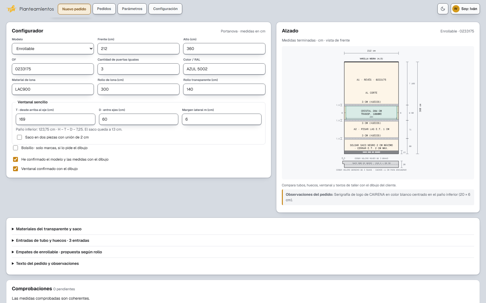
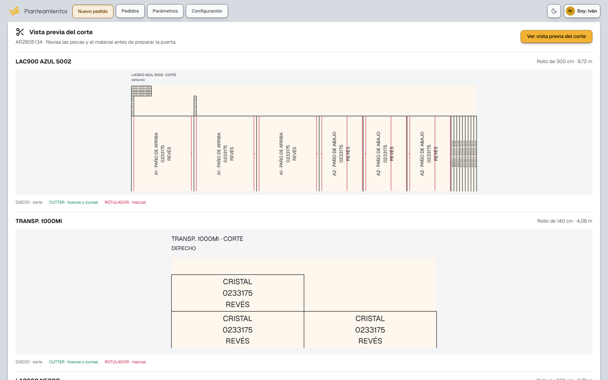
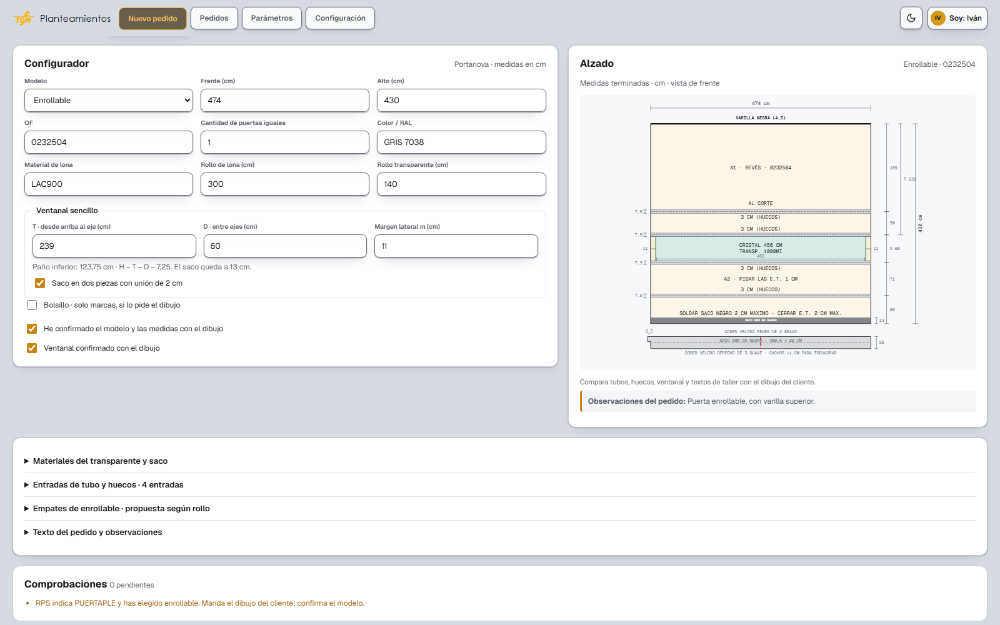
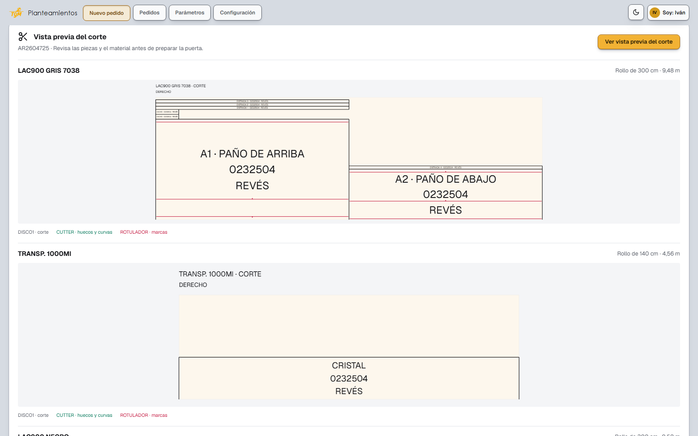
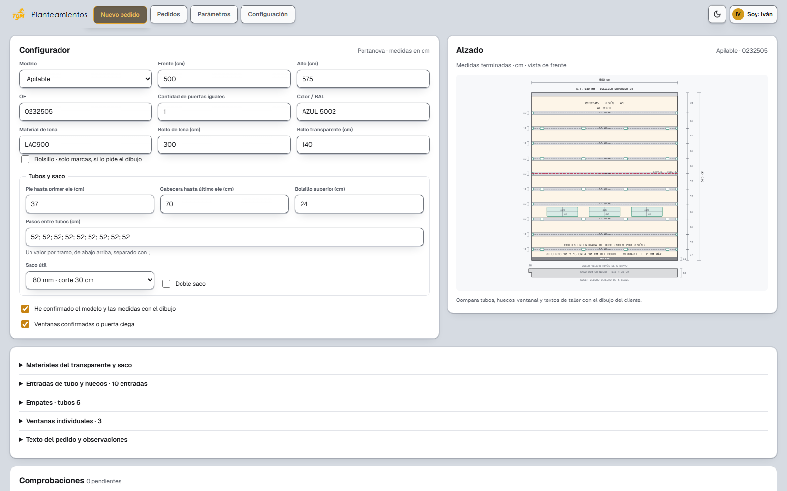
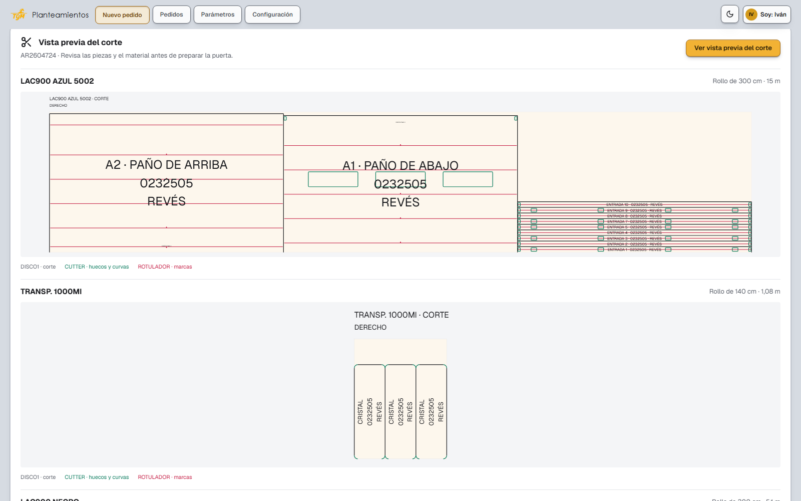
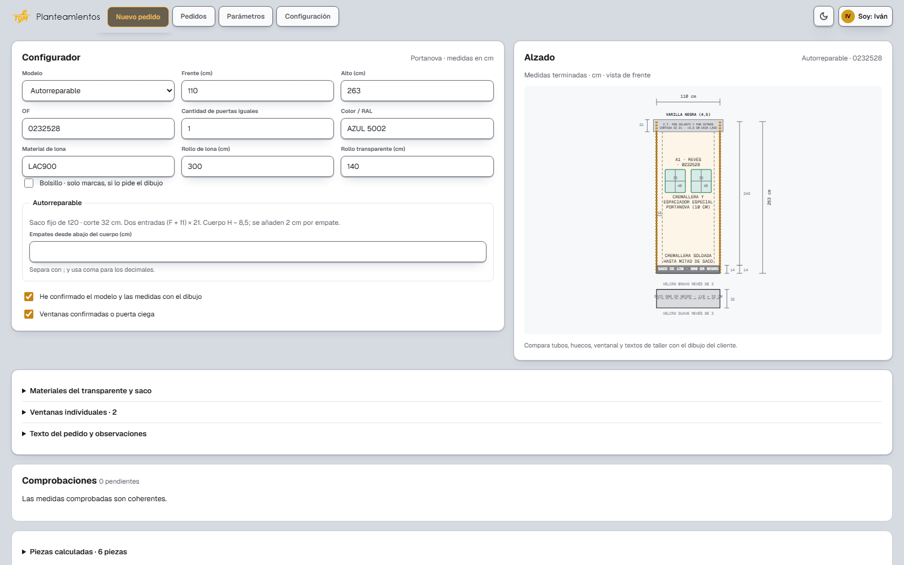
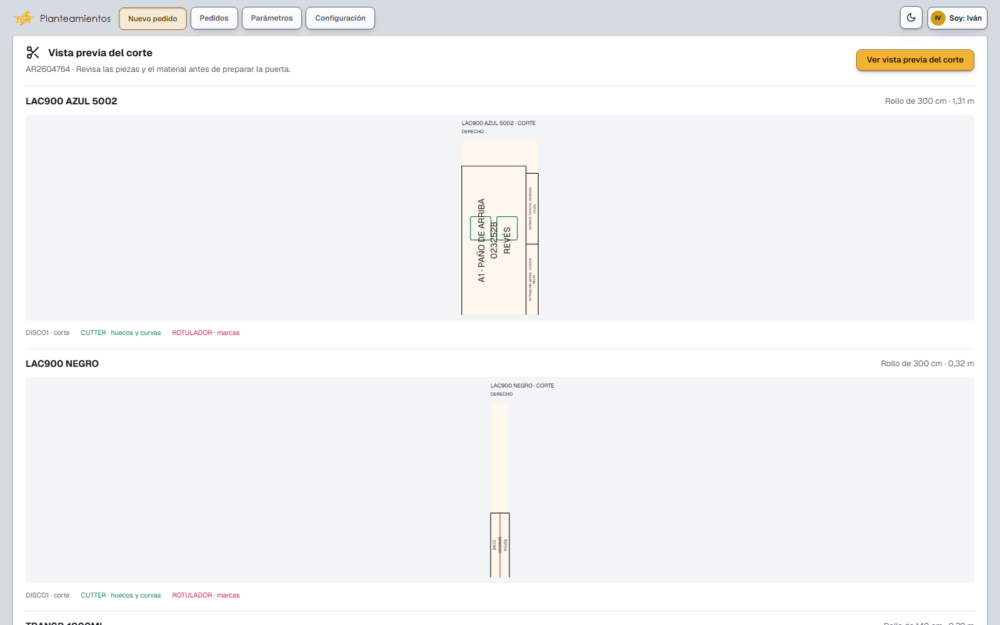
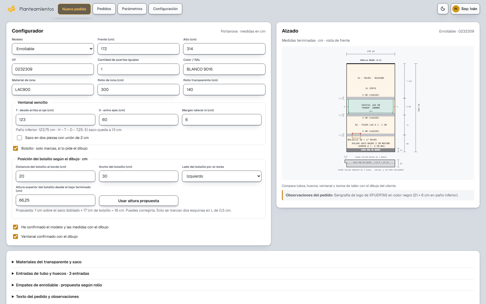
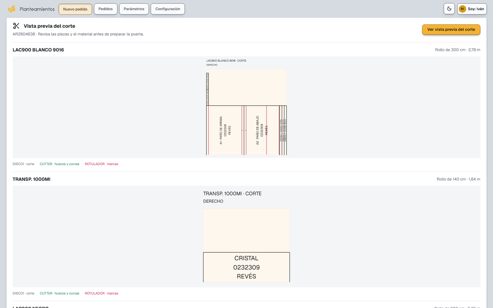

# Puertas · fase 1 · capturas

Capturas de la web (instancia de pruebas, sin datos de producción) del 21/10/2026: el alzado de cada puerta y la
vista previa de su corte. Todavía no hay plano DWG: llega en la fase 2. Reglas en [../puertas.md](../puertas.md).

## AR2605134 · enrollable con ventanal (el caso más común)

Tres puertas iguales de 212 × 360 configuradas desde el PDF del pedido. Aún no tiene corte hecho a mano.

## AR2604725 · enrollable con entrada de tubo encima de la ventana

En RPS figura como apilable, pero el dibujo es enrollable: la web lo avisa. Coincide con el corte hecho.

## Apilable

## Autorreparable

## Con bolsillo (solo dos marcas en L, sin pieza)

